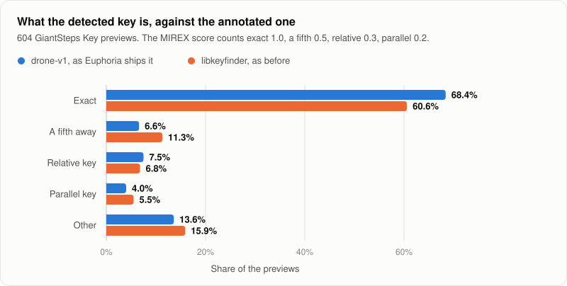
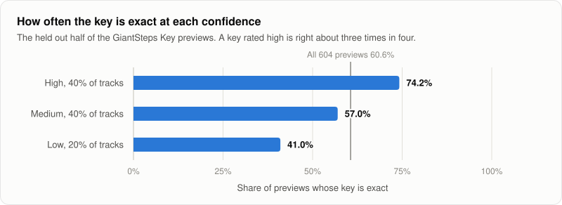
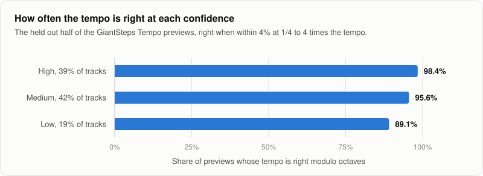
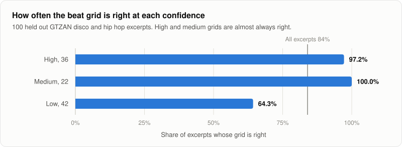

# Accuracy

Euphoria's detectors are measured on public datasets, and the numbers are published here including the misses.

## Datasets

- [GiantSteps Key](https://github.com/GiantSteps/giantsteps-key-dataset): 604 two minute previews of electronic dance music, each with a key labelled by people.
- [GiantSteps Tempo](https://github.com/GiantSteps/giantsteps-tempo-dataset): 664 previews, scored against the version 2 annotations. 3 of them are labelled as having no tempo and are left out, so 661 are scored.
- [GTZAN](https://huggingface.co/datasets/marsyas/gtzan) disco and hip hop: 200 excerpts of 30 seconds with [beat and downbeat annotations](https://github.com/CPJKU/beat_this_annotations), used for the [beat grid](#beat-grid).

## Scores

**Key.** Each estimate is an exact match, a near miss that still mixes acceptably (a fifth away, the relative key, or the parallel key), or wrong. The MIREX score is the standard summary: an exact match counts 1.0, a fifth 0.5, relative 0.3 and parallel 0.2.

**Tempo.** Accuracy 1 counts an estimate within 4% of the labelled tempo. Accuracy 2 also accepts 2, 1/2, 3 and 1/3 times the labelled tempo, as in the standard tempo evaluation.

**Cost.** CPU seconds per track, measured on the thread that ran each detector.

## Results

| | Key exact | Key MIREX score | Tempo Accuracy 1 | Tempo Accuracy 2 | CPU seconds per track |
| --- | --- | --- | --- | --- | --- |
| libkeyfinder with tuning correction, key | 60.6% | 69.4% | | | 0.26 |
| stratum-dsp, key | 30.6% | 45.4% | | | 2.21 |
| stratum-dsp, tempo | | | 85.8% | 94.3% | 0.38 |
| Essentia, best profile (reference) | 61.3% | 69.5% | 59.8% | 82.5% | |

Euphoria uses libkeyfinder for key, after [correcting for the tuning](#tuning-and-key-over-time) of a detuned track, and stratum-dsp for tempo. The full tables, including every Essentia profile, are in [bench/results/giantsteps.md](https://github.com/lvndry/euphoria/blob/main/bench/results/giantsteps.md).

## How the tempo is chosen

Tempo detection runs the stratum-dsp tempogram estimate on its own, without the key analysis that stratum-dsp otherwise computes with it. That estimate finds the pulse of a track well, but it often lands on half the tempo a DJ counts: before any correction, 83 of the 661 previews came out below 70 BPM, where only 3 are labelled that slow, and a 125 BPM house track could be reported as 62.5.

Euphoria therefore reports every tempo between 90 and 180 BPM. An estimate below 90 is doubled and one at 180 or above is halved until it falls in that range, which is where most dance music sits. On the benchmark:

| | Accuracy 1 | Accuracy 2 | Results below 70 BPM | Results above 180 BPM |
| --- | --- | --- | --- | --- |
| Tempogram estimate as it comes | 62.2% | 84.7% | 83 | 0 |
| Reported between 90 and 180 BPM | 77.6% | 85.5% | 0 | 0 |
| Full stratum-dsp analysis with its default settings, which Euphoria used before | 59.9% | 84.9% | 26 | 0 |
| Reported between 90 and 180 BPM, after choosing among the four best candidates | 85.8% | 94.3% | 0 | 0 |

The price is that a track whose real tempo is below 90 BPM, such as slow hip hop at 85, is reported at double, 170, and one at 180 or above at half. 50 of the 661 previews are labelled below 90 BPM and 6 at 180 or above, and those count as misses in Accuracy 1 above. The harmonic matching can treat half and double tempo as a match for such tracks.

### Choosing among the best candidates

Placed in the range, the tempogram's first choice is still wrong for about one track in five, and the mistake is seldom half or double. Of the 661 previews, 43 were reported at 5:4 or 4:5 of the annotated tempo and 20 at 4:3 or 3:4, as when a 130 BPM track comes out at 173: the tempogram ranked a dotted or syncopated subdivision of the beat above the beat.

Euphoria now takes the four best tempos the tempogram scored, places each in the range, and picks the one with the highest weighted sum of three things: its tempogram score relative to the best, and how strongly the onsets of the mid band (150 to 1500 Hz, where snares, claps and chords sit) repeat after half a beat, one beat and four beats at that tempo. A real beat repeats at those distances, and a subdivision does not repeat at the bar. The onsets come from the spectrogram the tempogram already computed, so the step adds a few dot products and no measurable time.

The four weights were fitted on the development half of GiantSteps Tempo, every other preview in name order starting with the first, and checked on the other half. Intervals are 95% Wilson intervals.

| Tempo, reported between 90 and 180 BPM | Tracks | Accuracy 1 before | Accuracy 1 after | Accuracy 2 before | Accuracy 2 after |
| --- | --- | --- | --- | --- | --- |
| GiantSteps Tempo, development half | 331 | 75.5% (70.6 to 79.8) | 84.9% (80.6 to 88.4) | 83.4% (79.0 to 87.0) | 93.1% (89.8 to 95.3) |
| GiantSteps Tempo, held out half | 330 | 79.7% (75.0 to 83.7) | 86.7% (82.6 to 89.9) | 87.6% (83.6 to 90.7) | 95.5% (92.6 to 97.2) |
| GTZAN disco and hip hop, tempo from the beat annotations | 200 | 89.0% (83.9 to 92.6) | 90.5% (85.6 to 93.8) | 96.0% (92.3 to 98.0) | 98.0% (95.0 to 99.2) |

GTZAN was not used to choose anything. On it the intervals overlap, so it shows no loss and not a proven gain. Its audio is not licensed for redistribution and was used only to measure.

What the choice fixed, as a share of the held out half, and what it did not:

| Result | Before | After |
| --- | --- | --- |
| Right, within 4% | 79.7% | 86.7% |
| Half the annotated tempo | 1.5% | 1.8% |
| Double the annotated tempo | 6.4% | 7.0% |
| 3:2 or 2:3 | 2.4% | 2.1% |
| 4:3 or 3:4 | 2.7% | 1.8% |
| 5:4 or 4:5 | 5.8% | 0.3% |
| Other | 1.5% | 0.3% |

Half and double did not move: before the choice, 23 of the 24 doubles in the development half and 20 of the 21 in the held out half are previews annotated below 90 BPM, which the default range reports at double by design. The octave is the range's choice, so no evidence from the audio changes it inside a range. Onset and kick periodicity at T and 2T and hi-hat density were tried on the previews reported above 150 BPM and told half from double poorly (AUC at best 0.67 for any one measure, 0.5 for the tempogram scores), so none is used.

Per genre, on all 661 GiantSteps Tempo previews (genres with fewer than 20 previews are grouped; intervals on the after column are 95% Wilson intervals). No genre gets worse:

| Genre | Previews | Accuracy 1 before | Accuracy 1 after | Accuracy 2 before | Accuracy 2 after |
| --- | --- | --- | --- | --- | --- |
| drum-and-bass | 139 | 81.3% | 85.6% (78.8 to 90.5) | 92.1% | 97.8% (93.8 to 99.3) |
| dubstep | 76 | 77.6% | 81.6% (71.4 to 88.7) | 85.5% | 89.5% (80.6 to 94.6) |
| trance | 74 | 86.5% | 89.2% (80.1 to 94.4) | 86.5% | 89.2% (80.1 to 94.4) |
| techno | 61 | 85.2% | 91.8% (82.2 to 96.4) | 85.2% | 91.8% (82.2 to 96.4) |
| electronica | 52 | 61.5% | 76.9% (63.9 to 86.3) | 75.0% | 92.3% (81.8 to 97.0) |
| psy-trance | 34 | 91.2% | 94.1% (80.9 to 98.4) | 97.1% | 100.0% (89.8 to 100.0) |
| breaks | 26 | 65.4% | 96.2% (81.1 to 99.3) | 65.4% | 96.2% (81.1 to 99.3) |
| deep-house | 24 | 91.7% | 95.8% (79.8 to 99.3) | 95.8% | 100.0% (86.2 to 100.0) |
| house | 23 | 91.3% | 95.7% (79.0 to 99.2) | 95.7% | 100.0% (85.7 to 100.0) |
| electro-house | 22 | 68.2% | 90.9% (72.2 to 97.5) | 72.7% | 95.5% (78.2 to 99.2) |
| tech-house | 22 | 90.9% | 100.0% (85.1 to 100.0) | 90.9% | 100.0% (85.1 to 100.0) |
| 10 other genres | 108 | 62.0% | 74.1% (65.1 to 81.4) | 79.6% | 92.6% (86.1 to 96.2) |

And on all ten genres of GTZAN, 998 decodable excerpts of 30 seconds with the tempo taken from the median beat interval of the Marchand and Peeters beat annotations, never used to choose anything. The last column counts excerpts that became right and excerpts that became wrong. The reference tempo of classical and jazz excerpts, which have no steady beat, is unreliable, and country and blues have many tempos below 90 BPM, which the default range reports at double; compare the columns with each other, not with the dance music rows. No genre gets worse: classical is level, with two excerpts gained and two lost.

| Genre | Excerpts | Accuracy 1 before | Accuracy 1 after | Accuracy 2 before | Accuracy 2 after | Better / worse |
| --- | --- | --- | --- | --- | --- | --- |
| blues | 100 | 64.0% | 65.0% (55 to 74) | 85.0% | 86.0% | +2 / -1 |
| classical | 100 | 48.0% | 48.0% (38 to 58) | 62.0% | 62.0% | +2 / -2 |
| country | 100 | 50.0% | 50.0% (40 to 60) | 95.0% | 95.0% | +0 / -0 |
| disco | 100 | 93.0% | 93.0% (86 to 97) | 99.0% | 99.0% | +0 / -0 |
| hip hop | 100 | 85.0% | 88.0% (80 to 93) | 93.0% | 97.0% | +3 / -0 |
| jazz | 99 | 35.4% | 41.4% (32 to 51) | 70.7% | 76.8% | +6 / -0 |
| metal | 100 | 63.0% | 66.0% (56 to 75) | 92.0% | 98.0% | +3 / -0 |
| pop | 100 | 65.0% | 68.0% (58 to 76) | 92.0% | 100.0% | +3 / -0 |
| reggae | 99 | 77.8% | 78.8% (70 to 86) | 98.0% | 99.0% | +1 / -0 |
| rock | 100 | 73.0% | 78.0% (69 to 85) | 90.0% | 94.0% | +5 / -0 |
| all | 998 | 65.4% | 67.6% (65 to 70) | 87.7% | 90.7% | +25 / -3 |

On a private library of 575 tracks analyzed with `--no-cache`, 12 tempos changed (2.1%): 7 became three quarters of the old tempo, 3 four fifths, 1 one and a half times and 1 another ratio. None changed by an octave. The library has no tempo corrections to check them against, so this shows only that the change is small and has the direction of the fixes above.

Choosing changes the confidence bands' meaning a little: the margin still rates the tempogram's own estimate, but the tracks it used to flag low were largely the dotted ones the choice now fixes, so on the held out half the share right modulo octaves is 98.4% for high, 95.6% for medium and 89.1% for low, against 97.7%, 89.8% and 62.5% before.

### Choosing the range

90 to 180 is the default, not a fixed rule. A DJ who plays hip hop can report tempos from 70 to 140 instead, and one who plays drum and bass from 120 to 200, with `--tempo-range` on the [command line](../reference/cli.md#options). Euphoria stores the tempo as it was estimated and places it in the range only when it shows it, so changing the range needs no new analysis.

A range is at most an octave wide, its fastest tempo at most twice its slowest, so that every estimate has exactly one tempo in it. A range narrower than an octave, such as 120 to 200, leaves out some octaves: an estimate of 105 has neither 105 nor 210 inside it, and is reported at 210, the one nearer to the range. A range wider than an octave is refused, because a tempo of 70 and one of 140 would both fit and nothing tells which to show.

The benchmark measures only the default. Other ranges move tempos by whole octaves, so a range suited to the music in a library is right more often on that library, and the previews, which are dance music, would score lower with a range chosen for hip hop. The energy rating always uses the tempo in the default range, the one it was set with, so changing the range does not change it.

## Confidence

Every key and every tempo is rated high, medium or low, for how far to trust it, and comes with a second answer: the runner up key, and for some tempos half or double the tempo. The point is to tell a DJ which tracks are worth checking by ear before a set, and what the likely alternative is.

### Key confidence

libkeyfinder scores every one of the 24 keys against a track, and the key is the best score. The confidence is how far that score is above the runner up's: when two keys score almost the same, the detector had little to choose between them. Of the measures tried, this margin separated right keys from wrong ones best (on the first half of the previews, a right key has the larger margin 70% of the time), better than the score of the key itself (58%).

The band edges were set on every other preview in name order and checked on the others. On that first half, the fifth of previews with the smallest margins became low and the two fifths with the largest became high, which with the edges rounded is low below a margin of 0.003 and high from 0.011.

| Key confidence | Share of the held out half | Exact | MIREX score | Key or runner up exact |
| --- | --- | --- | --- | --- |
| High | 40% | 74.2% | 78.9% | 81.7% |
| Medium | 40% | 57.0% | 67.6% | 78.5% |
| Low | 20% | 41.0% | 53.0% | 68.9% |

On the half the edges were set on, the same bands are right 77.2%, 55.8% and 35.6% of the time. So a key rated high is right about three times in four, and one rated low less than half the time.

The runner up is often the right key. Of the 238 previews whose detected key is wrong, the runner up is the annotated key for 105, so the key or its runner up is right for 78% of the previews. Against the detected key, the runner up is a fifth away for 211 previews, the parallel key (same tonic, other mode) for 196, the relative key for 112 and something else for 85. A fifth away and the relative key are the moves that mix in key, which is why a wrong key so often still sounds right in a mix.

### Tempo confidence

The tempogram scores many candidate tempos. The confidence is how far the chosen tempo scores above the best candidate that is not an octave of it, that is, not half, double or a further doubling. It rates the beat period itself, whatever octave the tempo is counted in, because the octave is the range's choice. On the first half of the previews this margin separated right tempos from wrong ones in 83% of pairs when octaves count as right, against 70% for the confidence value stratum-dsp reports.

Bands were set the same way, from the fifths of the first half: low below 0.09, high from 0.45.

“Right modulo octaves” accepts a reported tempo within 4% of the annotation after multiplying it by 1/4, 1/2, 1, 2 or 4. It allows up to two doublings or halvings, unlike Accuracy 1, and does not accept tripling or dividing by three as Accuracy 2 does.

| Tempo confidence | Share of the held out half | Right modulo octaves | Accuracy 1 |
| --- | --- | --- | --- |
| High | 39% | 98.4% | 83.7% |
| Medium | 42% | 95.6% | 92.0% |
| Low | 19% | 89.1% | 81.2% |

On the first half the bands are right modulo octaves 98.5%, 81.2% and 58.8% of the time. Accuracy 1 is not ordered between high and medium on the held out half because its misses are mostly octave errors, which the confidence does not rate: a tempo can be certain and still be counted at double.

### Half or double tempo

For the octave errors, Euphoria offers half or double the reported tempo as an alternative when that is a tempo a DJ could count, between 75 and 200 BPM, or the ends of the chosen range when those are further out. With the default range that means half of a tempo from 150 up, and double of one up to 100. The tempogram scores could not pick out octave errors (they back the other octave about as strongly whether or not it is right), but where the reported tempo sits does: on the first half, octave errors are reported at a median of 170 BPM.

The span was chosen on the first half, where it resolves 24 of its 26 octave errors while offering an alternative for 39% of tracks; widening it to 60 to 200 resolves all 26 but offers one for 89% of tracks, which says little. On the held out half it resolves 22 of 26 and is offered for 42% of tracks.

### What the confidence does and does not show

The bands are set on two minute previews of electronic dance music. On other music the margins may sit elsewhere, so the share of tracks in each band will differ, though a larger margin should still mean a more reliable answer. The levels are worked out from the stored margins each time a result is shown, so new band edges would not need a new analysis. Tracks with no key or no tempo, such as silence, have no rating. Builds without libkeyfinder rate the tempo but not the key, since stratum-dsp does not rank keys.

Rating costs no measurable time, since both margins come from scores the detectors already compute. The figures for every band on both halves, and the cost measured before and after, are in [bench/results/giantsteps.md](https://github.com/lvndry/euphoria/blob/main/bench/results/giantsteps.md#confidence).

## The key already in your tags

Most libraries already carry a key in their tags, written by another program or by an earlier version of Euphoria. Euphoria reads it and compares it with the key it detects, without changing the tags. When the two differ, the difference is named with the same categories as the [scores](#scores) above: a fifth away, the relative key, the parallel key, or another key.

The names say which reading to trust because detectors fail in known ways. On the benchmark, a fifth away was Euphoria's most common near miss, followed by the relative key and the parallel key, and the [chart of key outcomes](#results) shows the shares. A fifth or relative difference is a close call between two keys that share most of their notes, and the track mixes in key with either. A parallel or other difference means one of the two readings is wrong for mixing, so check it by ear.

### What has been checked

The parser is tested on the key fields Euphoria writes in every notation, on Camelot codes with a leading zero, Open Key codes, short and long musical names with sharps, flats and their Unicode signs, a tempo or an energy label after the key, two readings joined by a slash, the `o` ID3 uses for no key, empty fields and text that is not a key. Reading is tested on files tagged by Euphoria's own writer in MP3, M4A, FLAC, Ogg, WAV and AIFF, and on fields set the way rekordbox (`TKEY` such as `Abm`) and Mixed In Key (an M4A `KEY` atom such as `08A`) store them.

Not tested: how often the tags of a real library disagree with Euphoria, and which reading is right when they do. That needs a labelled library with keys written by other programs, which the benchmark does not have.

## Tuning and key over time

Euphoria measures two more things about the key of a track.

- **Tuning.** How far the track is tuned from A = 440 Hz, in cents, where 100 cents is a semitone. A track pressed from vinyl or played back at another speed can sit a quarter tone off, and the notes of a detuned track fall between the notes a key detector listens for.
- **Key over time.** The key of each stretch of the track, so that a track that changes key shows both keys.

The tuning is used: a track measured at least 20 cents off is analyzed as if it had been tuned to 440 Hz, and the key Euphoria reports is the nearest key at 440 Hz. The key over time is reported next to the key and does not change it. A vote between the sections of a track was measured as a way to decide the key and is not used.

| On the 604 previews | Exact | Fifth | Relative | Parallel | Other | MIREX score | CPU seconds per track | Tracks scored higher | Tracks scored lower |
| --- | --- | --- | --- | --- | --- | --- | --- | --- | --- |
| libkeyfinder with tuning correction, as Euphoria uses it | 60.6% | 11.3% | 6.8% | 5.5% | 15.9% | 69.4% | 0.26 | | |
| Without tuning correction | 60.4% | 11.1% | 6.5% | 5.6% | 16.4% | 69.0% | 0.23 | 0 | 4 |
| With a vote between sections | 60.9% | 11.3% | 7.0% | 5.5% | 15.4% | 69.7% | 0.26 | 8 | 7 |

The last two columns count the previews each variant scores higher and lower than the first row. They are the fair way to read a difference this small: 0.4 points of MIREX score is two or three previews out of 604.

### Why tuning correction is on

The benchmark does not show that tuning correction improves the key. With it, 4 previews score higher and none lower, which moves the MIREX score from 69.0% to 69.4%. Four previews are within what chance gives (a sign test on them has p = 0.125), so read the two rows as equal, not as a measured gain.

It is on for reasons the benchmark cannot weigh:

- The benchmark has almost no detuned tracks. Only 5 of the 604 previews are measured 20 cents or more off, so the correction has 5 chances to act. It improved 4 of those 5 and made none worse.
- On synthesized chord progressions, libkeyfinder keeps the right key up to 40 cents off and loses it from about 45 cents. With the correction it keeps the right key up to 49 cents off, the furthest that was tried.
- It costs nothing beyond measuring the tuning, which Euphoria does for every track anyway.
- Detuned tracks are rare in a set of dance music previews and common in a DJ library: vinyl transfers, and tracks that were pitched up or down.

A track is corrected only when its tuning could be measured, which leaves out tracks that are mostly drums, and only from 20 cents, which is where a note passes libkeyfinder's filter for it at half strength. Every other track is analyzed exactly as before.

### Why the vote between sections is off

The vote cuts the track into windows of about 7 seconds, lets every window score every key, and takes the key with the highest total, so that a loud passage counts no more than a quiet one. Against the shipped detector it scores 8 previews higher and 7 lower, which is a coin toss. Counting only the best key of each window, without the scores, was clearly worse in an early experiment, at 67.1%, and is not part of the benchmark.

### What the benchmark does and does not show

The previews are two minutes from the middle of electronic dance music. That music is produced on instruments tuned to 440 Hz and seldom changes key, and a two minute excerpt has no long intro or outro. So the benchmark shows that neither tuning correction nor the vote does harm on dance music excerpts, and that neither helps there by more than chance. It cannot show what they would do on full length tracks with long intros and breakdowns, on music that modulates, or on a library of vinyl transfers, because it holds almost none of those. No dataset with labelled tuning or labelled key changes was used, so the tuning offsets and the key changes Euphoria reports are checked against synthesized audio only.

### How the tuning is measured

Euphoria finds the strongest partials between 200 and 2,000 Hz in up to 256 frames spread over the track, and measures how far each is from the nearest note of the 440 Hz scale. The offset most of them share is the tuning. On synthesized chord progressions rendered from 45 cents flat to 48 cents sharp the measured offset is within 1 cent, also under noise as loud as the chords.

A tuning is reported only when at least half of the measured partials lie within 10 cents of it. Synthesized noise puts 21% to 30% of them there and synthesized chords more than 70%, and half is the middle. Drums spread the partials much as noise does, so many dance tracks fall below it: a tuning is reported for 237 of the 604 previews, and for the others it is left empty instead of guessed. Of the 237, 213 are within 5 cents of 440 Hz and 5 are 20 cents or more away. At that threshold the two halves of a preview, measured separately, agree within 10 cents for 99% of previews; with no threshold they do for 83%.

The offset runs from 50 cents flat to 50 cents sharp. A track tuned a quarter tone away is as close to one semitone as to the next, so near either end the sign of the offset is uncertain.

### How the key over time is found

The track is cut into windows of about 7 seconds and libkeyfinder scores every key in every window. The timeline stays in the key of the whole track, and moves to another key only for a section where that key beats the key of the track clearly and for long enough: by more than 0.03 per window on average, and by more than 0.03 in total beyond that, over at least four windows in a row, about 30 seconds. Every section in another key needs that much, whether it is at the start, in the middle or at the end of the track, and silence ends a section, so windows on either side of a silence do not add up to one. A change in the middle of a track shares a window with the music on each side of it, so it has to last a little longer to fill four windows: on synthesized progressions a move a fifth away shows from 30 seconds at the end of a track and from 34 seconds in the middle. Scores run from 0 to 1.

Those numbers come from how real music differs from a real change of key. In the best key of a seven second window, real music jumps around: on a two minute preview whose key does not change, other keys beat the key of the track by up to 0.02 per window for half a minute. A synthesized move to a key a fifth away wins by 0.04 to 0.05 per window, and a move to a distant key by 0.2. The setting was chosen among those with which a move a fifth away, about 0.045 per window, still shows over the minimum length: the one with the fewest previews split into sections on the first half, and among those, the one that leaves such a move the most to spare. A move to the parallel key, such as D minor to D major, wins by about 0.015 per window and does not show.

An earlier rule followed the best key from window to window with a price of 0.1 for each change, and nothing tied the sections to the key of the track. On a preview whose key detection was a near tie between Eb minor and B minor, it showed B minor for the first 77 seconds and Bb minor after, while the key of the track was Eb minor: three keys for a track that does not change key. The new rule was chosen on every other preview in name order and checked on the others:

| On the GiantSteps previews | More than one section, earlier rule | More than one section, now | Key of the track missing from the sections, earlier rule | Now |
| --- | --- | --- | --- | --- |
| Half the rule was chosen on | 4.3% | 0.7% | 1.0% | 0% |
| The other half | 5.3% | 1.0% | 1.0% | 0% |
| All 604 | 4.8% | 0.8% | 1.0% | 0% |

Of the 5 previews that still have more than one section, one is two sections in the same key around a silence, and the other four show another key for 28 to 38 seconds. A change is placed within a few seconds of where it happens, since each window is 7 seconds long.

When no change is found the timeline is one section in the key of the track. When changes are found, the key of the track covers every stretch where no other key is clearly stronger, and each other section carries the key that beat it there. A section starts and ends halfway between the middles of two of libkeyfinder's frames, which is where the frames of one window give way to those of the next; on a synthesized change that falls on a window edge, that puts the start of the new section within a quarter of a frame step, about a quarter of a second, of the change.

Silence has no key, so the timeline leaves a gap where a track is silent instead of stretching a key over it. A window counts as silent when its note strengths are 60 dB or more below the loudest window of the track, which a DJ would not hear in a mix. Without the gap, a change from one key to another across 30 seconds of silence was placed 5 seconds into the silence, labelling most of it with the key that follows. On the previews, 2 of 9,632 windows are that quiet.

A passage with sound but no harmony, such as a drum break or a noise riser, is not left out: it keeps the key of the music around it, and a change of key across it is placed somewhere within it. Such a passage cannot be told apart from music by how clearly it matches its best key. On a synthesized kick drum the best key scores 0.017 above the mean of the 24, and on pink noise 0.011, while one window in ten of the previews scores below 0.026 and one in a hundred below 0.016. Leaving out windows below 0.02 would cut gaps into 111 of the 604 previews with no way to check that they are drum breaks.

### How the settings were chosen

Every threshold above was chosen on synthesized audio or on a property of the previews that does not involve their key labels. The one choice that could have been fitted to the labels, the size of the windows for the vote, was made on half of the previews (every other one in name order) and checked on the other half: on the half it was chosen on, the vote scores 5 previews higher and 3 lower than the shipped detector, and on the other half 3 higher and 4 lower. Tuning correction acts from 20 cents, a value that comes from libkeyfinder's filter and not from the previews. All 4 previews it improves are in the first half.

### Cost

Measuring the tuning adds 0.02 to 0.03 CPU seconds to the analysis of a track, 2 to 4% of a two minute preview and less of a longer track. Correcting for it and following the key over time add nothing measurable, because both use what libkeyfinder computes for the key. Peak memory is unchanged for one track at a time, and was about 0.05 GB higher with 4 at once. The measurements are in [bench/results/giantsteps.md](https://github.com/lvndry/euphoria/blob/main/bench/results/giantsteps.md).

## Beat grid

The beat grid tells a DJ program where every beat and every bar of a track falls, so that its beat counter, its phase meter and its loops line up with the music. Euphoria finds one grid per track: the tempo, with decimals, and the time of the first downbeat, the first beat of a bar. It is rated high, medium or low like the key and the tempo. `euphoria analyze --json` reports it, and `euphoria export rekordbox --beat-grid` writes it into the rekordbox XML file; see [the command reference](../reference/cli.md#euphoria-export-rekordbox).

### How it is measured

No openly licensed dataset of electronic dance music has both audio and beat annotations, so the grid is measured on the 100 disco and 100 hip hop excerpts of GTZAN, 30 seconds each, with the beat and downbeat annotations of the GTZAN-Rhythm work. Both are steady 4/4 drum music, the closest available material to dance music. The annotations are under the MIT licence. The GTZAN audio has no stated licence: it is downloaded only to run the benchmark locally and is never part of the repository or redistributed. A beat counts as found within 70 ms of an annotated one, a grid is right when its beat F-measure is at least 0.9, and its downbeat is right when the F-measure of the downbeats alone is at least 0.9.

| On the 100 held out excerpts | Beat F-measure | Grid right | Downbeat right |
| --- | --- | --- | --- |
| Tempo as reported, between 90 and 180 BPM | 0.897 | 80% | 45% |
| Octave of the tempo taken from the annotation | 0.908 | 84% | 49% |

The second row judges the grid alone: a grid at half or double the annotated tempo misses half the beats or adds as many, which is the tempo's [octave](#how-the-tempo-is-chosen) and not the grid's placement. 14 of the excerpts are annotated below 90 BPM, outside the range tempos are reported in.

| Grid confidence, held out | Excerpts | Grid right |
| --- | --- | --- |
| High | 36 | 97.2% |
| Medium | 22 | 100% |
| Low | 42 | 64.3% |

The figures for the development half, where every setting was chosen, are close to these and are in [bench/results/beats.md](https://github.com/lvndry/euphoria/blob/main/bench/results/beats.md).

### The downbeat

The downbeat is right about half the time, and on 57% of the excerpts whose beats are right. When it is wrong, the beats still are: the grid is shifted by one, two or three beats within the bar. Euphoria chooses the beat whose kick is strongest, which is followed by a snare or clap one and three beats later, and where the overall sound and the bass and chords change. The snare alone finds the right pair of beats, the first and third against the second and fourth, for 76% of the excerpts; telling the first beat from the third is where most misses are. The confidence rates the beats and not the downbeat.

### Drift

Euphoria fits one constant tempo to the whole track, which is how dance music is made and how Euphoria writes a grid into the rekordbox XML file. It then cuts the track into 8 second stretches, finds where the beats of each stretch fall, and measures how far they are from the grid. When one in ten of the stretches with clear beats wanders more than 35 ms from it, half the window in which a beat counts as found, the grid is rated low whatever else it shows. A live recording or a track mixed from vinyl gets a grid that fits it on average, rated low, and the export leaves that grid out so rekordbox analyzes the track itself. A grid that follows a changing tempo, with a tempo for each stretch, is not made.

### How the tempo is made precise

The grid's tempo is searched within 2% of the detected tempo, by trying periods and phases and scoring how strongly the onsets fall on the beats. That score is nearly flat within a few thousandths of a beat of the best period, while over a long track such a small error adds up: on a synthesized four minute click track at 127.537 BPM the search alone ended 0.008 BPM off, which puts the last beats 15 ms late. So the period and phase are then fitted to the track itself: the beats of every 8 second stretch are lined up with the grid, and a line through how far each stretch sits from it gives the correction. On the click track that brings the last beats within 5 ms.

On the 604 GiantSteps Key previews, the share of grids rated medium or high with a tempo within 0.01 BPM of a whole number rose from 73% to 92%, and 35 grids were rated higher, one lower. On the GTZAN excerpts, 30 seconds long, it changed no rate on the held out half. No grid of the previews ends within 0.1% of the edge of the 2% window, and the five that end more than 1.5% from the detected tempo are all rated low: they are previews with no steady beat, where every tempo scores alike.

### What the benchmark does and does not show

It shows that the beats of steady drum music are placed within 70 ms for about four excerpts in five, that a grid rated medium or high is almost always right, and that the downbeat is right only about half the time.

It cannot show how the grid does on dance music, on full length tracks with beatless intros and breakdowns, or on fast tempos: the annotated tempos of 180 of the 200 excerpts lie between 90 and 132 BPM, and only 20 are faster. The 661 GiantSteps previews of dance music have tempo labels but no beat positions, so they only test consistency: fitted separately, the two halves of a preview agree within 1% on tempo and 35 ms on the beats for 77% of previews, as measured before the line fit described below was added. Of the 604 GiantSteps Key previews, 92% of the grids rated medium or high have a tempo within 0.01 BPM of a whole number, as tempos set in production software are.

### A grid you fixed in rekordbox

Euphoria's grid is right on most excerpts but its downbeat is wrong about half the time on the benchmark, and a DJ who fixed the grid in rekordbox has already done better. With `--collection`, a constant 4/4 grid from your rekordbox collection replaces the detected one and the [cues](#cue-points) are placed on its bars, so they sit where you put the downbeat. It is not scored: the grid is yours, not a measurement. Grids that change tempo or shift are not used, since one constant grid cannot follow them. This is tested only against XML fixtures written from the format description, not against a collection exported by rekordbox. See [use your rekordbox beat grid](../guides/export-to-rekordbox.md#use-your-rekordbox-beat-grid).

### Cost

The grid adds 11 to 12% to the analysis of a track, 0.1 CPU seconds for a two minute preview and 0.5 for an eight minute track, and about 25 MB of memory for the eight minute track.

## Cue points

Euphoria marks where the sections of a track start, the places a DJ sets cues at to mix in and out:

| Cue | Where |
| --- | --- |
| Start | The first bar with sound. |
| Main | The first bar of the first section at the level of the body of the track, when the track does not start at that level. |
| Breakdown | The first bar of a section below the level of the body of the track, after a section at that level. |
| Drop | The first bar back at the level of the body after a breakdown. |
| Outro | The first bar of the section below the level of the body that follows the last section at that level and runs to the end, when it is at least 8 bars. A track whose body runs to the end has no Outro, so the cue is never placed early in a track that plays steadily after its intro. |

A track gets at most 8 cues, one per hot cue pad from A to H. When there would be more, the start, the main section and the outro are kept, and then the earliest breakdowns and drops. `euphoria analyze --json` reports the cues, and `euphoria export rekordbox --beat-grid --cues` writes them; see [the command reference](../reference/cli.md#cue-points). Where a cue is off, move it, or add, rename and delete cues, in the [desktop app](../guides/desktop-app.md#cue-points); your cues then replace these everywhere.

### How they are found

Every bar of the [beat grid](#beat-grid) is measured four ways: how loud it is, how loud it is below 150 Hz, where the kick and the bass are, how loud it is above 2 kHz, where the hats and percussion are, and how much louder the low band is just after each beat than halfway between beats. A kick on the beat makes that last difference large; a sustained bass line or pad does not. A bar has a kick when the difference is at least 3 dB. The kick of each bar is searched for within 40 ms of where the kick of the bar before was found, since the grid has one tempo for the whole track and the beats of the music drift from it, which on long tracks put the kick between the measuring windows and made a steady groove read as having none.

The sections are then found the way structure analysis usually does it: the four numbers of each bar, scaled by how much they vary over the track, are compared bar to bar, and a section starts where the 8 bars before a bar differ most from the 8 after it, the checkerboard kernel novelty of Foote. Peaks of that novelty at least 8 bars apart are section changes. Each section is then judged against the level the track plays at for most of its length, the loudness and low end that 75% of its bars reach: it is at that level when it is within 3 dB of the loudness and 6 dB of the low end of the body, and, when the body has a kick, plays it for half of its bars. Sections at the same level that follow each other are one. The Outro is therefore the section below the body that follows the last section at the body level, instead of whatever comes after the last bar with the kick, and a track that plays steadily to its end has none. Earlier versions judged bars against the loudest 10% of the track and required the kick, so a groove whose kick was not found counted as a breakdown, and the Outro came right after the intro.

Sections shorter than 8 bars, such as a one bar break before a drop, belong to the section around them. Each section start is then placed on a phrase: a multiple of 8 bars from the first bar with sound, or of 4 bars when the change is more than 2 bars from the nearest multiple of 8, since sections sometimes start half a phrase off the count. The cues use the grid in the default tempo range, so they do not move with `--tempo-range`.

### What has been checked

No dataset with both audio and labelled sections of dance music was found (the public annotations of the Harmonix Set and SALAMI come without audio that can be redistributed), so the cues are not scored against labels. What was checked:

- **Synthesized arrangements.** An intro of kick alone, a full section with kick, bass, pad and claps, a breakdown with pad only, a drop and an outro each get their cue on the right bar. So does a breakdown that keeps the bass, while a two bar break before a drop gets none. So do a groove without an on-beat kick after a kick intro, which gets a Main and no Outro, a loud intro before a quieter steady body, which gets no Outro, and a few silent bars at the end of a track.
- **Boundaries on synthesized arrangements.** On 9 arrangements with 32 known section starts, the previous method placed 21 within one bar with the right name (66%) and this one all 32. The arrangements include the cases the previous method got wrong, so this shows the fix and is not an estimate of accuracy on real music.
- **575 full length tracks of one DJ library, without labels.** Counting cues, not scoring them: tracks with an Outro in the first half fell from 14 to 0, and in the first three quarters from 23 to 3; tracks with an Outro at all rose from 131 to 169, since most tracks with a clear ending had none; tracks with only the Start cue fell from 190 to 31. In the early Outro tracks inspected, the section was one the kick detector lost, not an outro: the kick of a bar was measured on the grid's beats, which drift from the music over a long track and after a breakdown, so it read as absent for the rest of the track.
- **The 604 GiantSteps Key previews, before the cues were changed to this method and not measured again.** These two minute excerpts from the middle of dance tracks mostly play at one level throughout. 435 get only the Start cue, 58 also an Outro, 52 a Main, 33 a breakdown and a drop, and the rest up to 5 cues. On the preview in the chart above, the cues fall where the energy curve changes.

It cannot show how often the cues fall where a DJ would put them on full length tracks.

The cues sit on the bars of the grid, so they share its weaknesses. When the [downbeat](#the-downbeat) is wrong, which on the benchmark is about half the time, the bars start one to three beats away from where the music's do. Every cue is then that many beats away from the start of its section. When the grid is rated low, the cues are not exported.

### Cost

Finding the cues adds no measurable time to an analysis: they use the onset envelope the grid computes and one pass over the audio at a quarter of its sample rate.

## Energy

The energy rating has no labelled dance music to be scored on, so it is measured against how listeners rated the arousal of 1802 songs of many genres. The method, the results and what they do not show are on the [energy rating](energy.md#how-well-it-works) page.

## Reproducing

See [running the accuracy benchmark](../development/building.md#accuracy-benchmark).
