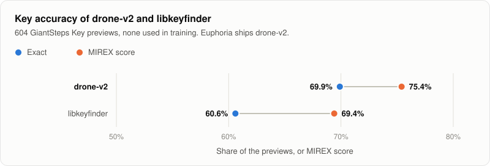
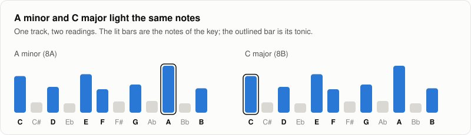
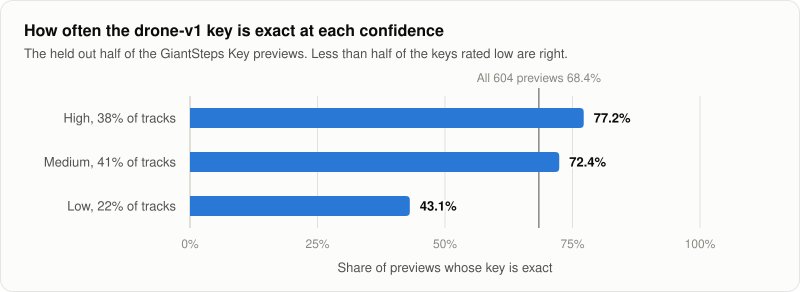
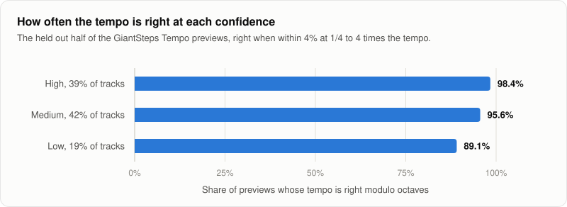
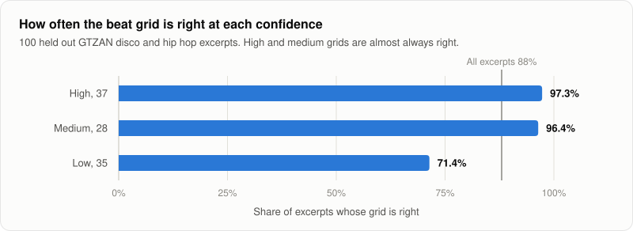
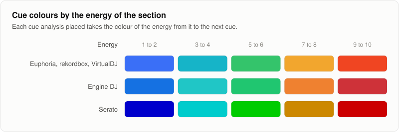

# Accuracy

Euphoria's detectors are measured on public datasets, and the numbers are published here including the misses.

## Datasets

- [GiantSteps Key](https://github.com/GiantSteps/giantsteps-key-dataset): 604 two minute previews of electronic dance music, each with a key labelled by people.
- [GiantSteps Tempo](https://github.com/GiantSteps/giantsteps-tempo-dataset): 664 previews, scored against the version 2 annotations. 3 of them are labelled as having no tempo and are left out, so 661 are scored.
- [GTZAN](https://huggingface.co/datasets/marsyas/gtzan) disco and hip hop: 200 excerpts of 30 seconds with [beat and downbeat annotations](https://github.com/CPJKU/beat_this_annotations), used for the [beat grid](#beat-grid).

## Scores

**Key.** Each estimate is an exact match, a near miss that still mixes acceptably (a fifth away, the relative key, or the parallel key), or wrong. The MIREX score is the standard summary: an exact match counts 1.0, a fifth 0.5, relative 0.3 and parallel 0.2.

**Tempo.** Accuracy 1 counts an estimate within 4% of the labelled tempo. Accuracy 2 also accepts 2, 1/2, 3 and 1/3 times the labelled tempo, as in the standard tempo evaluation.

**Cost.** CPU seconds per track, measured on the thread that ran each detector.

## Results

| | Key exact | Key MIREX score | Tempo Accuracy 1 | Tempo Accuracy 2 | CPU seconds per track |
| --- | --- | --- | --- | --- | --- |
| drone-v2, key | 69.9% | 75.4% | | | 0.31 |
| libkeyfinder with tuning correction, key (no longer shipped) | 60.6% | 69.4% | | | 0.27 |
| stratum-dsp, key | 30.6% | 45.4% | | | 2.39 |
| stratum-dsp, tempo | | | 85.8% | 94.3% | 0.38 |
| Essentia, best profile (reference) | 61.3% | 69.5% | 59.8% | 82.5% | |

Euphoria decides the key with [drone-v2](#key-detection-with-drone-v2), a small neural network, after [correcting for the tuning](#tuning-and-key-over-time) of a detuned track, and follows the key over time with the same network. Tempo comes from stratum-dsp. The full tables, including every Essentia profile, are in [bench/results/giantsteps.md](https://github.com/lvndry/euphoria/blob/main/bench/results/giantsteps.md).

## Accuracy by genre

Key and tempo detection is not equally good in every genre. These are the numbers for each genre, including the weak ones.

### What the reference is

- **Key:** the 604 GiantSteps Key previews, split by the genre Beatport gave each one. The keys were labelled by Beatport users correcting the store's keys, not by experts, and about one label in five disagrees with a later expert check (see [against expert labels](#against-expert-labels)), so part of every miss below is a wrong label.
- **Tempo:** the 661 scored GiantSteps Tempo previews, also split by Beatport genre. These are different previews from the key set.
- **Outside dance music:** GTZAN, ten genres of about 100 excerpts of 30 seconds each, for tempo only.

Genres with fewer than 20 previews are grouped, since a percentage of 5 or 10 tracks says little. Nothing here was measured on a DJ's own library: no library with hand-checked keys and tempos is available, so full length tracks are not scored.

### Key

drone-v2, as Euphoria ships it, with [tuning correction](#tuning-and-key-over-time). A fifth away is the neighbouring Camelot number with the same letter, and still mixes. The relative key is the same number with the other letter.

| Genre | Previews | Exact | Exact or a fifth away | Exact, a fifth or relative |
| --- | --- | --- | --- | --- |
| Deep house | 77 | 85.7% | 89.6% | 89.6% |
| Electronica | 20 | 75.0% | 75.0% | 80.0% |
| Electro house | 51 | 74.5% | 82.4% | 90.2% |
| House | 47 | 72.3% | 76.6% | 85.1% |
| Techno | 34 | 67.6% | 73.5% | 73.5% |
| Tech house | 81 | 65.4% | 72.8% | 74.1% |
| Progressive house | 88 | 63.6% | 68.2% | 83.0% |
| Dubstep | 22 | 63.6% | 77.3% | 81.8% |
| Drum and bass | 38 | 63.2% | 65.8% | 71.1% |
| Trance | 58 | 53.4% | 67.2% | 82.8% |
| 13 other genres | 88 | 79.5% | 83.0% | 85.2% |
| All | 604 | 70.2% | 76.2% | 82.3% |

The 13 other genres are breaks, indie dance and nu disco (14 previews each), chill out and minimal (11 each), pop and rock (7), glitch hop (6), psy-trance (5), hip hop and hard dance (4 each), and reggae and dub, hardcore and hard techno, funk and R&B, and DJ tools (3 each).

Tuning correction changes the key of two electronica previews, both to the annotated key; every other genre is as without it.

With 20 to 90 previews per genre, the 95% interval on each exact score is 15 to 40 points wide, so only the ends of the table are clearly apart: deep house (76% to 92%) is better than average and trance (41% to 66%) worse. The genres in between cannot be ranked against each other.

### Tempo

Accuracy 1 is within 4% of the labelled tempo. Accuracy 2 also accepts half, double, a third or triple; on these previews no tempo came out at a third or triple, so the gap between the two columns is tempos reported at half or double. Within 0.05 BPM is the share whose tempo is the labelled tempo to the decimal shown, before and after the [beat grid sets the tempo](#the-grid-sets-the-tempo); the labels are whole numbers, and many are a beat per minute off the track (see there), so this share is low for every method.

| Genre | Previews | Accuracy 1 | Accuracy 2 | Within 0.05 BPM before | Within 0.05 BPM after |
| --- | --- | --- | --- | --- | --- |
| Tech house | 22 | 100.0% | 100.0% | 0.0% | 9.1% |
| Breaks | 26 | 96.2% | 96.2% | 0.0% | 7.7% |
| Deep house | 24 | 95.8% | 100.0% | 0.0% | 4.2% |
| House | 23 | 95.7% | 100.0% | 0.0% | 4.3% |
| Psy-trance | 34 | 94.1% | 100.0% | 5.9% | 11.8% |
| Techno | 61 | 91.8% | 91.8% | 1.6% | 6.6% |
| Electro house | 22 | 90.9% | 95.5% | 13.6% | 18.2% |
| Trance | 74 | 89.2% | 89.2% | 2.7% | 2.7% |
| Drum and bass | 139 | 85.6% | 97.8% | 13.7% | 33.1% |
| Dubstep | 76 | 81.6% | 89.5% | 6.6% | 14.5% |
| Electronica | 52 | 76.9% | 92.3% | 9.6% | 17.3% |
| 10 other genres | 108 | 74.1% | 92.6% | 5.6% | 18.5% |
| All | 661 | 85.8% | 94.3% | 6.5% | 16.0% |

Letting the grid set the tempo changed Accuracy 1 and Accuracy 2 in no genre, on GiantSteps or on GTZAN: it moves a tempo by at most 2%, within the octave the detector chose.

Outside dance music, on GTZAN, Accuracy 1 is 93.0% for disco and 88.0% for hip hop, but 41.4% for jazz, 48.0% for classical and 50.0% for country. Jazz and classical often have no steady beat, and much country sits below 90 BPM, which the default range reports at double (country's Accuracy 2 is 95.0%). The [full GTZAN table](#choosing-among-the-best-candidates) has every genre, and [the grid sets the tempo](#the-grid-sets-the-tempo) how precise the tempo is in each.

### Where Euphoria is weak, and what to do

- **Trance and progressive house keys.** Trance is exact for about half the previews, progressive house for under two thirds. More than half of their misses are the relative key or a fifth away, which mix, but check the key by ear before you rely on it. A key rated low confidence puts the track under **Needs review** in the desktop app, which says the key may be its relative or a fifth away and offers the runner up key as one click; see [settle a track under Needs review](../guides/desktop-app.md#settle-a-track-under-needs-review).
- **Tech house, techno, drum and bass and electronica keys.** One key in five or more is a plain miss: not a fifth, not relative. A clash in the mix is the sign. [Check the key by ear](../guides/desktop-app.md#check-the-key-by-ear-and-correct-it) and correct it.
- **Drum and bass, dubstep and electronica tempos.** In drum and bass and electronica most misses are at half or double, in dubstep nearly half. Euphoria offers the other octave as the alternative tempo, and `--tempo-range 120-200` on the [command line](../reference/cli.md#options) reports drum and bass in its usual range; see [choosing the range](#choosing-the-range).
- **Slow or loose music.** With the default range a tempo below 90 BPM comes out at double, and jazz or classical without a steady beat is often wrong. Set a lower range for slow music, such as `70-140` for hip hop, and treat the tempo of music without a steady beat as a guess.
- **Melodic house.** GiantSteps has no melodic house genre, so its key and tempo are not measured; progressive house and deep house are the nearest genres scored. One measure that has been checked is weak there: telling warm up, build and peak tracks apart within the genre (see [set stage](set-stage.md)).

In every genre, a low [confidence](#confidence) rating, which puts the key under **Needs review**, is the best single hint that a key needs checking. A tempo is listed when half or double it is a tempo a DJ could count and the tempo is rated low or the onsets back that octave more strongly; see [which tempos are listed for review](#which-tempos-are-listed-for-review).

## Key detection with drone-v2

drone-v2 is a convolutional network of 109,128 parameters, trained by the Euphoria project ([source](https://github.com/lvndry/drone), [model card](https://huggingface.co/lvndry/drone)). It reads a constant-Q spectrogram of the whole track, 24 bins per octave over eight octaves from C1, and scores all 24 keys. It learned from 4,988 songs of many genres from the Free Music Archive and 1,275 Beatport dance-music previews, half from their key labels and half from the predictions of three earlier networks, with every excerpt shifted by up to 12 semitones so it hears every key in every song. No GiantSteps Key preview was used to train it, but GiantSteps results guided drone's development, so the benchmark below is not a blind test.

| On the 604 previews | Exact | Fifth | Relative | Parallel | Other | MIREX score |
| --- | --- | --- | --- | --- | --- | --- |
| drone-v2, as Euphoria ships it | 69.9% | 6.0% | 6.1% | 3.8% | 14.2% | 75.4% |
| libkeyfinder with tuning correction, as Euphoria used it before | 60.6% | 11.3% | 6.8% | 5.5% | 15.9% | 69.4% |

The difference is not chance. drone-v2 has the exact key on 83 previews where libkeyfinder does not, and libkeyfinder on 27 where drone-v2 does not (a sign test gives p < 0.0001). Resampling the previews 20,000 times, the gain lies between 3.5 and 8.7 points of MIREX score and between 6.0 and 12.6 points of exact matches 95% of the time. Most of the gain is fifths turned into exact matches.

### Against expert labels

The GiantSteps Key labels themselves are often wrong: a later expert re-annotation, [GiantSteps+](https://zenodo.org/records/4153506), agrees with them on only 82% of the previews. Scored against the expert labels, from the same readings:

| | Previews | drone-v2 exact | libkeyfinder exact | Gain (95% interval) |
| --- | --- | --- | --- | --- |
| Original labels | 604 | 69.9% | 60.6% | 9.3 points (6.0 to 12.6) |
| Expert labels | 571 | 80.7% | 70.1% | 10.7 points (7.2 to 14.2) |
| Expert labels, previews with one key throughout | 457 | 88.0% | 76.2% | 11.8 points (8.1 to 15.5) |

The second and third rows leave out previews the experts marked with no major or minor key, and the third those whose key changes.

### Usable for mixing: exact or a fifth away

A key a fifth away still mixes: it is the neighbouring number on the Camelot wheel, with the same letter. The relative key, the parallel key or another key does not. Counted that way, from the same readings:

| | Previews | drone-v2 | libkeyfinder | Gain (95% interval) |
| --- | --- | --- | --- | --- |
| Original labels | 604 | 75.8% | 71.9% | 4.0 points (1.0 to 7.0) |
| Expert labels, previews with one key throughout | 457 | 90.6% | 85.6% | 5.0 points (2.0 to 8.3) |

The gain is smaller than on exact keys, because many of libkeyfinder's misses were already a fifth away: 11.3% of previews, against 6.0% for drone-v2.

### Combining the two

Using libkeyfinder's key when the network is unsure was tried, with the threshold chosen on every other preview and checked on the rest. On the held out half it changed the MIREX score by +0.9 points (95% interval −0.2 to +2.2), which is not clearly a gain, so the network decides alone. When the two agree, on 442 previews, the key is exact 76.7% of the time.

### Running it in Euphoria

The network and the spectrogram run inside Euphoria in plain Rust, with no inference library, GPU or download: the weights, 441 KB, are compiled into the program. The Rust spectrogram reproduces drone's own Python code, which uses librosa: given the same audio, the features differ by at most 0.002 (one step of the 16 bit floats drone stores them in) and the key probabilities by at most 0.00001, and all 604 keys are identical. Through Euphoria's own decoder all 604 keys also agree with drone's, which decodes with ffmpeg, though the probabilities move by up to 0.07, since the two decoders do not give exactly the same samples. The scores above are Euphoria's, and they equal those of drone's Python package on the same files.

drone-v2 is the only key detector Euphoria ships; libkeyfinder, which it used before, was removed once drone-v2 and Euphoria's own note spectrum measured as good or better, within chance in every genre, at each part libkeyfinder still had: the key over time, the pitch-class profile and the key of very short audio. Audio shorter than the 1.5 seconds the network reads at least is read followed by silence. On one second excerpts of the previews that gives the exact key for 43.9%, against 26.8% for libkeyfinder, which `auto` used for such audio before; the [per genre table](https://github.com/lvndry/euphoria/blob/main/bench/results/giantsteps.md#without-libkeyfinder) has every genre.

### What the benchmark does and does not show

GiantSteps Key is two minute previews of electronic dance music from Beatport. That has three consequences:

- On other genres the benchmark says nothing. The drone project measured drone-v2 on 500 songs of many genres from the Free Music Archive at 75.0% exact, against 65.4% for drone-v1, but those songs come from the same collection as part of the training data, and libkeyfinder was not measured on them.
- On full length tracks it is not measured. The network averages over the whole track, so long intros and breakdowns count, which the previews do not have.
- Tracks tuned away from 440 Hz are rare in the training data and the benchmark. The network sees absolute pitch, so a track measured 20 cents or more off is converted as if recorded at the sample rate that brings it back to 440 Hz. On synthesized chord progressions in all 24 keys that keeps every key right from 50 cents flat to 50 cents sharp, where without it the network lost a third of the keys at 40 cents sharp.

### Cost

On the machine the benchmark ran on, an Apple M5 Mac, the network and its spectrogram take 0.31 CPU seconds per two minute preview on one thread, against 0.27 for libkeyfinder. Until libkeyfinder stopped following the key over time, `auto` ran both, and the numbers that follow are from then. A whole analysis of a ten minute track (key, tempo, energy, sections and cues) took 5.6 seconds with libkeyfinder alone, 5.6 seconds with the network alone and 6.7 seconds with `auto`, and its peak memory was 1.49 GB, 1.10 GB and 1.49 GB: running the network alongside libkeyfinder adds about a second and no memory. These are single runs.

## Reading the notes

The desktop app's inspector and `euphoria analyze --notes` show how strongly each of the 12 notes sounds in a track, every octave folded together, with the notes of the key lit. In a track whose key is right, the lit notes are the tallest bars and the tonic, the note the key is named after, is usually among the tallest of all.

A minor key and its relative major, such as A minor and C major (8A and 8B), use the same seven notes, so they light exactly the same bars. That is why they are so often confused, by people and detectors alike, and why the strip cannot settle them on its own: look at which note stands out. A tallest A points to A minor, a tallest C to C major. When it is still unclear, listen with **Check by ear**. Either way the two mix together, since they sit on the same number of the Camelot wheel.

The notes come from Euphoria's [note spectrum](#the-pitch-class-profile), added up over the whole track on the scale of its measured tuning. The key itself is decided by drone-v2, which reads a finer spectrogram than these 12 numbers, so the strip shows what the track holds, not the network's reasoning. The level that sounds without pitch is taken off each note first, so drums and noise raise the bars much less than they did with libkeyfinder's chromagram, which gave the notes before.

## How the tempo is chosen

Tempo detection runs the stratum-dsp tempogram estimate on its own, without the key analysis that stratum-dsp otherwise computes with it. That estimate finds the pulse of a track well, but it often lands on half the tempo a DJ counts: before any correction, 83 of the 661 previews came out below 70 BPM, where only 3 are labelled that slow, and a 125 BPM house track could be reported as 62.5.

Euphoria therefore reports every tempo between 90 and 180 BPM. An estimate below 90 is doubled and one at 180 or above is halved until it falls in that range, which is where most dance music sits. On the benchmark:

| | Accuracy 1 | Accuracy 2 | Results below 70 BPM | Results above 180 BPM |
| --- | --- | --- | --- | --- |
| Tempogram estimate as it comes | 62.2% | 84.7% | 83 | 0 |
| Reported between 90 and 180 BPM | 77.6% | 85.5% | 0 | 0 |
| Full stratum-dsp analysis with its default settings, which Euphoria used before | 59.9% | 84.9% | 26 | 0 |
| Reported between 90 and 180 BPM, after choosing among the four best candidates | 85.8% | 94.3% | 0 | 0 |

The price is that a track whose real tempo is below 90 BPM, such as slow hip hop at 85, is reported at double, 170, and one at 180 or above at half. 50 of the 661 previews are labelled below 90 BPM and 6 at 180 or above, and those count as misses in Accuracy 1 above. The harmonic matching can treat half and double tempo as a match for such tracks.

### Choosing among the best candidates

Placed in the range, the tempogram's first choice is still wrong for about one track in five, and the mistake is seldom half or double. Of the 661 previews, 43 were reported at 5:4 or 4:5 of the annotated tempo and 20 at 4:3 or 3:4, as when a 130 BPM track comes out at 173: the tempogram ranked a dotted or syncopated subdivision of the beat above the beat.

Euphoria now takes the four best tempos the tempogram scored, places each in the range, and picks the one with the highest weighted sum of three things: its tempogram score relative to the best, and how strongly the onsets of the mid band (150 to 1500 Hz, where snares, claps and chords sit) repeat after half a beat, one beat and four beats at that tempo. A real beat repeats at those distances, and a subdivision does not repeat at the bar. The onsets come from the spectrogram the tempogram already computed, so the step adds a few dot products and no measurable time.

The four weights were fitted on the development half of GiantSteps Tempo, every other preview in name order starting with the first, and checked on the other half. Intervals are 95% Wilson intervals.

| Tempo, reported between 90 and 180 BPM | Tracks | Accuracy 1 before | Accuracy 1 after | Accuracy 2 before | Accuracy 2 after |
| --- | --- | --- | --- | --- | --- |
| GiantSteps Tempo, development half | 331 | 75.5% (70.6 to 79.8) | 84.9% (80.6 to 88.4) | 83.4% (79.0 to 87.0) | 93.1% (89.8 to 95.3) |
| GiantSteps Tempo, held out half | 330 | 79.7% (75.0 to 83.7) | 86.7% (82.6 to 89.9) | 87.6% (83.6 to 90.7) | 95.5% (92.6 to 97.2) |
| GTZAN disco and hip hop, tempo from the beat annotations | 200 | 89.0% (83.9 to 92.6) | 90.5% (85.6 to 93.8) | 96.0% (92.3 to 98.0) | 98.0% (95.0 to 99.2) |

GTZAN was not used to choose anything. On it the intervals overlap, so it shows no loss and not a proven gain. Its audio is not licensed for redistribution and was used only to measure.

What the choice fixed, as a share of the held out half, and what it did not:

| Result | Before | After |
| --- | --- | --- |
| Right, within 4% | 79.7% | 86.7% |
| Half the annotated tempo | 1.5% | 1.8% |
| Double the annotated tempo | 6.4% | 7.0% |
| 3:2 or 2:3 | 2.4% | 2.1% |
| 4:3 or 3:4 | 2.7% | 1.8% |
| 5:4 or 4:5 | 5.8% | 0.3% |
| Other | 1.5% | 0.3% |

Half and double did not move: before the choice, 23 of the 24 doubles in the development half and 20 of the 21 in the held out half are previews annotated below 90 BPM, which the default range reports at double by design. The octave is the range's choice, so no evidence from the audio changes it inside a range. Onset and kick periodicity at T and 2T and hi-hat density were tried on the previews reported above 150 BPM and told half from double poorly (AUC at best 0.67 for any one measure, 0.5 for the tempogram scores), so none is used.

Per genre, on all 661 GiantSteps Tempo previews (genres with fewer than 20 previews are grouped; intervals on the after column are 95% Wilson intervals). No genre gets worse:

| Genre | Previews | Accuracy 1 before | Accuracy 1 after | Accuracy 2 before | Accuracy 2 after |
| --- | --- | --- | --- | --- | --- |
| drum-and-bass | 139 | 81.3% | 85.6% (78.8 to 90.5) | 92.1% | 97.8% (93.8 to 99.3) |
| dubstep | 76 | 77.6% | 81.6% (71.4 to 88.7) | 85.5% | 89.5% (80.6 to 94.6) |
| trance | 74 | 86.5% | 89.2% (80.1 to 94.4) | 86.5% | 89.2% (80.1 to 94.4) |
| techno | 61 | 85.2% | 91.8% (82.2 to 96.4) | 85.2% | 91.8% (82.2 to 96.4) |
| electronica | 52 | 61.5% | 76.9% (63.9 to 86.3) | 75.0% | 92.3% (81.8 to 97.0) |
| psy-trance | 34 | 91.2% | 94.1% (80.9 to 98.4) | 97.1% | 100.0% (89.8 to 100.0) |
| breaks | 26 | 65.4% | 96.2% (81.1 to 99.3) | 65.4% | 96.2% (81.1 to 99.3) |
| deep-house | 24 | 91.7% | 95.8% (79.8 to 99.3) | 95.8% | 100.0% (86.2 to 100.0) |
| house | 23 | 91.3% | 95.7% (79.0 to 99.2) | 95.7% | 100.0% (85.7 to 100.0) |
| electro-house | 22 | 68.2% | 90.9% (72.2 to 97.5) | 72.7% | 95.5% (78.2 to 99.2) |
| tech-house | 22 | 90.9% | 100.0% (85.1 to 100.0) | 90.9% | 100.0% (85.1 to 100.0) |
| 10 other genres | 108 | 62.0% | 74.1% (65.1 to 81.4) | 79.6% | 92.6% (86.1 to 96.2) |

And on all ten genres of GTZAN, 998 decodable excerpts of 30 seconds with the tempo taken from the median beat interval of the Marchand and Peeters beat annotations, never used to choose anything. The last column counts excerpts that became right and excerpts that became wrong. The reference tempo of classical and jazz excerpts, which have no steady beat, is unreliable, and country and blues have many tempos below 90 BPM, which the default range reports at double; compare the columns with each other, not with the dance music rows. No genre gets worse: classical is level, with two excerpts gained and two lost.

| Genre | Excerpts | Accuracy 1 before | Accuracy 1 after | Accuracy 2 before | Accuracy 2 after | Better / worse |
| --- | --- | --- | --- | --- | --- | --- |
| blues | 100 | 64.0% | 65.0% (55 to 74) | 85.0% | 86.0% | +2 / -1 |
| classical | 100 | 48.0% | 48.0% (38 to 58) | 62.0% | 62.0% | +2 / -2 |
| country | 100 | 50.0% | 50.0% (40 to 60) | 95.0% | 95.0% | +0 / -0 |
| disco | 100 | 93.0% | 93.0% (86 to 97) | 99.0% | 99.0% | +0 / -0 |
| hip hop | 100 | 85.0% | 88.0% (80 to 93) | 93.0% | 97.0% | +3 / -0 |
| jazz | 99 | 35.4% | 41.4% (32 to 51) | 70.7% | 76.8% | +6 / -0 |
| metal | 100 | 63.0% | 66.0% (56 to 75) | 92.0% | 98.0% | +3 / -0 |
| pop | 100 | 65.0% | 68.0% (58 to 76) | 92.0% | 100.0% | +3 / -0 |
| reggae | 99 | 77.8% | 78.8% (70 to 86) | 98.0% | 99.0% | +1 / -0 |
| rock | 100 | 73.0% | 78.0% (69 to 85) | 90.0% | 94.0% | +5 / -0 |
| all | 998 | 65.4% | 67.6% (65 to 70) | 87.7% | 90.7% | +25 / -3 |

On a private library of 575 tracks analyzed with `--no-cache`, 12 tempos changed (2.1%): 7 became three quarters of the old tempo, 3 four fifths, 1 one and a half times and 1 another ratio. None changed by an octave. The library has no tempo corrections to check them against, so this shows only that the change is small and has the direction of the fixes above.

Choosing changes the confidence bands' meaning a little: the margin still rates the tempogram's own estimate, but the tracks it used to flag low were largely the dotted ones the choice now fixes, so on the held out half the share right modulo octaves is 98.4% for high, 95.6% for medium and 89.1% for low, against 97.7%, 89.8% and 62.5% before.

### Choosing the range

90 to 180 is the default, not a fixed rule. A DJ who plays hip hop can report tempos from 70 to 140 instead, and one who plays drum and bass from 120 to 200, with `--tempo-range` on the [command line](../reference/cli.md#options). Euphoria stores the tempo as it was estimated and places it in the range only when it shows it, so changing the range needs no new analysis.

A range is at most an octave wide, its fastest tempo at most twice its slowest, so that every estimate has exactly one tempo in it. A range narrower than an octave, such as 120 to 200, leaves out some octaves: an estimate of 105 has neither 105 nor 210 inside it, and is reported at 210, the one nearer to the range. A range wider than an octave is refused, because a tempo of 70 and one of 140 would both fit and nothing tells which to show.

The benchmark measures only the default. Other ranges move tempos by whole octaves, so a range suited to the music in a library is right more often on that library, and the previews, which are dance music, would score lower with a range chosen for hip hop. The energy rating always uses the tempo in the default range, the one it was set with, so changing the range does not change it.

## Confidence

Every key and every tempo is rated high, medium or low, for how far to trust it, and comes with a second answer: the runner up key, and for some tempos half or double the tempo. The point is to tell a DJ which tracks are worth checking by ear before a set, and what the likely alternative is.

The ratings are not shown next to the key or the tempo, in the desktop app or in the terminal; they are in the command line's `--json` output. In the desktop app a key rated low puts the track under Needs review, and so does a tempo with a plausible half or double that is rated low or whose onsets back that octave more strongly, where each track says why in words, such as that the key may be its relative or a fifth away or the BPM half or double, and offers the likely alternative as one click, or a **Looks right** button that keeps the value and ends the doubt without changing it. See [Settle a track under Needs review](../guides/desktop-app.md#settle-a-track-under-needs-review).

### Key confidence

drone-v2 gives every key a probability, and the confidence is how far the probability of the key is above the runner up's. The band edges were set the same way as for libkeyfinder below, on every other preview: low below a margin of 0.16 and high from 0.72.

| drone-v2 key confidence | Share of the held out half | Exact | MIREX score | Key or runner up exact |
| --- | --- | --- | --- | --- |
| High | 43% | 83.7% | 85.9% | 86.8% |
| Medium | 42% | 67.7% | 73.8% | 80.3% |
| Low | 15% | 26.1% | 40.7% | 54.3% |

On the half the edges were set on, the bands are right 90.9%, 67.2% and 40.7% of the time. Low is what to check by ear: about one of those keys in four is right. Of the 182 previews whose drone-v2 key is wrong, the runner up is the annotated key for 66, so the key or its runner up is right for 80.8% of the previews.

The rest of this section describes the confidence of libkeyfinder, which Euphoria used before drone-v2 and no longer ships. Analyses stored by those versions are still rated on its scale until they are analyzed again.

libkeyfinder scores every one of the 24 keys against a track, and the key is the best score. The confidence is how far that score is above the runner up's: when two keys score almost the same, the detector had little to choose between them. Of the measures tried, this margin separated right keys from wrong ones best (on the first half of the previews, a right key has the larger margin 70% of the time), better than the score of the key itself (58%).

The band edges were set on every other preview in name order and checked on the others. On that first half, the fifth of previews with the smallest margins became low and the two fifths with the largest became high, which with the edges rounded is low below a margin of 0.003 and high from 0.011.

| Key confidence | Share of the held out half | Exact | MIREX score | Key or runner up exact |
| --- | --- | --- | --- | --- |
| High | 40% | 74.2% | 78.9% | 81.7% |
| Medium | 40% | 57.0% | 67.6% | 78.5% |
| Low | 20% | 41.0% | 53.0% | 68.9% |

On the half the edges were set on, the same bands are right 77.2%, 55.8% and 35.6% of the time. So a key rated high is right about three times in four, and one rated low less than half the time.

The runner up is often the right key. Of the 238 previews whose detected key is wrong, the runner up is the annotated key for 105, so the key or its runner up is right for 78% of the previews. Against the detected key, the runner up is a fifth away for 211 previews, the parallel key (same tonic, other mode) for 196, the relative key for 112 and something else for 85. A fifth away and the relative key are the moves that mix in key, which is why a wrong key so often still sounds right in a mix.

### Tempo confidence

The tempogram scores many candidate tempos. The confidence is how far the chosen tempo scores above the best candidate that is not an octave of it, that is, not half, double or a further doubling. It rates the beat period itself, whatever octave the tempo is counted in, because the octave is the range's choice. On the first half of the previews this margin separated right tempos from wrong ones in 83% of pairs when octaves count as right, against 70% for the confidence value stratum-dsp reports.

Bands were set the same way, from the fifths of the first half: low below 0.09, high from 0.45.

“Right modulo octaves” accepts a reported tempo within 4% of the annotation after multiplying it by 1/4, 1/2, 1, 2 or 4. It allows up to two doublings or halvings, unlike Accuracy 1, and does not accept tripling or dividing by three as Accuracy 2 does.

| Tempo confidence | Share of the held out half | Right modulo octaves | Accuracy 1 |
| --- | --- | --- | --- |
| High | 39% | 98.4% | 83.7% |
| Medium | 42% | 95.6% | 92.0% |
| Low | 19% | 89.1% | 81.2% |

On the first half the bands are right modulo octaves 98.5%, 81.2% and 58.8% of the time. Accuracy 1 is not ordered between high and medium on the held out half because its misses are mostly octave errors, which the confidence does not rate: a tempo can be certain and still be counted at double.

### Half or double tempo

For the octave errors, Euphoria offers half or double the reported tempo as an alternative when that is a tempo a DJ could count, between 75 and 200 BPM, or the ends of the chosen range when those are further out. With the default range that means half of a tempo from 150 up, and double of one up to 100. The tempogram scores could not pick out octave errors (they back the other octave about as strongly whether or not it is right), but where the reported tempo sits does: on the first half, octave errors are reported at a median of 170 BPM.

The span was chosen on the first half, where it resolves 24 of its 26 octave errors while offering an alternative for 39% of tracks; widening it to 60 to 200 resolves all 26 but offers one for 89% of tracks, which says little. On the held out half it resolves 22 of 26 and is offered for 42% of tracks.

### Which tempos are listed for review

A tempo puts the track under **Needs review** when it may be counted in the wrong octave: half or double it is a tempo a DJ could count, between 75 and 200 BPM or the ends of the chosen range, and either the tempo is rated low or the onsets of the track back that octave more strongly than the tempo shown. The review then says which one, such as "BPM may be 87.0, counted at half time", and the desktop app offers a single **½ ×** or **2 ×** button for it. A track at 119.8 BPM is never listed: 59.9 and 239.6 are not tempos a DJ counts.

The two conditions catch different octave errors. A low rating says another tempo, not an octave of this one, scored nearly as well in the tempogram: it lists tracks where the detector hesitated, and says nothing about the octave. The evidence is the measure the tempo detector already uses to [choose among its best candidates](#choosing-among-the-best-candidates): how strongly the onsets of the mid band, where snares, claps and chords sound, repeat after one beat and after one bar of four beats. For the tempo shown and for its half or double, the two repeat strengths are added, and the track is listed when the other octave's sum is at least 0.15 above the shown tempo's. A track counted at double repeats about as strongly after two of its beats as after one, since those are one beat of the music. That lists tracks where the detector was sure of the wrong octave. The two together list every octave error either lists alone. Analyses made before the evidence was measured, and tempos from the fallback estimate, which has none, are listed on the low rating alone.

Other measures were tried on the GiantSteps previews and on all ten genres of GTZAN, scored by how well they tell octave errors from right tempos among tracks with a plausible half or double (AUC, where 0.5 is chance): the tempogram's score at the other octave (0.54 on GiantSteps, 0.54 on GTZAN), the confidence margin (0.55, 0.56), onset density (0.55, 0.34), the beat grid's comb score at the other octave (0.58, 0.68), the onset repeat after one beat (0.62, 0.65), and the sum of the repeats after one beat and one bar (0.64, 0.71), which is used. Weighted combinations fitted on one dataset scored worse on the other than this unweighted sum. No measure separates the two well: the datasets annotate many tracks, drum and bass above all, at either octave, and the audio of a track labelled 87 and one labelled 174 is often the same kind of music.

The threshold sets how many right tempos are asked about. All tracks, by threshold, octave errors listed and right tempos listed, measured with `euphoria-bench tempo-review`:

| Rule | GiantSteps, default range | Hip hop range | Drum and bass range | GTZAN, default range | Hip hop range | Drum and bass range |
| --- | --- | --- | --- | --- | --- | --- |
| Rated low alone (before) | 9 and 30 | 59 and 8 | 10 and 31 | 29 and 56 | 28 and 61 | 106 and 41 |
| Evidence alone at 0.15 | 19 and 34 | 40 and 5 | 25 and 35 | 30 and 14 | 21 and 18 | 120 and 9 |
| Either, evidence at 0.10 | 31 and 76 | 104 and 13 | 35 and 78 | 59 and 68 | 70 and 75 | 213 and 57 |
| Either, evidence at 0.15 (shipped) | 25 and 61 | 80 and 12 | 30 and 63 | 55 and 62 | 45 and 70 | 193 and 49 |
| Either, evidence at 0.20 | 18 and 48 | 69 and 10 | 22 and 50 | 47 and 60 | 37 and 65 | 169 and 48 |
| Either, evidence at 0.25 | 14 and 44 | 67 and 10 | 18 and 46 | 39 and 58 | 34 and 62 | 148 and 45 |
| Either, evidence at 0.30 | 12 and 35 | 64 and 10 | 16 and 37 | 35 and 57 | 30 and 61 | 138 and 43 |

Going from 0.20 to 0.15 adds, over the four default and hip hop cells, 34 octave errors for 22 right tempos; going on to 0.10 adds 59 for 27, but most of those right tempos are GiantSteps drum and bass in the default range, where the list would hold 76 right tempos against 30 before. 0.15 was kept. The cost is in the default range on GiantSteps: 61 right tempos are listed against 30 before, 44 of them drum and bass, whose labels are split between 174 and 87.

Per genre on the 661 GiantSteps Tempo previews in the default range (genres with fewer than 20 previews grouped). Octave errors are tempos reported at half or double the label; for some of them half or double is not offered, as for a 140 BPM track labelled 70, which the default range cannot reach:

| Genre | Tracks | Octave errors | Right octave offered | Octave errors listed, rated low | Evidence | Combined | Right tempos listed, rated low | Evidence | Combined |
| --- | --- | --- | --- | --- | --- | --- | --- | --- | --- |
| drum-and-bass | 139 | 17 | 17 | 3 | 8 | 10 | 17 | 30 | 44 |
| dubstep | 76 | 6 | 4 | 0 | 1 | 1 | 1 | 1 | 2 |
| trance | 74 | 0 | 0 | 0 | 0 | 0 | 0 | 0 | 0 |
| techno | 61 | 0 | 0 | 0 | 0 | 0 | 1 | 0 | 1 |
| electronica | 52 | 8 | 7 | 1 | 2 | 3 | 5 | 0 | 5 |
| psy-trance | 34 | 2 | 2 | 1 | 2 | 2 | 0 | 0 | 0 |
| breaks | 26 | 0 | 0 | 0 | 0 | 0 | 1 | 1 | 2 |
| deep-house | 24 | 1 | 1 | 0 | 1 | 1 | 0 | 0 | 0 |
| house | 23 | 1 | 1 | 0 | 0 | 0 | 0 | 1 | 1 |
| electro-house | 22 | 1 | 0 | 0 | 0 | 0 | 0 | 0 | 0 |
| tech-house | 22 | 0 | 0 | 0 | 0 | 0 | 0 | 0 | 0 |
| 12 other genres | 108 | 20 | 18 | 4 | 5 | 8 | 5 | 1 | 6 |
| all | 661 | 56 | 50 | 9 | 19 | 25 | 30 | 34 | 61 |

On all ten genres of GTZAN, 30 second excerpts with the tempo taken from the median beat interval of the Marchand and Peeters annotations, never used to choose anything. Country, metal and pop are often reported at double because many of their tempos are below 90 BPM:

| Genre | Tracks | Octave errors | Right octave offered | Octave errors listed, rated low | Evidence | Combined | Right tempos listed, rated low | Evidence | Combined |
| --- | --- | --- | --- | --- | --- | --- | --- | --- | --- |
| blues | 100 | 19 | 10 | 3 | 5 | 7 | 8 | 3 | 9 |
| classical | 100 | 14 | 6 | 3 | 0 | 3 | 9 | 3 | 9 |
| country | 100 | 43 | 19 | 2 | 3 | 5 | 0 | 0 | 0 |
| disco | 100 | 5 | 3 | 0 | 1 | 1 | 1 | 0 | 1 |
| hiphop | 100 | 9 | 7 | 2 | 3 | 4 | 14 | 2 | 15 |
| metal | 100 | 32 | 13 | 4 | 2 | 6 | 5 | 0 | 5 |
| pop | 100 | 32 | 17 | 1 | 9 | 10 | 10 | 1 | 10 |
| rock | 100 | 16 | 10 | 1 | 2 | 3 | 8 | 2 | 9 |
| jazz | 99 | 32 | 10 | 8 | 2 | 9 | 1 | 0 | 1 |
| reggae | 99 | 19 | 15 | 5 | 3 | 7 | 0 | 3 | 3 |
| all | 998 | 221 | 110 | 29 | 30 | 55 | 56 | 14 | 62 |

Jazz keeps the 8 octave errors the low rating listed and gains one; the evidence alone lists 2, because the low rating catches jazz where its beat is unclear, not because of the octave. Hip hop lists one right tempo more than before, blues one and rock one, and reggae three.

In the hip hop range, 70 to 140, on GiantSteps:

| Genre | Tracks | Octave errors | Right octave offered | Octave errors listed, rated low | Evidence | Combined | Right tempos listed, rated low | Evidence | Combined |
| --- | --- | --- | --- | --- | --- | --- | --- | --- | --- |
| drum-and-bass | 139 | 119 | 119 | 17 | 13 | 26 | 3 | 3 | 5 |
| dubstep | 76 | 53 | 52 | 4 | 5 | 8 | 1 | 1 | 2 |
| trance | 74 | 46 | 46 | 5 | 5 | 8 | 0 | 0 | 0 |
| techno | 61 | 6 | 6 | 3 | 0 | 3 | 0 | 0 | 0 |
| electronica | 52 | 24 | 23 | 8 | 5 | 9 | 1 | 0 | 1 |
| psy-trance | 34 | 28 | 28 | 2 | 4 | 4 | 0 | 0 | 0 |
| breaks | 26 | 22 | 22 | 8 | 4 | 8 | 0 | 0 | 0 |
| deep-house | 24 | 0 | 0 | 0 | 0 | 0 | 0 | 0 | 0 |
| house | 23 | 7 | 7 | 2 | 1 | 2 | 0 | 0 | 0 |
| electro-house | 22 | 5 | 4 | 0 | 0 | 0 | 0 | 0 | 0 |
| tech-house | 22 | 0 | 0 | 0 | 0 | 0 | 0 | 0 | 0 |
| 12 other genres | 108 | 35 | 35 | 10 | 3 | 12 | 3 | 1 | 4 |
| all | 661 | 345 | 342 | 59 | 40 | 80 | 8 | 5 | 12 |

On GTZAN:

| Genre | Tracks | Octave errors | Right octave offered | Octave errors listed, rated low | Evidence | Combined | Right tempos listed, rated low | Evidence | Combined |
| --- | --- | --- | --- | --- | --- | --- | --- | --- | --- |
| blues | 100 | 30 | 22 | 3 | 2 | 5 | 9 | 2 | 9 |
| classical | 100 | 23 | 16 | 2 | 3 | 4 | 11 | 4 | 12 |
| country | 100 | 41 | 22 | 2 | 2 | 4 | 0 | 1 | 1 |
| disco | 100 | 2 | 0 | 0 | 0 | 0 | 1 | 0 | 1 |
| hiphop | 100 | 2 | 2 | 1 | 0 | 1 | 15 | 2 | 16 |
| metal | 100 | 44 | 27 | 5 | 2 | 7 | 4 | 2 | 5 |
| pop | 100 | 12 | 0 | 0 | 0 | 0 | 11 | 1 | 11 |
| rock | 100 | 15 | 11 | 2 | 2 | 3 | 7 | 5 | 11 |
| jazz | 99 | 36 | 19 | 8 | 2 | 9 | 3 | 0 | 3 |
| reggae | 99 | 58 | 54 | 5 | 8 | 12 | 0 | 1 | 1 |
| all | 998 | 263 | 173 | 28 | 21 | 45 | 61 | 18 | 70 |

In the drum and bass range, 120 to 200, on GiantSteps:

| Genre | Tracks | Octave errors | Right octave offered | Octave errors listed, rated low | Evidence | Combined | Right tempos listed, rated low | Evidence | Combined |
| --- | --- | --- | --- | --- | --- | --- | --- | --- | --- |
| drum-and-bass | 139 | 16 | 16 | 3 | 7 | 9 | 17 | 30 | 44 |
| dubstep | 76 | 7 | 5 | 1 | 1 | 2 | 0 | 1 | 1 |
| trance | 74 | 0 | 0 | 0 | 0 | 0 | 0 | 0 | 0 |
| techno | 61 | 0 | 0 | 0 | 0 | 0 | 1 | 0 | 1 |
| electronica | 52 | 13 | 12 | 2 | 6 | 7 | 5 | 1 | 6 |
| psy-trance | 34 | 0 | 0 | 0 | 0 | 0 | 1 | 0 | 1 |
| breaks | 26 | 0 | 0 | 0 | 0 | 0 | 1 | 1 | 2 |
| deep-house | 24 | 1 | 1 | 0 | 1 | 1 | 0 | 0 | 0 |
| house | 23 | 1 | 1 | 0 | 0 | 0 | 0 | 1 | 1 |
| electro-house | 22 | 1 | 0 | 0 | 0 | 0 | 0 | 0 | 0 |
| tech-house | 22 | 0 | 0 | 0 | 0 | 0 | 0 | 0 | 0 |
| 12 other genres | 108 | 24 | 22 | 4 | 10 | 11 | 6 | 1 | 7 |
| all | 661 | 63 | 57 | 10 | 25 | 30 | 31 | 35 | 63 |

On GTZAN:

| Genre | Tracks | Octave errors | Right octave offered | Octave errors listed, rated low | Evidence | Combined | Right tempos listed, rated low | Evidence | Combined |
| --- | --- | --- | --- | --- | --- | --- | --- | --- | --- |
| blues | 100 | 33 | 26 | 14 | 13 | 24 | 3 | 2 | 5 |
| classical | 100 | 29 | 22 | 13 | 2 | 15 | 3 | 0 | 3 |
| country | 100 | 46 | 26 | 1 | 5 | 6 | 4 | 1 | 5 |
| disco | 100 | 20 | 18 | 4 | 9 | 11 | 0 | 0 | 0 |
| hiphop | 100 | 78 | 76 | 28 | 30 | 47 | 1 | 1 | 1 |
| metal | 100 | 33 | 18 | 4 | 7 | 11 | 7 | 1 | 8 |
| pop | 100 | 73 | 59 | 23 | 36 | 45 | 0 | 0 | 0 |
| rock | 100 | 37 | 31 | 10 | 10 | 17 | 2 | 1 | 3 |
| jazz | 99 | 26 | 14 | 5 | 4 | 9 | 16 | 0 | 16 |
| reggae | 99 | 20 | 17 | 4 | 4 | 8 | 5 | 3 | 8 |
| all | 998 | 395 | 307 | 106 | 120 | 193 | 41 | 9 | 49 |

In every range and genre the combined rule lists at least the octave errors each rule lists alone. In the hip hop range it lists 80 octave errors of the GiantSteps previews against 59 for the low rating, with 12 right tempos against 8; on GTZAN 45 against 28, with 70 right tempos against 61.

### What the confidence does and does not show

The bands are set on two minute previews of electronic dance music. On other music the margins may sit elsewhere, so the share of tracks in each band will differ, though a larger margin should still mean a more reliable answer. The levels are worked out from the stored margins each time a result is shown, so new band edges would not need a new analysis. Tracks with no key or no tempo, such as silence, have no rating. Builds with neither drone-v2 nor libkeyfinder rate the tempo but not the key, since stratum-dsp does not rank keys.

Rating costs no measurable time, since both margins come from scores the detectors already compute. The figures for every band on both halves, and the cost measured before and after, are in [bench/results/giantsteps.md](https://github.com/lvndry/euphoria/blob/main/bench/results/giantsteps.md#confidence).

## The key already in your tags

Most libraries already carry a key in their tags, written by another program or by an earlier version of Euphoria. Euphoria reads it and compares it with the key it detects, without changing the tags. When the two differ, the difference is named with the same categories as the [scores](#scores) above: a fifth away, the relative key, the parallel key, or another key.

The names say which reading to trust because detectors fail in known ways. On the benchmark, a fifth away was Euphoria's most common near miss, followed by the relative key and the parallel key, and the [chart of key outcomes](#results) shows the shares. A fifth or relative difference is a close call between two keys that share most of their notes, and the track mixes in key with either. A parallel or other difference means one of the two readings is wrong for mixing, so check it by ear.

### What has been checked

The parser is tested on the key fields Euphoria writes in every notation, on Camelot codes with a leading zero, Open Key codes, short and long musical names with sharps, flats and their Unicode signs, a tempo or an energy label after the key, two readings joined by a slash, the `o` ID3 uses for no key, empty fields and text that is not a key. Reading is tested on files tagged by Euphoria's own writer in MP3, M4A, FLAC, Ogg, WAV and AIFF, and on fields set the way rekordbox (`TKEY` such as `Abm`) and Mixed In Key (an M4A `KEY` atom such as `08A`) store them.

Not tested: how often the tags of a real library disagree with Euphoria, and which reading is right when they do. That needs a labelled library with keys written by other programs, which the benchmark does not have.

## Tuning and key over time

Euphoria measures two more things about the key of a track.

- **Tuning.** How far the track is tuned from A = 440 Hz, in cents, where 100 cents is a semitone. A track pressed from vinyl or played back at another speed can sit a quarter tone off, and the notes of a detuned track fall between the notes a key detector listens for.
- **Key over time.** The key of each stretch of the track, so that a track that changes key shows both keys.

The tuning is used: a track measured at least 20 cents off is analyzed as if it had been tuned to 440 Hz, and the key Euphoria reports is the nearest key at 440 Hz. The key over time is reported next to the key and does not change it. A vote between the sections of a track was measured as a way to decide the key and is not used.

| On the 604 previews | Exact | Fifth | Relative | Parallel | Other | MIREX score | CPU seconds per track | Tracks scored higher | Tracks scored lower |
| --- | --- | --- | --- | --- | --- | --- | --- | --- | --- |
| libkeyfinder with tuning correction, as Euphoria used it | 60.6% | 11.3% | 6.8% | 5.5% | 15.9% | 69.4% | 0.26 | | |
| Without tuning correction | 60.4% | 11.1% | 6.5% | 5.6% | 16.4% | 69.0% | 0.23 | 0 | 4 |
| With a vote between sections | 60.9% | 11.3% | 7.0% | 5.5% | 15.4% | 69.7% | 0.26 | 8 | 7 |

The last two columns count the previews each variant scores higher and lower than the first row. They are the fair way to read a difference this small: 0.4 points of MIREX score is two or three previews out of 604.

### Why tuning correction is on

The benchmark does not show that tuning correction improves the key. With it, 4 previews score higher and none lower, which moves the MIREX score from 69.0% to 69.4%. Four previews are within what chance gives (a sign test on them has p = 0.125), so read the two rows as equal, not as a measured gain.

It is on for reasons the benchmark cannot weigh:

- The benchmark has almost no detuned tracks. Only 5 of the 604 previews are measured 20 cents or more off, so the correction has 5 chances to act. It improved 4 of those 5 and made none worse.
- On synthesized chord progressions, libkeyfinder keeps the right key up to 40 cents off and loses it from about 45 cents. With the correction it keeps the right key up to 49 cents off, the furthest that was tried.
- It costs nothing beyond measuring the tuning, which Euphoria does for every track anyway.
- Detuned tracks are rare in a set of dance music previews and common in a DJ library: vinyl transfers, and tracks that were pitched up or down.

A track is corrected only when its tuning could be measured, which leaves out tracks that are mostly drums, and only from 20 cents, which is where a note passes libkeyfinder's filter for it at half strength. Every other track is analyzed exactly as before.

### Why the vote between sections is off

The vote cuts the track into windows of about 7 seconds, lets every window score every key, and takes the key with the highest total, so that a loud passage counts no more than a quiet one. Against the shipped detector it scores 8 previews higher and 7 lower, which is a coin toss. Counting only the best key of each window, without the scores, was clearly worse in an early experiment, at 67.1%, and is not part of the benchmark.

### What the benchmark does and does not show

The previews are two minutes from the middle of electronic dance music. That music is produced on instruments tuned to 440 Hz and seldom changes key, and a two minute excerpt has no long intro or outro. So the benchmark shows that neither tuning correction nor the vote does harm on dance music excerpts, and that neither helps there by more than chance. It cannot show what they would do on full length tracks with long intros and breakdowns, on music that modulates, or on a library of vinyl transfers, because it holds almost none of those. No dataset with labelled tuning was used, so the tuning offsets are checked against synthesized audio only. The key changes are checked against synthesized audio and against the 13 changes in the GiantSteps+ expert annotation of the previews, too few to measure how often a real change is found.

### How the tuning is measured

Euphoria finds the strongest partials between 200 and 2,000 Hz in up to 256 frames spread over the track, and measures how far each is from the nearest note of the 440 Hz scale. The offset most of them share is the tuning. On synthesized chord progressions rendered from 45 cents flat to 48 cents sharp the measured offset is within 1 cent, also under noise as loud as the chords.

A tuning is reported only when at least half of the measured partials lie within 10 cents of it. Synthesized noise puts 21% to 30% of them there and synthesized chords more than 70%, and half is the middle. Drums spread the partials much as noise does, so many dance tracks fall below it: a tuning is reported for 237 of the 604 previews, and for the others it is left empty instead of guessed. Of the 237, 213 are within 5 cents of 440 Hz and 5 are 20 cents or more away. At that threshold the two halves of a preview, measured separately, agree within 10 cents for 99% of previews; with no threshold they do for 83%.

The offset runs from 50 cents flat to 50 cents sharp. A track tuned a quarter tone away is as close to one semitone as to the next, so near either end the sign of the offset is uncertain.

### How the key over time is found

drone-v2 averages its view of the track over time before it scores the 24 keys, and that view comes in columns of about 1.5 seconds. Scoring each column on its own costs nothing more, so the key over time comes from the same pass that gives the key. The track is cut into windows of five columns, about 7.4 seconds, and each window gets the probability of every key. The timeline stays in the key of the whole track, and moves to another key only for a section where that key is clearly more likely and for long enough: on average about 26 times as likely as the key of the track in every window (a margin of 3.25 in log probability), over at least four windows in a row, about 30 seconds. Silence ends a section, so windows on either side of a silence do not add up to one.

The margin comes from how real music differs from a real change of key. On synthesized chord progressions that move to a key a fifth away, the new key is ahead by 3.3 to 4.8 per window, while the windows that stay in the key have the other key 5 behind. The margin was chosen on every other preview in name order, among the margins with which those moves still show: the one with the fewest previews split into more than one key. On all 604 previews, 0.7% have more than one key in their timeline, against 1.7% with libkeyfinder, which followed the key before. Of the previews whose expert annotation in [GiantSteps+](https://zenodo.org/records/4153506) has one key, 0.5% are split, against 1.2%. Of the 13 previews that expert annotation gives a change between two plain keys, the timeline shows both keys for 1, as it did with libkeyfinder: most of those changes are short, modal or between relative keys, which neither detector separates. By genre, progressive house has 3 previews split against 2 before; every other genre has as many or fewer. The [per genre tables](https://github.com/lvndry/euphoria/blob/main/bench/results/giantsteps.md#without-libkeyfinder) have the numbers.

When no change is found the timeline is one section in the key of the track. When changes are found, the key of the track covers every stretch where no other key is clearly stronger, and each other section carries the key that beat it there. A section starts and ends where the first column of its window starts, so a change is placed within a window, about 7 seconds, of where it happens.

Silence has no key, so the timeline leaves a gap where a track is silent instead of stretching a key over it. A window counts as silent when its level is 60 dB or more below the loudest window of the track, which a DJ would not hear in a mix. A passage with sound but no harmony, such as a drum break or a noise riser, is not left out: it keeps the key of the music around it, and a change of key across it is placed somewhere within it.

Before drone-v2 followed the key, libkeyfinder did, with the same rule on its own key scores: a section had to beat the key of the track by more than 0.03 per window and by 0.03 in total beyond that, over four windows.

### The pitch-class profile

The note view shows how strongly each of the 12 notes sounds in a track. Euphoria measures it with a note spectrum of its own: the audio is brought down to about 5.5 kHz, cut into frames of about three seconds and transformed, and each of the 72 notes from C1 to B6 gathers the spectrum within 35 cents of its frequency on the scale of the track's measured tuning. Steady sounds without pitch, such as noise, cymbals and the body of a drum, spread over every note alike, so each note first loses the median level of the notes within half an octave of it. What stays is the peaks pitched sounds make, and the 72 notes are added up into 12.

Against libkeyfinder's chromagram, which gave the profile before, the notes of the key stand out more in every genre. Taking the scale of the detected key, the mean level of its seven notes is 32.7 points above that of the other five, with the strongest note at 100, against 20.4 for libkeyfinder, and the seven strongest notes are exactly the scale for 23.5% of the previews against 17.4%. Neither is near 100%: much dance music leaves out a note or two of its scale, and drums and effects add notes outside it.

### How the settings were chosen

Every threshold above was chosen on synthesized audio or on a property of the previews that does not involve their key labels, except the margin of the key over time, which was chosen on the expert annotations of half of the previews and checked on the other half: 1.0% of the first half and none of the other are split. The other choice that could have been fitted to the labels, the size of the windows for the vote, was made on half of the previews (every other one in name order) and checked on the other half: on the half it was chosen on, the vote scores 5 previews higher and 3 lower than the shipped detector, and on the other half 3 higher and 4 lower. Tuning correction acts from 20 cents, a value that comes from libkeyfinder's filter and not from the previews. All 4 previews it improves are in the first half.

### Cost

Measuring the tuning adds 0.02 to 0.03 CPU seconds to the analysis of a track, 2 to 4% of a two minute preview and less of a longer track. The key over time costs nothing beyond the key. The note spectrum for the pitch-class profile takes about 0.14 CPU seconds per two minute preview. With drone-v2 following the key instead of libkeyfinder, the key analysis of the `auto` engine takes 0.38 CPU seconds per preview against 0.43 before, and 1.09 against 1.33 on full length tracks of 6.4 minutes on average. The measurements are in [bench/results/giantsteps.md](https://github.com/lvndry/euphoria/blob/main/bench/results/giantsteps.md#without-libkeyfinder).

## Beat grid

The beat grid tells a DJ program where every beat and every bar of a track falls, so that its beat counter, its phase meter and its loops line up with the music. Euphoria finds one grid per track: the tempo, with decimals, and the time of the first downbeat, the first beat of a bar. It is rated high, medium or low like the key and the tempo. `euphoria analyze --json` reports it, and `euphoria export rekordbox --beat-grid` writes it into the rekordbox XML file; see [the command reference](../reference/cli.md#euphoria-export-rekordbox).

### How it is measured

No openly licensed dataset of electronic dance music has both audio and beat annotations, so the grid is measured on the 100 disco and 100 hip hop excerpts of GTZAN, 30 seconds each, with the beat and downbeat annotations of the GTZAN-Rhythm work. Both are steady 4/4 drum music, the closest available material to dance music. The annotations are under the MIT licence. The GTZAN audio has no stated licence: it is downloaded only to run the benchmark locally and is never part of the repository or redistributed. A beat counts as found within 70 ms of an annotated one, a grid is right when its beat F-measure is at least 0.9, and its downbeat is right when the F-measure of the downbeats alone is at least 0.9.

| On the 100 held out excerpts | Beat F-measure | Grid right | Downbeat right |
| --- | --- | --- | --- |
| Tempo as reported, between 90 and 180 BPM | 0.922 | 84% | 46% |
| Octave of the tempo taken from the annotation | 0.934 | 88% | 50% |

The second row judges the grid alone: a grid at half or double the annotated tempo misses half the beats or adds as many, which is the tempo's [octave](#how-the-tempo-is-chosen) and not the grid's placement. 14 of the excerpts are annotated below 90 BPM, outside the range tempos are reported in.

| Grid confidence, held out | Excerpts | Grid right |
| --- | --- | --- |
| High | 37 | 97.3% |
| Medium | 28 | 96.4% |
| Low | 35 | 71.4% |

The figures for the development half, where every setting was chosen, are close to these and are in [bench/results/beats.md](https://github.com/lvndry/euphoria/blob/main/bench/results/beats.md).

### The downbeat

The downbeat is right about half the time, and on 57% of the excerpts whose beats are right. When it is wrong, the beats still are: the grid is shifted by one, two or three beats within the bar. Euphoria chooses the beat whose kick is strongest, which is followed by a snare or clap one and three beats later, and where the overall sound and the bass and chords change. The snare alone finds the right pair of beats, the first and third against the second and fourth, for 76% of the excerpts; telling the first beat from the third is where most misses are. The confidence rates the beats and not the downbeat.

### Drift

Euphoria fits one constant tempo to the whole track, which is how dance music is made and how Euphoria writes a grid into the rekordbox XML file. It then cuts the track into 8 second stretches, finds where the beats of each stretch fall, and measures how far they are from the grid. When one in ten of the stretches with clear beats wanders more than 35 ms from it, half the window in which a beat counts as found, the grid is rated low whatever else it shows. A live recording or a track mixed from vinyl gets a grid that fits it on average, rated low, and the export leaves that grid out so rekordbox analyzes the track itself. A grid that follows a changing tempo, with a tempo for each stretch, is not made.

Where the beats of a stretch fall is the beat nearest the grid: of the offsets at which the stretch's onsets line up with a grid of the same tempo, the one closest to the grid among those that stand out, at least 1.3 times the average over every offset and at least half the strongest. Taking the strongest offset instead, as Euphoria did before, misread steady tracks: in a stretch where off-beat bass, open hats or a syncopated riff are louder than the kick, the strongest offset sits half or a quarter of a beat away while the beat is still on the grid. On the GiantSteps previews of dance music, 369 of the 376 grids rated low were rated low by that check, and in their stretches the offsets jumped between zero and half or a quarter of a beat instead of moving gradually, as a drifting tempo does. A tempo that really drifts moves the beat nearest the grid with it, so it is still caught: synthesized kicks whose tempo rises by 1, 2 or 3% over two minutes, and kicks that wander 2% around their tempo with a few milliseconds of human timing, are rated low, while steady clicks in noise after 12 seconds of silence and a steady track whose off-beats are louder than its kick for 40 seconds are not.

| GiantSteps Tempo, by genre | Previews | Rated low before | After | Within 0.05 BPM before | After | Accuracy 1 before | After | Accuracy 2 before | After |
| --- | --- | --- | --- | --- | --- | --- | --- | --- | --- |
| Drum and bass | 139 | 52 | 14 | 33.1% | 39.6% | 85.6% | 85.6% | 97.8% | 97.8% |
| Dubstep | 76 | 47 | 16 | 14.5% | 18.4% | 81.6% | 81.6% | 89.5% | 89.5% |
| Trance | 74 | 62 | 17 | 2.7% | 6.8% | 89.2% | 89.2% | 89.2% | 89.2% |
| Techno | 61 | 39 | 8 | 6.6% | 24.6% | 91.8% | 91.8% | 91.8% | 91.8% |
| Electronica | 52 | 28 | 6 | 17.3% | 23.1% | 76.9% | 76.9% | 92.3% | 92.3% |
| Psy-trance | 34 | 16 | 3 | 11.8% | 14.7% | 94.1% | 94.1% | 100.0% | 100.0% |
| Breaks | 26 | 12 | 0 | 7.7% | 19.2% | 96.2% | 96.2% | 96.2% | 96.2% |
| Deep house | 24 | 13 | 2 | 4.2% | 16.7% | 95.8% | 95.8% | 100.0% | 100.0% |
| House | 23 | 13 | 0 | 4.3% | 30.4% | 95.7% | 95.7% | 100.0% | 100.0% |
| Electro house | 22 | 18 | 8 | 18.2% | 22.7% | 90.9% | 90.9% | 95.5% | 95.5% |
| Tech house | 22 | 10 | 2 | 9.1% | 18.2% | 100.0% | 100.0% | 100.0% | 100.0% |
| 12 other genres | 108 | 66 | 24 | 18.5% | 28.7% | 74.1% | 74.1% | 92.6% | 92.6% |
| All | 661 | 376 | 100 | 16.0% | 24.5% | 85.8% | 85.8% | 94.3% | 94.3% |

276 grids rated low became medium or high, 2 medium became high and 1 high became medium; none became low. The tempo moved on 280 previews, as more grids set it and the line fit of [the next section](#how-the-tempo-is-made-precise) uses the beat nearest the grid too, and 162 previews are now within 0.05 BPM of the label against 106, out of the 173 that trusting every grid would give. Accuracy 1 and 2 do not move in any genre.

On all ten genres of GTZAN, never used to choose anything, with the tempo taken from the median of the annotated beat intervals, and the beat F-measure and the share of grids right against the annotated beats at the tempo as reported:

| GTZAN genre | Excerpts | Rated low before | After | Within 0.05 BPM before | After | Beat F-measure before | After | Grid right before | After |
| --- | --- | --- | --- | --- | --- | --- | --- | --- | --- |
| Blues | 100 | 92 | 92 | 4.0% | 4.0% | 0.570 | 0.572 | 21.0% | 21.0% |
| Classical | 100 | 100 | 100 | 2.0% | 2.0% | 0.455 | 0.454 | 8.0% | 7.0% |
| Country | 100 | 62 | 59 | 3.0% | 3.0% | 0.754 | 0.755 | 43.0% | 44.0% |
| Disco | 100 | 36 | 34 | 8.0% | 8.0% | 0.933 | 0.934 | 81.0% | 82.0% |
| Hip hop | 100 | 33 | 25 | 7.0% | 8.0% | 0.904 | 0.904 | 83.0% | 83.0% |
| Jazz | 99 | 95 | 93 | 5.1% | 5.1% | 0.510 | 0.511 | 12.1% | 12.1% |
| Metal | 100 | 85 | 81 | 6.0% | 4.0% | 0.750 | 0.751 | 41.0% | 41.0% |
| Pop | 100 | 20 | 12 | 6.0% | 6.0% | 0.831 | 0.831 | 63.0% | 63.0% |
| Reggae | 99 | 50 | 47 | 5.1% | 5.1% | 0.879 | 0.879 | 67.7% | 67.7% |
| Rock | 100 | 75 | 69 | 7.0% | 7.0% | 0.773 | 0.773 | 48.0% | 49.0% |
| All | 998 | 648 | 612 | 5.3% | 5.2% | 0.736 | 0.736 | 46.8% | 47.0% |

Accuracy 1 and 2 are the same before and after in every GTZAN genre. Blues, jazz and country, where live playing drifts, keep their low ratings: blues does not change, and two jazz and three country excerpts move up, with no loss of beat F-measure, grids right or tempos within 0.05 BPM. Two metal excerpts are no longer within 0.05 BPM of their reference, which is the median of tapped beat intervals and not a production tempo, and one classical grid fewer is right. Most GTZAN grids rated low are rated low because their beats barely stand out (a salience below 6.5), not for drift: 600 of the 648 before.

### How the tempo is made precise

The grid's tempo is searched within 2% of the detected tempo, by trying periods and phases and scoring how strongly the onsets fall on the beats. That score is nearly flat within a few thousandths of a beat of the best period, while over a long track such a small error adds up: on a synthesized four minute click track at 127.537 BPM the search alone ended 0.008 BPM off, which puts the last beats 15 ms late. So the period and phase are then fitted to the track itself: the beats of every 8 second stretch are lined up with the grid, and a line through how far each stretch sits from it gives the correction. On the click track that brings the last beats within 5 ms.

On the 604 GiantSteps Key previews, the share of grids rated medium or high with a tempo within 0.01 BPM of a whole number rose from 73% to 92%, and 35 grids were rated higher, one lower. On the GTZAN excerpts, 30 seconds long, it changed no rate on the held out half. No grid of the previews ends within 0.1% of the edge of the 2% window, and the five that end more than 1.5% from the detected tempo are all rated low: they are previews with no steady beat, where every tempo scores alike.

### The grid sets the tempo

The tempo shown for a track, written to its tags and exported is the beat grid's whenever the grid fits the beats well, so the table, the inspector, the metronome locked to the track, the tags and every export show one tempo. Before, they showed the tempo detector's estimate, rounded to a tenth, while the grid and the metronome used the grid's own tempo, so a track could read 99.9 in the table and 100.0 on the metronome.

1. **Rough tempo.** The tempo detector chooses the tempo and its octave, as [above](#how-the-tempo-is-chosen).
2. **Grid.** The grid is fitted within 2% of it, as described under [how the tempo is made precise](#how-the-tempo-is-made-precise).
3. **Whole number.** When the grid is rated medium or high, a grid at the nearest whole number of beats per minute, counted in the default range of 90 to 180, is tried with its phase fitted again. When its beats score at least 99% of the fitted grid's comb score, it replaces the fitted grid, so 99.996 becomes 100.0 and the beats stay on the music. Half numbers are not tried: of the 285 GiantSteps grids rated medium or high, 254 are within 0.01 BPM of a whole number and 1 of a half.
4. **Tempo.** A grid rated medium or high gives the track its tempo, in the octave the detector chose. A grid rated low, because its beats are weak or drift as in a live recording, leaves the detector's estimate, and so does a grid tempo that would be shown in another octave, as when 179.8 refines to 180.0, which the default range shows at 90.

The 99% was chosen on all 661 GiantSteps previews and 998 GTZAN excerpts, trying 95%, 97% and 99% with and without a limit on how far a snap may move. 99% snaps 242 previews against 252 at 97%, and leaves out the two at 97% that moved to a whole number other than the labelled one and other than where the grid already was. On GTZAN it snaps 51 excerpts against 78. A limit on the move changed nothing on GiantSteps, so none is used.

On GiantSteps the grid sets the tempo of 285 previews (43.1%) and 242 are snapped. The snaps move the tempo by 0.0013 BPM at the median and 0.015 at most: the grid was already at the whole number to the hundredth. 78 snaps land on the labelled tempo, 137 on a whole number the grid was already within 0.01 BPM of while the label is a beat per minute or more away, which is a disagreement with the label rather than a snap gone wrong, none move off the label, and 27 are previews whose tempo is not within 4% of the label in either case.

| GiantSteps genre | Previews | Grid sets the tempo | Snapped | To the labelled tempo | Label 1 BPM or more away, grid already there | Not within 4% |
| --- | --- | --- | --- | --- | --- | --- |
| Drum and bass | 139 | 62.6% | 80 | 34 | 36 | 10 |
| Dubstep | 76 | 38.2% | 26 | 9 | 13 | 4 |
| Trance | 74 | 16.2% | 9 | 0 | 8 | 1 |
| Techno | 61 | 36.1% | 14 | 3 | 11 | 0 |
| Electronica | 52 | 46.2% | 20 | 7 | 10 | 3 |
| Psy-trance | 34 | 52.9% | 16 | 4 | 12 | 0 |
| Breaks | 26 | 53.8% | 14 | 2 | 12 | 0 |
| Deep house | 24 | 45.8% | 8 | 1 | 7 | 0 |
| House | 23 | 43.5% | 7 | 1 | 5 | 1 |
| Tech house | 22 | 54.5% | 10 | 2 | 8 | 0 |
| Electro house | 22 | 18.2% | 4 | 1 | 2 | 1 |
| 10 other genres | 108 | 38.9% | 34 | 14 | 13 | 7 |
| All | 661 | 43.1% | 242 | 78 | 137 | 27 |

On GTZAN, 30 second excerpts of mostly live music whose reference tempo is the median of annotated beat intervals and not a whole number, the grid sets the tempo of 35.0% of the excerpts, and of only 7 blues, 4 jazz and no classical excerpts, where the detector's estimate stays. Accuracy 1 and 2 do not move in any genre. A snap moves the tempo by 0.009 BPM at the median and 0.14 at most, below what the reference can tell: of the 51 snaps, 14 moved closer to the reference, 23 further and 14 are excerpts not within 4% of it. The beats of the snapped grids fit the annotated beats as well as before (beat F-measure 0.736 for all excerpts either way; one excerpt more counts as right).

| GTZAN genre | Excerpts | Within 0.05 BPM before | Within 0.05 BPM after | Grid sets the tempo | Snapped | Closer / further / not within 4% |
| --- | --- | --- | --- | --- | --- | --- |
| blues | 100 | 4.0% | 4.0% | 7.0% | 0 | 0 / 0 / 0 |
| classical | 100 | 2.0% | 2.0% | 0.0% | 0 | 0 / 0 / 0 |
| country | 100 | 2.0% | 3.0% | 38.0% | 5 | 0 / 1 / 4 |
| disco | 100 | 5.0% | 8.0% | 64.0% | 3 | 2 / 1 / 0 |
| hip hop | 100 | 4.0% | 7.0% | 67.0% | 7 | 2 / 3 / 2 |
| jazz | 99 | 4.0% | 5.1% | 4.0% | 1 | 0 / 1 / 0 |
| metal | 100 | 4.0% | 6.0% | 15.0% | 2 | 1 / 1 / 0 |
| pop | 100 | 2.0% | 6.0% | 80.0% | 24 | 5 / 11 / 8 |
| reggae | 99 | 3.0% | 5.1% | 49.5% | 5 | 2 / 3 / 0 |
| rock | 100 | 5.0% | 7.0% | 25.0% | 4 | 2 / 2 / 0 |
| all | 998 | 3.5% | 5.3% | 35.0% | 51 | 14 / 23 / 14 |

On the 200 disco and hip hop excerpts of the beat benchmark, the beat F-measure (0.919) and the share of grids right (82.0%) are the same with and without snapping, and one excerpt's downbeat moved, from 49.0% right to 48.5%.

A grid rated low leaves the detector's estimate. With drift measured at the beat nearest the grid (see [drift](#drift)), 561 of the 661 GiantSteps grids set the tempo and 162 previews are within 0.05 BPM of the label, against 106 when drift was measured at the strongest offset; trusting every grid would give 173, but on GTZAN it puts fewer blues excerpts within 0.05 BPM (1 against 4), so grids rated low still do not set the tempo. The genre table above was measured before the drift change, when the grid set the tempo of 285 previews.

Analyses made before this change are analyzed again, since the stored tempo now means the grid's.

### What the benchmark does and does not show

It shows that the beats of steady drum music are placed within 70 ms for about four excerpts in five, that a grid rated medium or high is almost always right, and that the downbeat is right only about half the time.

It cannot show how the grid does on dance music, on full length tracks with beatless intros and breakdowns, or on fast tempos: the annotated tempos of 180 of the 200 excerpts lie between 90 and 132 BPM, and only 20 are faster. The 661 GiantSteps previews of dance music have tempo labels but no beat positions, so they only test consistency: fitted separately, the two halves of a preview agree within 1% on tempo and 35 ms on the beats for 77% of previews, as measured before the line fit described below was added. Of the 604 GiantSteps Key previews, 92% of the grids rated medium or high have a tempo within 0.01 BPM of a whole number, as tempos set in production software are.

### A grid you fixed in rekordbox

Euphoria's grid is right on most excerpts but its downbeat is wrong about half the time on the benchmark, and a DJ who fixed the grid in rekordbox has already done better. With `--collection`, a constant 4/4 grid from your rekordbox collection replaces the detected one and the [cues](#cue-points) are placed on its bars, so they sit where you put the downbeat. It is not scored: the grid is yours, not a measurement. Grids that change tempo or shift are not used, since one constant grid cannot follow them. This is tested only against XML fixtures written from the format description, not against a collection exported by rekordbox. See [use your rekordbox beat grid](../guides/export-to-rekordbox.md#use-your-rekordbox-beat-grid).

### Cost

The grid adds 11 to 12% to the analysis of a track, 0.1 CPU seconds for a two minute preview and 0.5 for an eight minute track, and about 25 MB of memory for the eight minute track.

## Cue points

Euphoria marks where the sections of a track start, the places a DJ sets cues at to mix in and out:

| Cue | Where |
| --- | --- |
| Start | The first bar with sound. |
| Main | The first bar of the first section at the level of the body of the track, when the track does not start at that level. |
| Breakdown | The first bar of a section below the level of the body of the track, after a section at that level. |
| Drop | The first bar back at the level of the body after a breakdown. |
| Outro | The first bar of the section below the level of the body that follows the last section at that level and runs to the end, when it is at least 8 bars. A track whose body runs to the end has no Outro, so the cue is never placed early in a track that plays steadily after its intro. |
| Section 2, Section 3 and so on | Instead of the cues above, on a track whose level does not rise and fall the way a DJ arrangement does, such as a ballad, a jam or a classical piece: the start of each section that a clear change begins, numbered from the Start, which is 1. |

A track gets at most 8 cues, one per hot cue pad from A to H. When there would be more, the start, the main section and the outro are kept, and then the earliest breakdowns and drops; numbered sections keep the 7 largest changes. `euphoria analyze --json` reports the cues, and `euphoria export rekordbox --beat-grid --cues` writes them; see [the command reference](../reference/cli.md#cue-points). Where a cue is off, move it, or add, rename and delete cues, in the [desktop app](../guides/desktop-app.md#cue-points); your cues then replace these everywhere.

### Energy of each cue

Each cue carries the energy of its section, from 1 to 10, from that cue to the next one, or to the end of the track for the last. It is read from the track's [energy curve](energy.md): the mean score of the 8 second windows whose centre falls inside the section, cut into ten ratings as the track's own rating is. A section therefore rates where the curve under it sits, on the same scale as the track. A section too short to hold the centre of a window takes the window nearest to its middle, and a silent section has none.

Exports to DJ programs colour each cue by that energy, from cool to warm, in five steps:

On the player, a DJ sees where the track lifts and where it drops before hearing it. Only the cues analysis placed are coloured this way. Cues you [edited in the desktop app](../guides/desktop-app.md#cue-points) keep the colour each program gives their pad, since the sections between them were never rated. To keep every cue in the pad colours, pass `--cue-colors fixed` or turn off **Colour cues by energy** in the app.

| Program | Where the colour goes |
| --- | --- |
| rekordbox | `Red`, `Green` and `Blue` of each hot cue in the XML, in Euphoria's colours. Memory cues get none. rekordbox shows hot cues in a palette of its own and may show the nearest of its colours. **(not verified)** |
| Engine DJ | The colour of each hot cue in `quickCues`, from the pad colours Engine DJ writes itself. **(not verified)** |
| VirtualDJ | `Color` of each hot cue in `database.xml`, in Euphoria's colours. **(not verified)** |
| Serato | The colour of each cue point in `Serato Markers2`, from Serato's own pad colours. **(not verified)** |
| Traktor | None. Traktor colours a cue by its type, so the cues keep Traktor's colour for a hot cue. **(not verified)** |

`euphoria analyze` shows the energy beside each cue in the [detailed view](../reference/cli.md#the-detailed-view) and as `energy` in the JSON, and the desktop app beside each cue of the list. The energy of each section is measured when a track is analyzed. A track analyzed before this has cues with no energy, and they keep the pad colours until it is analyzed again, for example with `euphoria analyze --reanalyze`.

It is not scored against listeners: no dataset rates the sections of a track. With energy model version 2, when each section was rated from its own features rather than from the curve, it was checked on 36 full length tracks of one DJ library, about 8 from each genre folder (1 afrobeats and 3 organic house tracks, as those folders are small), counting the cues rather than scoring them. The Start cue is below the most intense cue of its track on 29 of 35 tracks. A Drop is rated above the Breakdown before it far less often:

| Folder | Tracks | Drop above its Breakdown | Same | Below |
| --- | --- | --- | --- | --- |
| tech house | 8 | 8 | 1 | 3 |
| organic house | 3 | 5 | 0 | 0 |
| melodic house | 8 | 7 | 2 | 7 |
| deep house | 8 | 4 | 3 | 9 |
| afro house | 8 | 3 | 0 | 4 |
| afrobeats | 1 | 1 | 0 | 1 |
| All | 36 | 28 | 6 | 24 |

So on deep, melodic and afro house a breakdown is often rated as intense as the drop after it, or more. The rating leans mostly on spectral flux, how busy the sound is, and gives no weight to the share of the kick and the bass, whose absence is what makes a breakdown one; a breakdown full of pads, vocals and risers is likely busy enough to rate high. This was not measured feature by feature. Read the colours as how busy and loud each section is, not as where the kick comes back.

### How they are found

Two layers find the cues, and only the second knows anything about DJs.

**Where the sections change.** This layer is meant for any music, so it assumes no beat, no kick, no 4/4 and no phrases of 8 bars. The audio, at about 11 kHz, is cut into frames of 190 ms every 93 ms, and each frame is described three ways:

- harmony: a chroma vector, the energy of each of the 12 pitch classes between 100 Hz and 2.5 kHz;
- timbre: the first 13 cepstral coefficients of a 40 band mel spectrum, without the zeroth, which is the level, the usual MFCC;
- level: the loudness, the low end below 150 Hz, the high end above 2 kHz, and how much the low band strikes, which a kick raises in any style.

The frames are averaged over units: the beats of the grid when the grid is rated medium or high, and stretches of half a second otherwise, so a live band or a rubato piece is not forced onto a grid that does not fit it. For each of the three descriptions, a checkerboard kernel slid along the matrix of distances between units measures how much the 16 seconds before each unit differ from the 16 seconds after it while each side stays alike, the novelty of Foote (2000). The three curves are scaled to their largest value away from the ends of the track and averaged, timbre and level counting twice as much as harmony, and the peaks of the average at least 10 seconds apart are the section changes. A curve whose largest value is very small, as on a steady loop, is not scaled up, so it gives only weak changes.

This is Foote's method with the features MSAF, the reference toolkit for music structure analysis, uses for it. The Laplacian segmentation of McFee and Ellis (2014), which also uses the repetition of sections, scores higher in the literature, but it needs an eigendecomposition of a matrix the size of the track, and this crate has no linear algebra; it is left for later. The kernel width, the weights, the threshold and the spacing were chosen on the 216 development recordings of SALAMI below, against both the functional and the large scale annotations, and nothing was chosen on the test recordings.

**What the sections are for a DJ.** Every bar of the [beat grid](#beat-grid) is measured four ways: how loud it is, how loud it is below 150 Hz, where the kick and the bass are, how loud it is above 2 kHz, where the hats and percussion are, and how much louder the low band is just after each beat than halfway between beats. A kick on the beat makes that last difference large; a sustained bass line or pad does not. A bar has a kick when the difference is at least 3 dB. The kick of each bar is searched for within 40 ms of where the kick of the bar before was found, since the grid has one tempo for the whole track and the beats of the music drift from it.

Each section between two changes is then judged against the level the track plays at for most of its length, its body, the loudness and low end that 75% of its bars reach: it is at that level when it is within 3 dB of the loudness and 6 dB of the low end of the body, and, when the body has a kick, plays it for half of its bars. Sections at the same level that follow each other are one. A fall below the body after a section at the body level is a Breakdown, the return a Drop, and the fall that runs to the end an Outro, so a track that plays steadily to its end has none.

A track gets these names only when they describe it. When the level falls between two sections at the body level, at least one fall must look like a DJ breakdown: the low end at least 4 dB below the body's, or the kick gone from half of the bars or more. A band that plays a quieter verse or a solo dips less than that. Such a track, and a track whose only cue would be the Start, gets numbered sections instead: Section 2, Section 3 and so on, at the changes of at least 40% of the largest change of the track. On one DJ library almost every track with a fall had one that deep, against about half of the live recordings of SALAMI; see below.

Sections shorter than 4 bars, such as a two bar break before a drop or the last bar before silence, belong to the section around them. On a grid rated medium or high, each cue is placed on the start of a bar, and on the phrase line, a multiple of 8 bars from the first bar with sound, when the change is within one bar of it. Music that is not played in phrases keeps its changes where they are heard. On a grid rated low, the cues stay where the changes are heard and are not exported. The cues use the grid in the default tempo range, so they do not move with `--tempo-range`.

### What has been checked

There is still no annotated benchmark of dance music with audio that can be fetched: the public annotations of the Harmonix Set come without audio, and the audio of SALAMI that can be fetched is live rock, folk and jam recordings. So the boundaries are scored on music in general, and the DJ names are only counted on dance music, not scored. What was checked:

- **Synthesized arrangements.** An intro of kick alone, a full section with kick, bass, pad and claps, a breakdown with pad only, a drop and an outro each get their cue on the right bar. So does a breakdown that keeps the bass, while a two bar break before a drop gets none, and neither do a few silent bars at the end of a track. A groove without an on-beat kick after a kick intro gets a Main and no Outro, and a loud intro before a quieter steady body gets a numbered section where the body starts rather than an Outro. A change of chord at the same level, and a change of timbre on the same note, each start a section without any beat; a steady chord gives only weak changes.
- **462 live recordings annotated in SALAMI, by genre.** See [against SALAMI](#against-salami) below.
- **575 full length tracks of one DJ library, without labels.** Counting cues, not scoring them, on the 574 tracks with a beat grid, before and after this method, both with the tempo detector of this version:

| Tracks | Before | After |
| --- | --- | --- |
| With an Outro in the first half | 0 | 0 |
| With an Outro in the first three quarters | 4 | 6 |
| Without a Breakdown | 52 | 45 |
| Without a Drop | 52 | 48 |
| With only the Start cue | 31 | 23 |
| With numbered sections | 0 | 4 |

  The two extra Outros before three quarters start at 70% to 75% of tracks whose last 30 to 70 bars play well below the body, which reads as a long DJ outro rather than an error. Tracks get 5.0 cues on average, against 4.7 before; the Breakdown, Drop and Outro cues rise from 878, 853 and 170 to 958, 893 and 196.
- **The 604 GiantSteps Key previews, before the cues were changed to the previous method and not measured again.** These two minute excerpts from the middle of dance tracks mostly play at one level throughout; on the preview in the chart above, the cues fall where the energy curve changes.

None of this shows how often the cues fall where a DJ would put them on dance tracks.

### Against SALAMI

SALAMI is a set of structure annotations made by trained listeners: each track has a large scale layer (A, B, C), a small scale layer (a, b, c) and a layer of functions (intro, verse, chorus, bridge, outro and so on), by one or two annotators. Its annotations are released under CC0. Its Internet Archive part is 476 live recordings from the Live Music Archive, 462 of which could still be fetched. The audio was used to measure and deleted afterwards, and is not redistributed. SALAMI gives these recordings no genre: its metadata calls them all Live_Music_Archive. Their genres here come from the subject tags of each recording on the Archive and from the tags of the artist on MusicBrainz, when the artist is found there under the same name; two thirds of the recordings have neither, and a recording can have two genres. SALAMI's classical, jazz, world and popular studio recordings come from collections whose audio cannot be fetched, so classical music and studio pop are not tested.

The recordings are split by concert, with the CRC-32 of the Archive item's name, so that songs of one concert stay on one side: 216 with annotations to choose settings on and 216 to report. Boundaries are scored as `mir_eval` does, as the precision, the recall and the F-measure of boundaries that fall within 0.5 s or 3 s of an annotated one, averaged over every annotator and track, after dropping the silence at the start and the end of the annotations. A boundary every 20 s is the reference for what counts as nothing learned about the music, and a Foote novelty curve on beat-synchronous chroma and MFCC features from librosa, with its kernel, threshold and spacing chosen on the development tracks, is the usual baseline. "Previous" is the method of the version before this one, energy novelty on bars of a constant 4/4 grid snapped to 8 bar phrases, run with the same tempo detector. Dance-like is the closest this data has to dance music: the tracks whose bars have a kick in at least half of them. Only 8 test recordings are tagged electronic.

On the test tracks, the F-measure of the boundaries against the functional annotations, in percent:

| Group | Tracks | Previous, 3 s | Euphoria, 3 s | Foote, 3 s | Previous, 0.5 s | Euphoria, 0.5 s | Foote, 0.5 s |
| --- | --- | --- | --- | --- | --- | --- | --- |
| All test tracks | 216 | 21.3 | 48.8 | 45.1 | 5.0 | 21.7 | 20.7 |
| Dance-like: a kick in at least half the bars | 138 | 21.5 | 48.4 | 45.6 | 5.4 | 21.2 | 20.7 |
| Rock | 37 | 21.4 | 52.4 | 45.8 | 4.7 | 27.5 | 22.6 |
| Folk and country | 20 | 25.1 | 56.3 | 49.9 | 2.6 | 20.9 | 20.4 |
| Funk and soul | 12 | 29.2 | 49.8 | 44.2 | 8.9 | 24.0 | 22.7 |
| Jazz | 11 | 14.7 | 40.2 | 38.9 | 1.2 | 21.9 | 17.6 |
| Jam band | 12 | 16.3 | 48.0 | 47.9 | 7.3 | 19.1 | 19.2 |
| Blues | 6 | 29.9 | 46.7 | 42.5 | 12.4 | 16.2 | 13.3 |
| Electronic | 8 | 23.6 | 53.4 | 45.8 | 9.7 | 16.4 | 19.9 |
| Hip hop | 3 | 35.3 | 41.3 | 32.4 | 12.4 | 15.0 | 21.4 |
| Reggae and world | 1 | 0.0 | 61.7 | 64.2 | 0.0 | 12.3 | 12.9 |
| No genre tag | 147 | 20.7 | 46.8 | 44.0 | 5.1 | 20.7 | 20.2 |

In every genre with 10 tracks or more, the boundaries score 1.7 to 3 times the previous method's within 3 s and 2.6 to 18 times within 0.5 s, and level with or a little above the librosa baseline. The dance-like tracks gain as much as the others. The genres with fewer than 10 tracks (blues, electronic, hip hop, reggae) are too small to rank methods; they are listed so that no genre is hidden in the average.

Against the cues themselves, which are what a DJ sees, and which keep only the changes of level that make a DJ section:

The cues gain less than the boundaries, from 12.3% to 15.6% within 3 s, since a live band seldom changes level the way a DJ arrangement does and most of its section changes give no cue. They gain in most genres and lose on the 6 blues tracks (18.5% to 16.5%). The labels changed more than the scores: on the test tracks the previous method called a stretch of 101 of the 216 recordings a Breakdown or a Drop, and this one 76; 57 get numbered sections instead.

Precision, recall and F-measure by genre, both layers, every method

Against the functional annotations:

| Group | Tracks | Method | Per track | P, 0.5 s | R, 0.5 s | F, 0.5 s | P, 3 s | R, 3 s | F, 3 s |
| --- | --- | --- | --- | --- | --- | --- | --- | --- | --- |
| All test tracks | 216 | Previous section changes | 6.1 | 7.7 | 4.0 | 5.0 | 31.8 | 18.1 | 21.3 |
| All test tracks | 216 | Euphoria boundaries | 17.6 | 19.5 | 27.4 | 21.7 | 43.3 | 62.5 | 48.8 |
| All test tracks | 216 | Foote, librosa | 16.6 | 18.9 | 25.3 | 20.7 | 40.9 | 55.8 | 45.1 |
| All test tracks | 216 | Previous cues | 2.6 | 7.0 | 2.1 | 3.0 | 26.8 | 8.9 | 12.3 |
| All test tracks | 216 | Euphoria cues | 2.7 | 13.1 | 5.2 | 6.8 | 30.4 | 11.9 | 15.6 |
| Dance-like: a kick in at least half the bars | 138 | Previous section changes | 6.1 | 8.9 | 4.2 | 5.4 | 32.4 | 17.8 | 21.5 |
| Dance-like: a kick in at least half the bars | 138 | Euphoria boundaries | 18.1 | 18.5 | 27.4 | 21.2 | 42.4 | 62.9 | 48.4 |
| Dance-like: a kick in at least half the bars | 138 | Foote, librosa | 16.9 | 18.9 | 25.4 | 20.7 | 41.3 | 56.7 | 45.6 |
| Dance-like: a kick in at least half the bars | 138 | Previous cues | 2.8 | 7.2 | 1.9 | 2.8 | 28.8 | 8.8 | 12.7 |
| Dance-like: a kick in at least half the bars | 138 | Euphoria cues | 2.9 | 12.9 | 5.3 | 6.8 | 29.1 | 11.3 | 14.8 |
| Rock | 37 | Previous section changes | 6.2 | 6.7 | 3.9 | 4.7 | 35.2 | 17.6 | 21.4 |
| Rock | 37 | Euphoria boundaries | 16.0 | 27.3 | 31.3 | 27.5 | 50.2 | 61.1 | 52.4 |
| Rock | 37 | Foote, librosa | 15.2 | 21.5 | 25.8 | 22.6 | 43.2 | 52.9 | 45.8 |
| Rock | 37 | Previous cues | 2.6 | 7.2 | 2.0 | 2.9 | 26.7 | 8.2 | 11.8 |
| Rock | 37 | Euphoria cues | 3.1 | 14.0 | 5.5 | 7.3 | 31.0 | 13.3 | 17.4 |
| Folk and country | 20 | Previous section changes | 6.8 | 4.4 | 2.3 | 2.6 | 35.0 | 23.0 | 25.1 |
| Folk and country | 20 | Euphoria boundaries | 16.0 | 19.2 | 23.9 | 20.9 | 51.6 | 65.3 | 56.3 |
| Folk and country | 20 | Foote, librosa | 15.8 | 19.7 | 22.1 | 20.4 | 47.0 | 56.6 | 49.9 |
| Folk and country | 20 | Previous cues | 2.5 | 4.7 | 1.3 | 1.7 | 23.6 | 9.6 | 12.8 |
| Folk and country | 20 | Euphoria cues | 3.1 | 8.3 | 4.4 | 5.1 | 28.5 | 15.3 | 18.3 |
| Funk and soul | 12 | Previous section changes | 6.5 | 18.4 | 6.2 | 8.9 | 48.7 | 23.8 | 29.2 |
| Funk and soul | 12 | Euphoria boundaries | 16.3 | 20.5 | 30.0 | 24.0 | 42.4 | 62.6 | 49.8 |
| Funk and soul | 12 | Foote, librosa | 16.6 | 19.5 | 28.3 | 22.7 | 38.2 | 54.3 | 44.2 |
| Funk and soul | 12 | Previous cues | 1.7 | 11.8 | 2.5 | 3.9 | 45.1 | 10.3 | 16.4 |
| Funk and soul | 12 | Euphoria cues | 2.8 | 17.2 | 7.1 | 9.8 | 47.5 | 14.6 | 21.3 |
| Jazz | 11 | Previous section changes | 7.6 | 3.6 | 0.7 | 1.2 | 21.7 | 13.0 | 14.7 |
| Jazz | 11 | Euphoria boundaries | 20.3 | 17.6 | 31.3 | 21.9 | 31.8 | 58.3 | 40.2 |
| Jazz | 11 | Foote, librosa | 19.5 | 14.2 | 25.1 | 17.6 | 31.5 | 54.3 | 38.9 |
| Jazz | 11 | Previous cues | 2.2 | 0.0 | 0.0 | 0.0 | 10.7 | 1.7 | 3.0 |
| Jazz | 11 | Euphoria cues | 2.6 | 6.0 | 2.8 | 3.8 | 20.2 | 7.7 | 10.8 |
| Jam band | 12 | Previous section changes | 7.0 | 13.1 | 5.8 | 7.3 | 28.8 | 13.0 | 16.3 |
| Jam band | 12 | Euphoria boundaries | 19.3 | 16.4 | 24.2 | 19.1 | 41.0 | 61.5 | 48.0 |
| Jam band | 12 | Foote, librosa | 18.9 | 17.0 | 23.7 | 19.2 | 41.3 | 60.9 | 47.9 |
| Jam band | 12 | Previous cues | 2.5 | 11.9 | 3.6 | 5.1 | 25.0 | 6.5 | 9.7 |
| Jam band | 12 | Euphoria cues | 2.3 | 4.0 | 1.0 | 1.6 | 32.5 | 9.2 | 13.1 |
| Blues | 6 | Previous section changes | 7.5 | 24.5 | 9.7 | 12.4 | 45.2 | 26.6 | 29.9 |
| Blues | 6 | Euphoria boundaries | 16.5 | 13.7 | 20.9 | 16.2 | 38.8 | 61.7 | 46.7 |
| Blues | 6 | Foote, librosa | 15.7 | 11.3 | 17.0 | 13.3 | 34.9 | 57.3 | 42.5 |
| Blues | 6 | Previous cues | 3.0 | 25.0 | 5.4 | 7.6 | 48.0 | 13.2 | 18.5 |
| Blues | 6 | Euphoria cues | 3.0 | 0.0 | 0.0 | 0.0 | 36.2 | 12.3 | 16.5 |
| Electronic | 8 | Previous section changes | 6.8 | 16.3 | 7.6 | 9.7 | 44.8 | 18.5 | 23.6 |
| Electronic | 8 | Euphoria boundaries | 18.2 | 13.3 | 22.1 | 16.4 | 43.8 | 70.8 | 53.4 |
| Electronic | 8 | Foote, librosa | 16.6 | 17.7 | 23.0 | 19.9 | 40.1 | 54.3 | 45.8 |
| Electronic | 8 | Previous cues | 3.4 | 3.4 | 2.0 | 2.5 | 23.8 | 8.4 | 11.4 |
| Electronic | 8 | Euphoria cues | 3.6 | 13.1 | 6.6 | 8.6 | 42.5 | 19.7 | 25.7 |
| Hip hop | 3 | Previous section changes | 9.0 | 20.0 | 9.0 | 12.4 | 42.1 | 34.0 | 35.3 |
| Hip hop | 3 | Euphoria boundaries | 17.7 | 10.5 | 26.7 | 15.0 | 28.8 | 74.5 | 41.3 |
| Hip hop | 3 | Foote, librosa | 16.7 | 15.3 | 36.3 | 21.4 | 23.0 | 56.2 | 32.4 |
| Hip hop | 3 | Previous cues | 3.3 | 40.0 | 9.0 | 14.7 | 80.0 | 22.3 | 34.7 |
| Hip hop | 3 | Euphoria cues | 1.7 | 26.7 | 13.3 | 17.8 | 60.0 | 29.0 | 39.0 |
| Reggae and world | 1 | Previous section changes | 5.0 | 0.0 | 0.0 | 0.0 | 0.0 | 0.0 | 0.0 |
| Reggae and world | 1 | Euphoria boundaries | 11.0 | 13.6 | 13.3 | 12.3 | 68.2 | 66.7 | 61.7 |
| Reggae and world | 1 | Foote, librosa | 10.0 | 15.0 | 13.3 | 12.9 | 70.0 | 70.0 | 64.2 |
| Reggae and world | 1 | Previous cues | 2.0 | 0.0 | 0.0 | 0.0 | 0.0 | 0.0 | 0.0 |
| Reggae and world | 1 | Euphoria cues | 0.0 | 0.0 | 0.0 | 0.0 | 0.0 | 0.0 | 0.0 |
| No genre tag | 147 | Previous section changes | 6.0 | 7.7 | 4.1 | 5.1 | 30.2 | 17.6 | 20.7 |
| No genre tag | 147 | Euphoria boundaries | 17.8 | 18.0 | 26.9 | 20.7 | 40.8 | 61.5 | 46.8 |
| No genre tag | 147 | Foote, librosa | 16.8 | 18.3 | 25.2 | 20.2 | 39.7 | 55.5 | 44.0 |
| No genre tag | 147 | Previous cues | 2.5 | 6.6 | 2.1 | 2.9 | 25.8 | 8.8 | 12.1 |
| No genre tag | 147 | Euphoria cues | 2.6 | 13.2 | 5.0 | 6.6 | 29.4 | 10.9 | 14.3 |

Against the large scale annotations:

| Group | Tracks | Method | Per track | P, 0.5 s | R, 0.5 s | F, 0.5 s | P, 3 s | R, 3 s | F, 3 s |
| --- | --- | --- | --- | --- | --- | --- | --- | --- | --- |
| All test tracks | 216 | Previous section changes | 6.1 | 8.1 | 4.2 | 5.2 | 34.6 | 19.1 | 22.8 |
| All test tracks | 216 | Euphoria boundaries | 17.6 | 19.7 | 27.3 | 21.9 | 42.9 | 60.8 | 48.1 |
| All test tracks | 216 | Foote, librosa | 16.6 | 19.6 | 26.9 | 21.7 | 41.1 | 57.6 | 46.0 |
| All test tracks | 216 | Previous cues | 2.6 | 8.5 | 2.3 | 3.3 | 36.9 | 10.1 | 14.6 |
| All test tracks | 216 | Euphoria cues | 2.7 | 23.4 | 6.5 | 9.0 | 49.2 | 14.2 | 19.9 |
| Dance-like: a kick in at least half the bars | 138 | Previous section changes | 6.1 | 9.6 | 4.8 | 6.1 | 36.0 | 19.3 | 23.4 |
| Dance-like: a kick in at least half the bars | 138 | Euphoria boundaries | 18.1 | 19.3 | 27.7 | 21.8 | 42.5 | 61.5 | 48.2 |
| Dance-like: a kick in at least half the bars | 138 | Foote, librosa | 16.9 | 19.7 | 27.1 | 21.8 | 41.4 | 58.6 | 46.5 |
| Dance-like: a kick in at least half the bars | 138 | Previous cues | 2.8 | 9.7 | 2.4 | 3.6 | 39.4 | 10.2 | 15.2 |
| Dance-like: a kick in at least half the bars | 138 | Euphoria cues | 2.9 | 23.4 | 6.6 | 9.1 | 46.5 | 13.6 | 18.9 |
| Rock | 37 | Previous section changes | 6.2 | 5.9 | 3.9 | 4.3 | 35.3 | 19.1 | 22.7 |
| Rock | 37 | Euphoria boundaries | 16.0 | 25.5 | 30.6 | 26.5 | 47.0 | 58.7 | 49.5 |
| Rock | 37 | Foote, librosa | 15.2 | 22.2 | 27.7 | 23.5 | 43.6 | 55.1 | 46.6 |
| Rock | 37 | Previous cues | 2.6 | 7.9 | 2.1 | 2.8 | 39.7 | 10.6 | 15.4 |
| Rock | 37 | Euphoria cues | 3.1 | 24.7 | 7.5 | 10.2 | 47.7 | 16.0 | 21.4 |
| Folk and country | 20 | Previous section changes | 6.8 | 3.4 | 2.7 | 2.6 | 35.5 | 24.1 | 26.1 |
| Folk and country | 20 | Euphoria boundaries | 16.0 | 20.8 | 24.9 | 22.2 | 51.7 | 64.8 | 55.8 |
| Folk and country | 20 | Foote, librosa | 15.8 | 20.8 | 25.4 | 22.3 | 46.7 | 60.4 | 51.0 |
| Folk and country | 20 | Previous cues | 2.5 | 4.7 | 1.6 | 1.9 | 37.1 | 11.8 | 16.0 |
| Folk and country | 20 | Euphoria cues | 3.1 | 21.1 | 5.4 | 7.4 | 47.0 | 17.0 | 21.8 |
| Funk and soul | 12 | Previous section changes | 6.5 | 17.2 | 5.5 | 8.0 | 42.5 | 21.9 | 26.9 |
| Funk and soul | 12 | Euphoria boundaries | 16.3 | 21.8 | 29.5 | 24.6 | 43.5 | 59.8 | 49.6 |
| Funk and soul | 12 | Foote, librosa | 16.6 | 22.0 | 31.6 | 25.6 | 40.1 | 56.5 | 46.4 |
| Funk and soul | 12 | Previous cues | 1.7 | 11.8 | 2.3 | 3.7 | 45.1 | 9.7 | 15.5 |
| Funk and soul | 12 | Euphoria cues | 2.8 | 39.7 | 9.8 | 14.6 | 73.8 | 18.0 | 27.3 |
| Jazz | 11 | Previous section changes | 7.6 | 2.4 | 0.6 | 1.0 | 20.4 | 11.8 | 13.9 |
| Jazz | 11 | Euphoria boundaries | 20.3 | 19.3 | 30.5 | 23.0 | 33.9 | 55.0 | 40.9 |
| Jazz | 11 | Foote, librosa | 19.5 | 16.8 | 27.9 | 20.4 | 35.5 | 57.6 | 42.9 |
| Jazz | 11 | Previous cues | 2.2 | 0.0 | 0.0 | 0.0 | 12.5 | 1.9 | 3.3 |
| Jazz | 11 | Euphoria cues | 2.6 | 39.4 | 6.2 | 10.0 | 57.7 | 11.5 | 17.9 |
| Jam band | 12 | Previous section changes | 7.0 | 13.1 | 5.9 | 7.0 | 31.1 | 14.6 | 17.3 |
| Jam band | 12 | Euphoria boundaries | 19.3 | 18.2 | 24.4 | 20.5 | 42.0 | 58.8 | 47.6 |
| Jam band | 12 | Foote, librosa | 18.9 | 18.2 | 25.4 | 20.7 | 42.1 | 61.5 | 48.6 |
| Jam band | 12 | Previous cues | 2.5 | 11.9 | 4.0 | 5.2 | 27.4 | 7.5 | 10.4 |
| Jam band | 12 | Euphoria cues | 2.3 | 23.8 | 3.5 | 5.9 | 55.2 | 12.2 | 18.0 |
| Blues | 6 | Previous section changes | 7.5 | 21.5 | 10.7 | 11.9 | 42.9 | 29.0 | 29.8 |
| Blues | 6 | Euphoria boundaries | 16.5 | 13.2 | 21.0 | 15.9 | 35.1 | 57.7 | 42.5 |
| Blues | 6 | Foote, librosa | 15.7 | 13.3 | 21.0 | 16.0 | 33.5 | 56.4 | 41.1 |
| Blues | 6 | Previous cues | 3.0 | 25.0 | 6.3 | 8.0 | 58.0 | 15.4 | 20.5 |
| Blues | 6 | Euphoria cues | 3.0 | 0.0 | 0.0 | 0.0 | 33.7 | 11.2 | 14.4 |
| Electronic | 8 | Previous section changes | 6.8 | 13.0 | 6.9 | 8.0 | 34.8 | 17.8 | 22.1 |
| Electronic | 8 | Euphoria boundaries | 18.2 | 15.2 | 28.4 | 19.1 | 40.3 | 67.7 | 49.1 |
| Electronic | 8 | Foote, librosa | 16.6 | 19.2 | 29.5 | 22.5 | 37.8 | 56.2 | 43.9 |
| Electronic | 8 | Previous cues | 3.4 | 3.1 | 2.8 | 2.7 | 29.8 | 10.1 | 13.3 |
| Electronic | 8 | Euphoria cues | 3.6 | 19.6 | 11.0 | 12.3 | 44.3 | 21.2 | 25.2 |
| Hip hop | 3 | Previous section changes | 9.0 | 20.0 | 6.2 | 9.4 | 42.1 | 30.6 | 32.3 |
| Hip hop | 3 | Euphoria boundaries | 17.7 | 10.5 | 25.6 | 14.9 | 30.5 | 67.0 | 41.6 |
| Hip hop | 3 | Foote, librosa | 16.7 | 15.4 | 33.5 | 21.0 | 22.7 | 49.7 | 31.0 |
| Hip hop | 3 | Previous cues | 3.3 | 40.0 | 6.2 | 10.7 | 80.0 | 19.5 | 30.7 |
| Hip hop | 3 | Euphoria cues | 1.7 | 26.7 | 13.3 | 17.8 | 70.0 | 29.0 | 40.6 |
| Reggae and world | 1 | Previous section changes | 5.0 | 0.0 | 0.0 | 0.0 | 0.0 | 0.0 | 0.0 |
| Reggae and world | 1 | Euphoria boundaries | 11.0 | 9.1 | 12.5 | 10.2 | 54.5 | 70.8 | 59.8 |
| Reggae and world | 1 | Foote, librosa | 10.0 | 15.0 | 16.7 | 15.3 | 65.0 | 79.2 | 69.3 |
| Reggae and world | 1 | Previous cues | 2.0 | 0.0 | 0.0 | 0.0 | 0.0 | 0.0 | 0.0 |
| Reggae and world | 1 | Euphoria cues | 0.0 | 0.0 | 0.0 | 0.0 | 0.0 | 0.0 | 0.0 |
| No genre tag | 147 | Previous section changes | 6.0 | 8.4 | 4.6 | 5.7 | 33.9 | 18.8 | 22.5 |
| No genre tag | 147 | Euphoria boundaries | 17.8 | 18.6 | 27.0 | 21.1 | 40.8 | 60.2 | 46.6 |
| No genre tag | 147 | Foote, librosa | 16.8 | 18.8 | 26.7 | 21.1 | 39.7 | 57.2 | 44.8 |
| No genre tag | 147 | Previous cues | 2.5 | 8.7 | 2.5 | 3.6 | 35.4 | 9.9 | 14.3 |
| No genre tag | 147 | Euphoria cues | 2.6 | 23.0 | 6.2 | 8.8 | 48.4 | 13.3 | 18.9 |

The labels do not map one to one, so the names are not scored against SALAMI: SALAMI says nothing about energy, and a chorus is not a drop. Within 0.5 s, the previous method was no better than a boundary every 20 s, since each section start was moved onto a phrase of 8 bars of the grid, which a live band does not play to; the new one moves a change onto a phrase only on a trusted grid and within a bar of it, and none of these recordings has a trusted grid.

What this does not show. There is still no annotated benchmark of dance music, so nothing here scores the boundaries or the names on the music Euphoria is mostly used for; the dance-like tracks are live recordings with a steady kick, not club tracks. The genres come from sparse tags, and most groups have 6 to 37 test tracks, so a difference of a few points within one genre is noise. The boundaries were chosen to match how listeners mark sections, which gives about 17 a track; the cues use them only where the level changes, or the clearest of them when they are numbered. The 4 dB and half-the-bars test that decides between DJ names and numbered sections was set by comparing one DJ library with the SALAMI development recordings, without labels, so it is a judgement, not a measurement.

The cues sit on the bars of the grid when the grid is trusted, so they share its weaknesses. When the [downbeat](#the-downbeat) is wrong, which on the benchmark is about half the time, the bars start one to three beats away from where the music's do, and every cue snapped to a bar is that many beats away from the start of its section. When the grid is rated low, the cues are not exported.

### Cost

Finding the grid and the cues took 0.44 s of one core for a track of 6 minutes, against 0.38 s before, measured on 30 tracks of the DJ library one at a time: 0.06 s more, or 0.01 s per minute of audio. A whole analysis of the same library took about 4 s of processor time per track, so the new sections add about 1.5% to it. The features come from one pass of a 2048 point FFT every 93 ms over the audio at a quarter of its sample rate, which the grid already computes, and the novelty compares each unit only with the units within 32 seconds of it.

## Energy

The energy rating has no labelled dance music to be scored on, so it is measured against how listeners rated the arousal of 1802 songs of many genres. The method, the results and what they do not show are on the [energy rating](energy.md#how-well-it-works) page.

## Reproducing

See [running the accuracy benchmark](../development/building.md#accuracy-benchmark).
