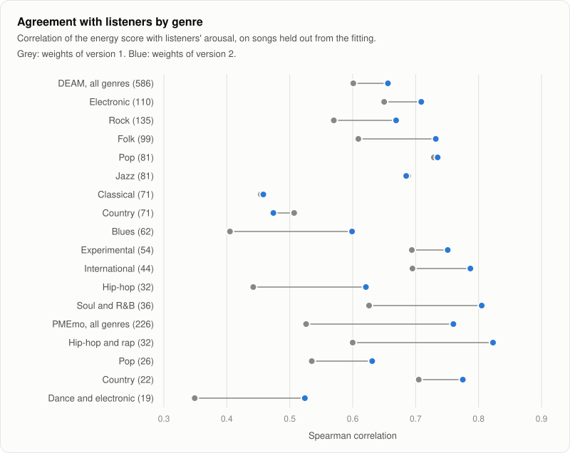

# Energy rating

Euphoria gives every track an energy rating from 1 to 10. Key and tempo tell you whether two tracks fit together. Energy tells you where a track belongs in a set: low numbers for warming up, the middle for building, high numbers for the peak.

The rating describes how intense a track sounds, not how good it is. A 4 is not a worse track than an 8.

## What the numbers mean

| Rating | How it sounds |
| --- | --- |
| 1 to 3 | Calm. Sparse drums or none, quiet or very dynamic, long breakdowns. |
| 4 to 6 | A steady groove with room in it. Most house music lands here. |
| 7 to 8 | Full, loud and busy, with few quiet passages. |
| 9 to 10 | Relentless. Dense percussion at full level from start to end. |

## Euphoria's own scale

Other tools also rate energy from 1 to 10, each with its own method, and the best known ones do not publish theirs. Euphoria's rating is computed in the open, from the measurements described on this page. The numbers are not comparable between tools: a 7 in Euphoria is not a 7 anywhere else. Use the ratings to compare tracks inside one Euphoria library.

## What is measured

The rating is built from five measurements of the audio, and from the tempo when it is known.

| Feature | What it is | More energy when |
| --- | --- | --- |
| Integrated loudness | The overall loudness of the track in LUFS, measured as the EBU R128 broadcast standard describes. | louder |
| Loudness range | How far apart the loud and quiet passages are, in LU, also from EBU R128. | narrower, so the track stays at full level |
| Onset rate | Percussive events per second: kicks, claps, hats and other sharp attacks. | more events |
| Low frequency share | The share of the signal's power below 150 Hz, where the kick drum and the bass sit. | larger share |
| Spectral flux | How much the sound changes from one moment to the next. A held note scores near zero, layered percussion scores high. | busier |
| Tempo | Beats per minute, from the tempo detector. Measured, but it has no weight in the rating. | faster |

Onset rate, low frequency share and spectral flux do not depend on how loud the file is. Turning a track down changes only its loudness.

## From measurements to a rating

1. Each feature becomes a score from 0 to 1. A feature at or below its low anchor scores 0, at or above its high anchor scores 1, and in between the score rises in a straight line.
2. The scores are averaged using the weights below. When the tempo is not known, it is left out and the other weights keep their proportions.
3. The average is stretched so that 0.1 maps to the bottom of the scale and 0.9 to the top, then cut into ten equal steps.

| Feature | Scores 0 at | Scores 1 at | Weight |
| --- | --- | --- | --- |
| Spectral flux | 0.0045 | 0.0105 | 0.65 |
| Integrated loudness | -14 LUFS | -6.5 LUFS | 0.20 |
| Onset rate | 2.5 per second | 7 per second | 0.10 |
| Loudness range | 12 LU | 1.5 LU | 0.05 |
| Low frequency share | 35% | 90% | 0 |
| Tempo, when known | 100 BPM | 140 BPM | 0 |

The anchors were chosen so that the 604 dance music previews of the [GiantSteps Key](https://github.com/GiantSteps/giantsteps-key-dataset) dataset spread over the scale. Each feature's anchors sit near the values that the lowest and highest few percent of those tracks reach, and the range of the average that is stretched over the ratings is the 2nd to the 98th percentile of the same previews, rounded to 0.1 and 0.9. The previews come out as:

| Rating | 1 | 2 | 3 | 4 | 5 | 6 | 7 | 8 | 9 | 10 |
| --- | --- | --- | --- | --- | --- | --- | --- | --- | --- | --- |
| GiantSteps previews | 26 | 22 | 53 | 67 | 86 | 91 | 102 | 79 | 42 | 36 |

Tempo and low frequency share have no weight, so the rating is the same with and without a tempo.

The weights were fitted to what listeners said, as the next section describes. Spectral flux describes what happens in the music and followed listeners' arousal most closely, so it carries two thirds of the rating. Loudness comes next, but it also reflects how a track was mastered, so it does not dominate. Onset rate and loudness range add a little. Low frequency share and tempo received no weight: a deep, bass heavy warm up track is not an intense one, and tempo detection reports every tempo between 90 and 180 BPM, so a track slower or faster than that enters at double or half its tempo. Neither followed listeners' arousal in either dataset.

## How well it works

The rating is checked against what listeners said about the intensity of music. Two public datasets hold that: [DEAM](https://cvml.unige.ch/databases/DEAM/) has 1802 songs of rock, pop, folk, jazz, classical, blues, hip-hop, country and electronic music, and [PMEmo](https://github.com/HuiZhangDB/PMEmo) has 794 choruses of popular songs, many of them hip-hop, pop and country. In both, listeners rated each song for arousal, the calm to excited axis of emotion, which is the closest public measure to energy. Both also hold arousal ratings given second by second, so the energy curve can be checked too.

Arousal is not the same as DJ energy. A listener asked how excited a song sounds is not asking what it does on a dance floor, and neither dataset is dance music. Treat the numbers below as agreement with listeners, not as proof that the rating suits a set.

### Method

- Every song is rated the way `euphoria analyze` rates it, with its detected tempo, and the energy curve of each song is computed with `energy_curve`.
- The correlations are Spearman (rank) and Pearson (linear) between the rating and the mean arousal of the song. The 95% intervals come from resampling the songs 1000 times.
- DEAM is split once, by a hash of the song number, into 1216 songs for fitting and 586 held out. PMEmo is split the same way into 541 for fitting and 226 held out. The weights were fitted on the two fitting sets, and every figure below is from the held out songs.
- Only the weights and the stretch of the average were fitted. The anchors of the features stayed where the GiantSteps previews put them, and the range of the average was set on the GiantSteps previews, so dance music still spreads over the whole scale.
- The weights are a least squares fit of each song's rank within its dataset on the feature scores, with every weight held at zero or above, rounded to 0.05, and the range of the average comes from the GiantSteps previews.
- Both datasets are free for research, and DEAM is under Creative Commons BY-NC terms. They are downloaded to run the check and deleted afterwards. No audio, no annotation and no per song value is stored in the repository, and the only thing that comes from them is the six weights of the model.

### Agreement with listeners

Rating from 1 to 10 against the arousal of the held out songs:

| Held out songs | Version | Spearman | Pearson |
| --- | --- | --- | --- |
| DEAM, 586 songs | 1, the weights before | 0.586 (0.528 to 0.640) | 0.545 (0.486 to 0.600) |
| DEAM, 586 songs | 2, this page | 0.636 (0.585 to 0.686) | 0.566 (0.506 to 0.618) |
| PMEmo, 226 songs | 1 | 0.522 (0.412 to 0.622) | 0.550 (0.437 to 0.649) |
| PMEmo, 226 songs | 2 | 0.757 (0.675 to 0.819) | 0.776 (0.706 to 0.834) |

Weights fitted on the DEAM fitting songs alone also improved the held out PMEmo songs, from 0.526 to 0.651 (the interval of the difference is 0.06 to 0.20), so the gain is not only that of one dataset being fitted to itself.

### By genre

Spearman correlation of the score before it is cut into ten ratings, on the held out songs of each genre. A song can carry several tags in DEAM, so the genres overlap. The last column is the change, with its 95% interval.

| Genre | Songs | Version 1 | Version 2 | Change |
| --- | --- | --- | --- | --- |
| DEAM, all | 586 | 0.601 | 0.656 | +0.056 (+0.013 to +0.096) |
| Electronic | 110 | 0.650 | 0.709 | +0.059 (-0.025 to +0.149) |
| Rock | 135 | 0.570 | 0.669 | +0.100 (-0.002 to +0.208) |
| Folk | 99 | 0.609 | 0.732 | +0.122 (+0.017 to +0.230) |
| Pop | 81 | 0.729 | 0.735 | +0.006 (-0.094 to +0.110) |
| Jazz | 81 | 0.688 | 0.685 | -0.003 (-0.120 to +0.107) |
| Classical | 71 | 0.454 | 0.458 | +0.005 (-0.169 to +0.165) |
| Country | 71 | 0.507 | 0.474 | -0.032 (-0.175 to +0.112) |
| Blues | 62 | 0.405 | 0.599 | +0.195 (+0.043 to +0.336) |
| Experimental | 54 | 0.694 | 0.751 | +0.057 (-0.090 to +0.207) |
| International | 44 | 0.695 | 0.787 | +0.092 (-0.046 to +0.255) |
| Hip-hop | 32 | 0.442 | 0.621 | +0.179 (-0.054 to +0.404) |
| Soul and R&B | 36 | 0.626 | 0.805 | +0.179 (+0.074 to +0.336) |
| PMEmo, all | 226 | 0.526 | 0.760 | +0.234 (+0.169 to +0.314) |
| Hip-hop and rap | 32 | 0.600 | 0.823 | +0.223 (+0.031 to +0.461) |
| Pop | 26 | 0.535 | 0.631 | +0.096 (-0.217 to +0.429) |
| Country | 22 | 0.705 | 0.775 | +0.070 (-0.052 to +0.185) |
| Dance and electronic | 19 | 0.349 | 0.524 | +0.175 (-0.150 to +0.496) |

No genre gets meaningfully worse. The only drops are DEAM country (0.03) and jazz (0.003), both far inside their intervals, and country music in PMEmo improves. The genre groups are small, so most of their intervals include zero: the table shows no genre going backwards, it does not show that every genre improves. PMEmo carries no genre labels of its own. They are the genre that the uploader chose on SoundCloud, available for 519 of 645 songs, so the PMEmo rows are rougher, and pop, country, hip-hop and dance are the only groups with enough held out songs to list.

Among the 166 DEAM songs whose only tag is electronic, the rating's Spearman correlation rises from 0.560 (0.444 to 0.658) to 0.660 (0.555 to 0.748). That group includes the 110 above, as well as songs that were in the fitting set, so it is not a held out figure.

### The energy curve

The curve is checked against the arousal that listeners gave over time. Each 8 second window is compared with the mean of the second by second ratings inside it, for the windows that overlap the annotated part of the song by at least 4 seconds (DEAM from second 15, PMEmo from second 15 of each chorus).

| Held out songs | Version | Spearman, all windows | Spearman, change within a song |
| --- | --- | --- | --- |
| DEAM, 586 songs, 4659 windows | 1 | 0.475 | 0.088 |
| DEAM, 586 songs, 4659 windows | 2 | 0.633 | 0.171 |
| PMEmo, 179 songs, 1192 windows | 1 | 0.552 | 0.215 |
| PMEmo, 179 songs, 1192 windows | 2 | 0.751 | 0.212 |

The first column is mostly about which songs are intense. The second is the average, over songs, of how well the curve follows the ups and downs inside one song, and it is weak: 0.09 to 0.21. The curve tells an intense passage from a calm one in a different song far better than it follows a change inside one song. The arousal ratings of the second by second part are also noisy and move slowly, so part of that gap is the reference. PMEmo songs are 30 second choruses, and the windows overlap.

### How the weights were chosen

- Each feature became a score between its anchors, as above, and the weights were fitted so that the weighted average follows the rank of the listeners' arousal.
- The first fit used the DEAM fitting songs only and was tested on PMEmo. The second pooled the DEAM and PMEmo fitting songs and was tested on both held out sets. The second was kept: against the first it gives up 0.02 on the held out DEAM songs (0.660 against 0.680, scores before the cut into ten) and gains 0.10 on PMEmo (0.752 against 0.651), and it is the one that was not fitted to a single kind of music.
- Spectral flux is the feature that matters: alone it correlates at 0.64 with arousal in DEAM and 0.73 in PMEmo. Loudness range got 0.05, and low frequency share and tempo got nothing in the pooled fit.
- The previous weights gave tempo 0.10 and low frequency share 0.10. Tempo correlated with arousal at -0.02 in DEAM and -0.12 in PMEmo. Low frequency share followed arousal in DEAM (+0.29) and ran against it in PMEmo (-0.18). Onset rate follows arousal in DEAM (+0.44) and not at all in PMEmo (+0.01), which is why it carries 0.10.

### What this does not show

- Whether the rating suits a DJ set. Arousal ratings of a chorus or a 45 second excerpt are not stage-in-the-set ratings of a full track, and no public dataset with energy ratings of dance music was found. In particular the dance music in these datasets is a small share: 166 DEAM songs tagged only electronic and the 19 to 54 PMEmo songs that uploaders called dance or electronic.
- Whether the new weights agree with a DJ's idea of energy. On one DJ's library of house tracks sorted into warm up, build and peak folders, version 1 put 56.8% of the pairs from different folders in order, and the stage there follows tempo closely. Version 2 gives tempo no weight, and its result on those folders is still being measured.
- Whether it holds for loud, compressed masters of every era. Mastering affects the loudness feature, and spectral flux also follows brightness.
- Lossless against lossy files, which was not measured. Encoding 60 songs again as 128 kbit/s MP3 left 80% of the version 1 ratings unchanged and moved the rest by one.

Treat the rating as a guide. It tells calm tracks from intense ones more reliably than it orders tracks that are close.

## Model version

The anchors and weights live in one place in the code, the `ENERGY_MODEL` constant, with a version number, `ENERGY_MODEL_VERSION`. Every rating carries the version that produced it, together with the measured features. The same audio and the same version always give the same rating. When the anchors or weights change, the version changes, and ratings from different versions should not be mixed in one library. The [analysis cache](../reference/cli.md#the-analysis-cache) stores the model version next to each rating and analyzes a track again when its rating comes from another version.

This page describes version 2. Version 1 weighted loudness 0.25, loudness range 0.20, onset rate 0.25, low frequency share 0.10, spectral flux 0.20 and tempo 0.10, and stretched the average from 0.2 to 0.8. Ratings from version 1 are computed again when a library is analyzed with version 2.

## Energy curve

A track's energy is not constant. Euphoria also computes the same rating over a sliding window of 8 seconds that moves in steps of 4 seconds, which gives a curve an app can draw under the waveform. The curve shows where the breakdowns and the drops are. Silent stretches have no rating.

A window is rated on its own, so the curve usually reaches higher and lower than the rating of the whole track.

The curve of a two minute preview from the benchmark set, computed with `energy_curve`.

## Overriding the rating

When the rating disagrees with your ear, pick another from 1 to 10 in the desktop app's [correction editor](../guides/desktop-app.md#check-the-key-by-ear-and-correct-it). Your rating is kept like a corrected key or tempo, so it survives analyzing again and is used in the table, the tags you write and the rekordbox export, and **Reset to detected** brings the measured rating back.

## Limits

- **It measures sound, not feeling.** A quiet track with a tense vocal can lift a room, and the rating cannot know that.
- **Mastering affects it.** A heavily compressed master rates higher than a dynamic master of the same music. Spectral flux, which carries most of the weight, also follows brightness.
- **It follows listeners, not a dance floor.** The weights were fitted to arousal ratings of two public datasets. Arousal is not DJ energy, and inside one song the curve follows listeners only weakly.
- **The scale is set on dance music.** The anchors and the stretch of the average come from dance music previews, so most acoustic or ambient music lands at the bottom of the scale and very dense music at the top. The weights were fitted on music of many genres, and [the table by genre](#by-genre) shows how well each follows listeners.
- **The whole track is averaged.** A track with a long quiet intro and a huge drop rates lower than its peak. Look at the energy curve for that.
- **Tempo is not used.** Tempo detection reports every tempo between 90 and 180 BPM, so a track slower or faster than that is reported at double or half its tempo. The rating gives tempo no weight, and the model keeps its anchors in case a weight is given back.
- **Sample rates from 8 kHz to 384 kHz.** A file that claims a rate outside that range is reported as a failure, since only a damaged file does.
- **Mono analysis.** Euphoria mixes a track to mono before analysis, so stereo width plays no part.
- **Lossy files differ a little.** Encoding 60 songs again as 128 kbit/s MP3 left 80% of the ratings unchanged and moved the rest by one. A lossless file against a lossy copy of it was not measured.
