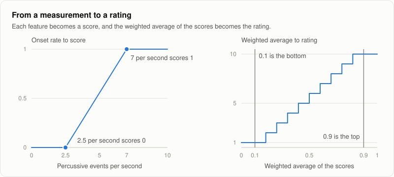
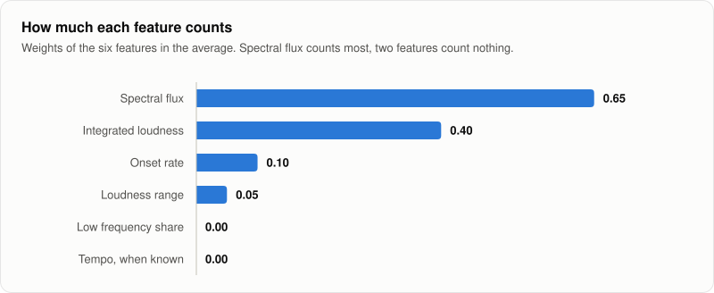
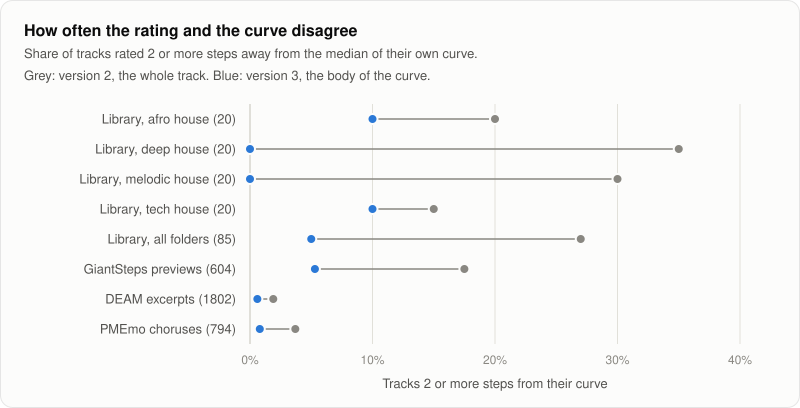
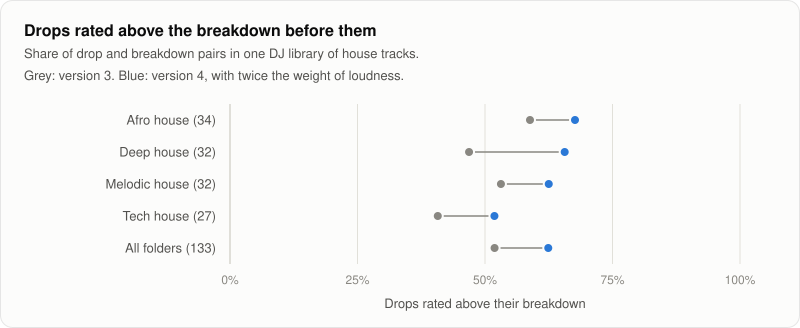

# Energy rating

Euphoria gives every track an energy rating from 1 to 10. Key and tempo tell you whether two tracks fit together. Energy tells you where a track belongs in a set: low numbers for warming up, the middle for building, high numbers for the peak.

The rating describes how intense a track sounds, not how good it is. A 4 is not a worse track than an 8.

To see where a track tends to sit in a set, from its tempo and loudness among your other tracks, use the separate [set stage](set-stage.md) suggestion: it is not the same thing, and on a DJ's own warm-up, build and peak folders it follows them where this rating does not.

## What the numbers mean

| Rating | How it sounds |
| --- | --- |
| 1 to 3 | Calm. Sparse drums or none, quiet or very dynamic, long breakdowns. |
| 4 to 6 | A steady groove with room in it. Most house music lands here. |
| 7 to 8 | Full, loud and busy, with few quiet passages. |
| 9 to 10 | Relentless. Dense percussion at full level from start to end. |

## Euphoria's own scale

Other tools also rate energy from 1 to 10, each with its own method, and the best known ones do not publish theirs. Euphoria's rating is computed in the open, from the measurements described on this page. The numbers are not comparable between tools: a 7 in Euphoria is not a 7 anywhere else. Use the ratings to compare tracks inside one Euphoria library.

## What is measured

A stretch of audio is rated from five measurements, and from the tempo when it is known. The stretch is one 8 second window of the [energy curve](#energy-curve), and a track's rating comes from the windows of its curve, as [step 4](#from-measurements-to-a-rating) explains.

| Feature | What it is | More energy when |
| --- | --- | --- |
| Integrated loudness | The overall loudness of the stretch in LUFS, measured as the EBU R128 broadcast standard describes. | louder |
| Loudness range | How far apart the loud and quiet passages are, in LU, also from EBU R128. | narrower, so the track stays at full level |
| Onset rate | Percussive events per second: kicks, claps, hats and other sharp attacks. | more events |
| Low frequency share | The share of the signal's power below 150 Hz, where the kick drum and the bass sit. | larger share |
| Spectral flux | How much the sound changes from one moment to the next. A held note scores near zero, layered percussion scores high. | busier |
| Tempo | Beats per minute, from the tempo detector. Measured, but it has no weight in the rating. | faster |

Onset rate, low frequency share and spectral flux do not depend on how loud the file is. Turning a track down changes only its loudness.

## From measurements to a rating

1. Each feature becomes a score from 0 to 1. A feature at or below its low anchor scores 0, at or above its high anchor scores 1, and in between the score rises in a straight line.
2. The scores are averaged using the weights below. The weights are relative: each is divided by their sum, so the Share column is what each feature counts for. When the tempo is not known, it is left out and the other weights keep their proportions.
3. The average is stretched so that 0.1 maps to the bottom of the scale and 0.9 to the top, then cut into ten equal steps.
4. A track is rated from its energy curve. Its main body is the windows that are at most 6 LU quieter than the loudness its loudest tenth of windows reach. The track's score is the mean score of those windows. A long quiet intro, a quiet outro or a breakdown far below the rest stays out, so the rating describes the part a DJ mixes and sits where the curve sits.

| Feature | Scores 0 at | Scores 1 at | Weight | Share |
| --- | --- | --- | --- | --- |
| Spectral flux | 0.0045 | 0.0105 | 0.65 | 54% |
| Integrated loudness | -14 LUFS | -6.5 LUFS | 0.40 | 33% |
| Onset rate | 2.5 per second | 7 per second | 0.10 | 8% |
| Loudness range | 12 LU | 1.5 LU | 0.05 | 4% |
| Low frequency share | 35% | 90% | 0 | 0% |
| Tempo, when known | 100 BPM | 140 BPM | 0 | 0% |

The anchors were chosen so that the 604 dance music previews of the [GiantSteps Key](https://github.com/GiantSteps/giantsteps-key-dataset) dataset spread over the scale. Each feature's anchors sit near the values that the lowest and highest few percent of those tracks reach, and the range of the average that is stretched over the ratings is the 2nd to the 98th percentile of the same previews rated whole, rounded to 0.1 and 0.9. Rated from the body of their curves, the previews come out as:

| Rating | 1 | 2 | 3 | 4 | 5 | 6 | 7 | 8 | 9 | 10 |
| --- | --- | --- | --- | --- | --- | --- | --- | --- | --- | --- |
| GiantSteps previews, version 4 | 8 | 22 | 23 | 68 | 79 | 105 | 99 | 89 | 71 | 40 |
| GiantSteps previews, version 3 | 11 | 20 | 21 | 60 | 80 | 95 | 101 | 103 | 66 | 47 |
| GiantSteps previews, version 2 | 26 | 22 | 53 | 67 | 86 | 91 | 102 | 79 | 42 | 36 |

Version 3 left out the quiet breakdowns of the previews, so they sat a little higher on the scale than rated whole. Version 4 gives loudness more weight, which spreads them back over the scale: the stretch of the average stays at 0.1 to 0.9.

Tempo and low frequency share have no weight, so the rating is the same with and without a tempo.

The weights were fitted to what listeners said, as the next section describes, and then the weight of loudness was doubled from 0.20 to 0.40 so that a drop rates above the breakdown before it more often. Spectral flux describes what happens in the music and followed listeners' arousal most closely, so it carries more than half of the rating. Loudness comes next with a third: it is what tells a drop from a busy breakdown, but it also reflects how a track was mastered. [The trade-off](#loudness-and-the-drop) has the numbers. Onset rate and loudness range add a little. Low frequency share and tempo received no weight: a deep, bass heavy warm up track is not an intense one, and tempo detection reports every tempo between 90 and 180 BPM, so a track slower or faster than that enters at double or half its tempo. Neither followed listeners' arousal in either dataset.

## How well it works

The rating is checked against what listeners said about the intensity of music. Two public datasets hold that: [DEAM](https://cvml.unige.ch/databases/DEAM/) has 1802 songs of rock, pop, folk, jazz, classical, blues, hip-hop, country and electronic music, and [PMEmo](https://github.com/HuiZhangDB/PMEmo) has 794 choruses of popular songs, many of them hip-hop, pop and country. In both, listeners rated each song for arousal, the calm to excited axis of emotion, which is the closest public measure to energy. Both also hold arousal ratings given second by second, so the energy curve can be checked too.

Arousal is not the same as DJ energy. A listener asked how excited a song sounds is not asking what it does on a dance floor, and neither dataset is dance music. Treat the numbers below as agreement with listeners, not as proof that the rating suits a set.

### Method

- Every song is rated the way `euphoria analyze` rates it, with its detected tempo, and the energy curve of each song is computed with `energy_curve`.
- Versions 3 and 4 change how a song's score is drawn from the windows of its curve and the weight of loudness. Their figures come from the per window measurements recorded for the version 2 check, rated again with the rules of each version. On the GiantSteps previews and the DJ library below, that recomputation gives exactly the ratings Euphoria computes. The audio had been deleted after that check, as below.
- The correlations are Spearman (rank) and Pearson (linear) between the rating and the mean arousal of the song. The 95% intervals come from resampling the songs 1000 times.
- DEAM is split once, by a hash of the song number, into 1216 songs for fitting and 586 held out. PMEmo is split the same way into 541 for fitting and 226 held out. The weights were fitted on the two fitting sets, and every figure below is from the held out songs.
- Only the weights and the stretch of the average were fitted. The anchors of the features stayed where the GiantSteps previews put them, and the range of the average was set on the GiantSteps previews, so dance music still spreads over the whole scale.
- The weights are a least squares fit of each song's rank within its dataset on the feature scores, with every weight held at zero or above, rounded to 0.05, and the range of the average comes from the GiantSteps previews.
- Both datasets are free for research, and DEAM is under Creative Commons BY-NC terms. They are downloaded to run the check and deleted afterwards. No audio, no annotation and no per song value is stored in the repository, and the only thing that comes from them is the six weights of the model.

### Agreement with listeners

Rating from 1 to 10 against the arousal of the held out songs:

| Held out songs | Version | Spearman | Pearson |
| --- | --- | --- | --- |
| DEAM, 586 songs | 1, the weights before | 0.586 (0.528 to 0.640) | 0.545 (0.486 to 0.600) |
| DEAM, 586 songs | 2 | 0.636 (0.585 to 0.686) | 0.566 (0.506 to 0.618) |
| DEAM, 586 songs | 3 | 0.627 (0.572 to 0.678) | 0.567 (0.510 to 0.622) |
| DEAM, 586 songs | 4, this page | 0.610 (0.555 to 0.663) | 0.533 (0.471 to 0.591) |
| PMEmo, 226 songs | 1 | 0.522 (0.412 to 0.622) | 0.550 (0.437 to 0.649) |
| PMEmo, 226 songs | 2 | 0.757 (0.675 to 0.819) | 0.776 (0.706 to 0.834) |
| PMEmo, 226 songs | 3 | 0.744 (0.664 to 0.806) | 0.764 (0.691 to 0.823) |
| PMEmo, 226 songs | 4 | 0.775 (0.705 to 0.832) | 0.790 (0.724 to 0.842) |

Version 3 agreed with listeners as well as version 2. Version 4 follows the PMEmo choruses more closely and the DEAM songs less closely: before the cut into ten ratings, 0.782 against 0.755 on PMEmo and 0.651 against 0.671 on DEAM. Both changes are larger than their intervals allow, so this is a real trade, described [below](#loudness-and-the-drop).

Weights fitted on the DEAM fitting songs alone also improved the held out PMEmo songs, from 0.526 to 0.651 (the interval of the difference is 0.06 to 0.20), so the gain is not only that of one dataset being fitted to itself.

### By genre

Spearman correlation of the score before it is cut into ten ratings, on the held out songs of each genre. A song can carry several tags in DEAM, so the genres overlap. The last column is the change from version 3 to version 4, with its 95% interval. A change in bold is larger than its interval allows.

| Genre | Songs | Version 2 | Version 3 | Version 4 | Change, 3 to 4 |
| --- | --- | --- | --- | --- | --- |
| DEAM, all | 586 | 0.656 | 0.671 | 0.651 | **-0.020 (-0.034 to -0.008)** |
| Electronic | 110 | 0.709 | 0.746 | 0.753 | +0.007 (-0.019 to +0.034) |
| Rock | 135 | 0.669 | 0.684 | 0.649 | **-0.035 (-0.065 to -0.010)** |
| Folk | 99 | 0.732 | 0.717 | 0.713 | -0.004 (-0.027 to +0.015) |
| Pop | 81 | 0.735 | 0.728 | 0.729 | +0.001 (-0.020 to +0.021) |
| Jazz | 81 | 0.685 | 0.657 | 0.666 | +0.009 (-0.007 to +0.029) |
| Classical | 71 | 0.458 | 0.585 | 0.528 | -0.057 (-0.170 to +0.047) |
| Country | 71 | 0.474 | 0.499 | 0.471 | -0.029 (-0.079 to +0.020) |
| Blues | 62 | 0.599 | 0.610 | 0.517 | **-0.092 (-0.173 to -0.029)** |
| Experimental | 54 | 0.751 | 0.779 | 0.768 | -0.010 (-0.034 to +0.003) |
| International | 44 | 0.787 | 0.748 | 0.748 | +0.000 (+0.000 to +0.000) |
| Hip-hop | 32 | 0.621 | 0.643 | 0.633 | -0.011 (-0.037 to +0.000) |
| Soul and R&B | 36 | 0.805 | 0.763 | 0.763 | +0.000 (+0.000 to +0.000) |
| PMEmo, all | 226 | 0.760 | 0.755 | 0.782 | **+0.027 (+0.006 to +0.049)** |
| Hip-hop and rap | 32 | 0.823 | 0.804 | 0.820 | +0.017 (-0.022 to +0.068) |
| Pop | 26 | 0.631 | 0.626 | 0.709 | +0.084 (-0.020 to +0.186) |
| Country | 22 | 0.775 | 0.760 | 0.798 | +0.038 (-0.021 to +0.126) |
| Dance and electronic | 19 | 0.524 | 0.502 | 0.509 | +0.007 (-0.110 to +0.126) |

Version 2 raised agreement over version 1 in 13 of 16 genre groups, and version 3 kept it: no genre moved by an amount its interval could tell from zero. Version 4 is lower on rock, blues and DEAM as a whole, by more than the intervals allow, and higher on the PMEmo choruses. Country and classical music also drop, by 0.03 and 0.06, inside their intervals. The genre groups are small, so most of their intervals are wide. PMEmo carries no genre labels of its own. They are the genre that the uploader chose on SoundCloud, available for 519 of 645 songs, so the PMEmo rows are rougher, and pop, country, hip-hop and dance are the only groups with enough held out songs to list.

Among the 166 DEAM songs whose only tag is electronic, the rating's Spearman correlation rises from 0.560 (0.444 to 0.658) to 0.660 (0.555 to 0.748). That group includes the 110 above, as well as songs that were in the fitting set, so it is not a held out figure.

### The energy curve

The curve is checked against the arousal that listeners gave over time. Each 8 second window is compared with the mean of the second by second ratings inside it, for the windows that overlap the annotated part of the song by at least 4 seconds (DEAM from second 15, PMEmo from second 15 of each chorus).

| Held out songs | Version | Spearman, all windows | Spearman, change within a song |
| --- | --- | --- | --- |
| DEAM, 586 songs, 4659 windows | 1 | 0.475 | 0.088 |
| DEAM, 586 songs, 4659 windows | 2 and 3 | 0.633 | 0.171 |
| DEAM, 586 songs, 4659 windows | 4 | 0.602 | 0.191 |
| PMEmo, 179 songs, 1192 windows | 1 | 0.552 | 0.215 |
| PMEmo, 179 songs, 1192 windows | 2 and 3 | 0.751 | 0.212 |
| PMEmo, 179 songs, 1192 windows | 4 | 0.776 | 0.246 |

The curve is the same in versions 2 and 3. Version 4's heavier loudness follows the ups and downs inside a song a little better in both datasets, and ranks DEAM's windows across songs a little worse. The first column is mostly about which songs are intense. The second is the average, over songs, of how well the curve follows the ups and downs inside one song, and it is weak: 0.09 to 0.25. The curve tells an intense passage from a calm one in a different song far better than it follows a change inside one song. The arousal ratings of the second by second part are also noisy and move slowly, so part of that gap is the reference. PMEmo songs are 30 second choruses, and the windows overlap.

### The rating and the curve agree

A DJ reads a track's rating next to its curve, so the two have to tell the same story. Version 2 rated the features of the whole track, and a whole track measures lower than its body: a quiet intro or a breakdown lowers its spectral flux and loudness, and its loudness range is wide where that of an 8 second window is close to zero. On full length house tracks the rating sat a median of one step below the body of the curve, and two or more steps away from it for a third of them.

The check below counts, for each track, how far its rating is from the median rating of its own curve, the level that most of the curve sits at.

| Tracks | Count | Version 2, mean distance | Version 4, mean distance | Version 2, 2 or more steps away | Version 3, 2 or more steps away | Version 4, 2 or more steps away |
| --- | --- | --- | --- | --- | --- | --- |
| One DJ's library, afro house | 20 | 0.95 | 0.42 | 20% | 10% | 5% |
| One DJ's library, deep house | 20 | 1.05 | 0.28 | 35% | 0% | 0% |
| One DJ's library, melodic house | 20 | 0.90 | 0.47 | 30% | 0% | 0% |
| One DJ's library, tech house | 20 | 0.82 | 0.65 | 15% | 10% | 10% |
| One DJ's library, all folders | 85 | 0.97 | 0.44 | 27% | 5% | 3.5% |
| GiantSteps previews | 604 | 0.81 | 0.46 | 17.5% | 5.3% | 4.1% |
| DEAM excerpts | 1802 | 0.23 | 0.13 | 1.9% | 0.6% | 0.4% |
| PMEmo choruses | 794 | 0.39 | 0.24 | 3.7% | 0.8% | 0.6% |

The library rows are full length tracks copied from one DJ's genre folders, 20 picked at random from each, plus the 5 tracks of two smaller folders in the total. On them version 3 rates 0.9 steps higher on average than version 2, because their intros, breakdowns and outros no longer count. The public sets are short excerpts with little quiet in them, so they move less. The few tracks still 2 steps away have a long stretch below the rest of the track that is still within 6 LU of it, such as a long breakdown with the drums still running.

### Loudness and the drop

In house music, a breakdown is often full of percussion and effects, and spectral flux rates it as busy as the drop that follows. A DJ expects the drop to rate higher. Version 4 doubles the weight of loudness, which tells the two apart more often.

The check counts, in 85 tracks from one DJ's library, each drop that Euphoria's cues find against the breakdown before it, both rated from the curve windows inside them: higher, equal or lower.

| Folder | Pairs | Version 3, higher / equal / lower | Version 4, higher / equal / lower |
| --- | --- | --- | --- |
| Afro house | 34 | 20 / 3 / 11 | 23 / 6 / 5 |
| Deep house | 32 | 15 / 5 / 12 | 21 / 2 / 9 |
| Melodic house | 32 | 17 / 2 / 13 | 20 / 7 / 5 |
| Tech house | 27 | 11 / 3 / 13 | 14 / 5 / 8 |
| Organic house | 6 | 5 / 1 / 0 | 5 / 1 / 0 |
| All folders | 133 | 69 / 14 / 50 | 83 / 22 / 28 |

The price is agreement with listeners on other music. On the DEAM songs, version 4 follows arousal less closely on rock (0.649 against 0.684), blues (0.517 against 0.610) and the whole set (0.651 against 0.671), each by more than its interval allows. On the PMEmo choruses it follows them more closely (0.782 against 0.755). Loudness also reflects mastering, so a loud master of a calm song now rates higher than before. The breakdowns are those that Euphoria's own cues find, from the track's loudness, so this check is not independent of loudness. A larger weight was not taken: giving low frequency share weight instead, or loudness more, ordered more drops but lost more agreement on jazz, hip-hop and the PMEmo choruses.

### How the weights were chosen

- Each feature became a score between its anchors, as above, and the weights were fitted so that the weighted average follows the rank of the listeners' arousal.
- The first fit used the DEAM fitting songs only and was tested on PMEmo. The second pooled the DEAM and PMEmo fitting songs and was tested on both held out sets. The second was kept: against the first it gives up 0.02 on the held out DEAM songs (0.660 against 0.680, scores before the cut into ten) and gains 0.10 on PMEmo (0.752 against 0.651), and it is the one that was not fitted to a single kind of music.
- Spectral flux is the feature that matters: alone it correlates at 0.64 with arousal in DEAM and 0.73 in PMEmo. Loudness range got 0.05, and low frequency share and tempo got nothing in the pooled fit.
- The previous weights gave tempo 0.10 and low frequency share 0.10. Tempo correlated with arousal at -0.02 in DEAM and -0.12 in PMEmo. Low frequency share followed arousal in DEAM (+0.29) and ran against it in PMEmo (-0.18). Onset rate follows arousal in DEAM (+0.44) and not at all in PMEmo (+0.01), which is why it carries 0.10.

### What this does not show

- Whether the rating suits a DJ set. Arousal ratings of a chorus or a 45 second excerpt are not stage-in-the-set ratings of a full track, and no public dataset with energy ratings of dance music was found. In particular the dance music in these datasets is a small share: 166 DEAM songs tagged only electronic and the 19 to 54 PMEmo songs that uploaders called dance or electronic.
- Whether the new weights agree with a DJ's idea of energy. On one DJ's library of house tracks sorted into warm up, build and peak folders, the stage follows tempo closely (correlation 0.45 with the stage in a sample of 180 tracks: 20 warm up, 20 build and 140 peak). Version 1 followed the stage with a correlation of 0.31 (0.17 to 0.45), version 2 does not follow it at all, 0.02 (-0.13 to 0.18), and rates build tracks lowest. Spectral flux, which carries most of version 2, does not rise with the stage in those folders (-0.09). This is one person's way of sorting one genre, and nothing shows that it is the better reference, but it is the only dance music reference available, and on it version 2 is worse. Versions 3 and 4 were not checked against those folders.
- Whether it holds for loud, compressed masters of every era. Mastering affects the loudness feature, and spectral flux also follows brightness.
- Lossless against lossy files, which was not measured. Encoding 60 songs again as 128 kbit/s MP3 left 80% of the version 1 ratings unchanged and moved the rest by one.

Treat the rating as a guide. It tells calm tracks from intense ones more reliably than it orders tracks that are close.

## Model version

The anchors and weights live in one place in the code, the `ENERGY_MODEL` constant, with a version number, `ENERGY_MODEL_VERSION`. Every rating carries the version that produced it, together with the measured features. The same audio and the same version always give the same rating. When the anchors or weights change, the version changes, and ratings from different versions should not be mixed in one library. The [analysis cache](../reference/cli.md#the-analysis-cache) stores the model version next to each rating and analyzes a track again when its rating comes from another version.

This page describes version 4. It doubles the weight of loudness, from 0.20 to 0.40, and keeps everything else of version 3, which rates a track from the mean score of the main body of its energy curve. Version 2 had the same weights as version 3 and rated the features of the whole track. The curve of version 4 differs from that of versions 2 and 3 only through the loudness weight. Version 1 weighted loudness 0.25, loudness range 0.20, onset rate 0.25, low frequency share 0.10, spectral flux 0.20 and tempo 0.10, and stretched the average from 0.2 to 0.8. Ratings from an older version are computed again when a library is analyzed with version 4.

## Energy curve

A track's energy is not constant. Euphoria also computes the same rating over a sliding window of 8 seconds that moves in steps of 4 seconds, which gives a curve an app can draw under the waveform. The curve shows where the breakdowns and the drops are. Silent stretches have no rating.

The track's rating is the mean of the body of this curve, so it sits where most of the curve sits. The peaks of the curve reach higher than the rating and the breakdowns lower.

The curve of a two minute preview from the benchmark set, computed with `energy_curve`.

## Overriding the rating

When the rating disagrees with your ear, pick another from 1 to 10 in the desktop app's [correction editor](../guides/desktop-app.md#check-the-key-by-ear-and-correct-it). Your rating is kept like a corrected key or tempo, so it survives analyzing again and is used in the table, the tags you write and the rekordbox export, and **Reset to detected** brings the measured rating back.

## Limits

- **It measures sound, not feeling.** A quiet track with a tense vocal can lift a room, and the rating cannot know that.
- **Mastering affects it.** A heavily compressed master rates higher than a dynamic master of the same music. Spectral flux, which carries most of the weight, also follows brightness.
- **It follows listeners, not a dance floor.** The weights were fitted to arousal ratings of two public datasets. Arousal is not DJ energy, and inside one song the curve follows listeners only weakly.
- **The scale is set on dance music.** The anchors and the stretch of the average come from dance music previews, so most acoustic or ambient music lands at the bottom of the scale and very dense music at the top. The weights were fitted on music of many genres, and [the table by genre](#by-genre) shows how well each follows listeners.
- **The body is averaged.** The rating is the mean of the loud part of the track, so a track with a huge drop and long busy breakdowns rates below its peak. Look at the energy curve for that.
- **A busy breakdown can still rate as high as the drop.** Spectral flux carries more than half of the rating, and a breakdown full of percussion changes as much as a drop. In 85 house tracks from one DJ's library, a drop rated above the breakdown before it in 83 of 133 pairs, equal in 22 and lower in 28. The Drop cue marks where the drop is.
- **Rock and blues follow listeners less closely than in version 3, and country a little less.** Doubling the weight of loudness traded some agreement on those genres for drops that rate above their breakdowns, as [loudness and the drop](#loudness-and-the-drop) shows.
- **Loudness range adds little inside a window.** The loudness range of 8 seconds of music is almost always narrow, so in the windows the rating is built from, it adds nearly the same small amount to every track.
- **Tempo is not used.** Tempo detection reports every tempo between 90 and 180 BPM, so a track slower or faster than that is reported at double or half its tempo. The rating gives tempo no weight, and the model keeps its anchors in case a weight is given back.
- **Sample rates from 8 kHz to 384 kHz.** A file that claims a rate outside that range is reported as a failure, since only a damaged file does.
- **Mono analysis.** Euphoria mixes a track to mono before analysis, so stereo width plays no part.
- **Lossy files differ a little.** Encoding 60 songs again as 128 kbit/s MP3 left 80% of the ratings unchanged and moved the rest by one. A lossless file against a lossy copy of it was not measured.
