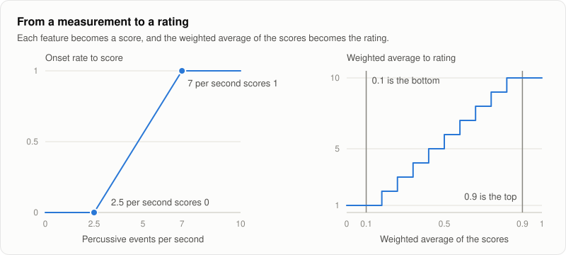
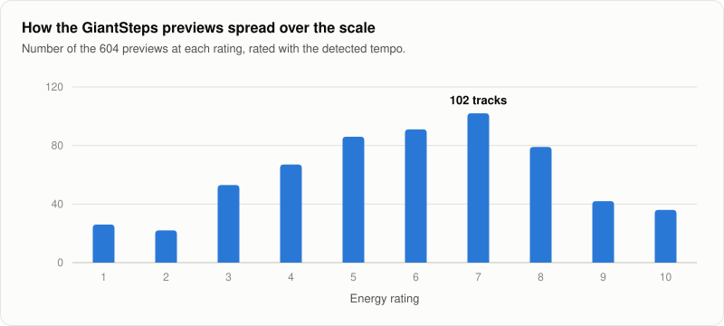
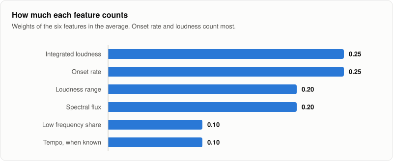
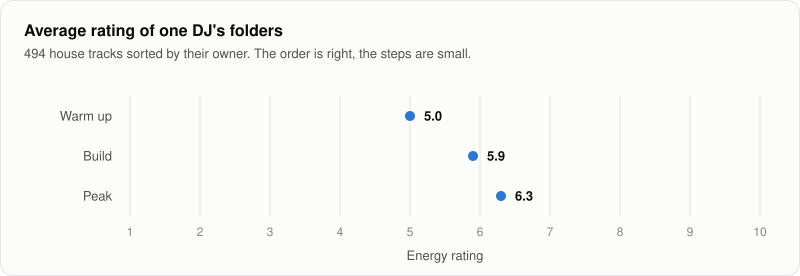
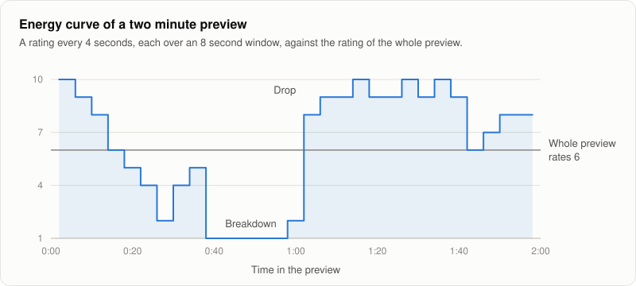

# Energy rating

Euphoria gives every track an energy rating from 1 to 10. Key and tempo tell you whether two tracks fit together. Energy tells you where a track belongs in a set: low numbers for warming up, the middle for building, high numbers for the peak.

The rating describes how intense a track sounds, not how good it is. A 4 is not a worse track than an 8.

## What the numbers mean

| Rating | How it sounds |
| --- | --- |
| 1 to 3 | Calm. Sparse drums or none, quiet or very dynamic, long breakdowns. |
| 4 to 6 | A steady groove with room in it. Most house music lands here. |
| 7 to 8 | Full, loud and busy, with few quiet passages. |
| 9 to 10 | Relentless. Dense percussion at full level from start to end. |

## Euphoria's own scale

Other tools also rate energy from 1 to 10, each with its own method, and the best known ones do not publish theirs. Euphoria's rating is computed in the open, from the measurements described on this page. The numbers are not comparable between tools: a 7 in Euphoria is not a 7 anywhere else. Use the ratings to compare tracks inside one Euphoria library.

## What is measured

The rating is built from five measurements of the audio, and from the tempo when it is known.

| Feature | What it is | More energy when |
| --- | --- | --- |
| Integrated loudness | The overall loudness of the track in LUFS, measured as the EBU R128 broadcast standard describes. | louder |
| Loudness range | How far apart the loud and quiet passages are, in LU, also from EBU R128. | narrower, so the track stays at full level |
| Onset rate | Percussive events per second: kicks, claps, hats and other sharp attacks. | more events |
| Low frequency share | The share of the signal's power below 150 Hz, where the kick drum and the bass sit. | larger share |
| Spectral flux | How much the sound changes from one moment to the next. A held note scores near zero, layered percussion scores high. | busier |
| Tempo | Beats per minute, from the tempo detector. | faster |

Onset rate, low frequency share and spectral flux do not depend on how loud the file is. Turning a track down changes only its loudness.

## From measurements to a rating

1. Each feature becomes a score from 0 to 1. A feature at or below its low anchor scores 0, at or above its high anchor scores 1, and in between the score rises in a straight line.
2. The scores are averaged using the weights below. When the tempo is not known, it is left out and the other weights keep their proportions.
3. The average is stretched so that 0.2 maps to the bottom of the scale and 0.8 to the top, then cut into ten equal steps.

| Feature | Scores 0 at | Scores 1 at | Weight |
| --- | --- | --- | --- |
| Integrated loudness | -14 LUFS | -6.5 LUFS | 0.25 |
| Loudness range | 12 LU | 1.5 LU | 0.20 |
| Onset rate | 2.5 per second | 7 per second | 0.25 |
| Low frequency share | 35% | 90% | 0.10 |
| Spectral flux | 0.0045 | 0.0105 | 0.20 |
| Tempo, when known | 100 BPM | 140 BPM | 0.10 |

The anchors were chosen so that the 604 dance music previews of the [GiantSteps Key](https://github.com/GiantSteps/giantsteps-key-dataset) dataset spread over the scale. Each feature's anchors sit near the values that the lowest and highest few percent of those tracks reach. The dataset comes out as:

| Rating | 1 | 2 | 3 | 4 | 5 | 6 | 7 | 8 | 9 | 10 |
| --- | --- | --- | --- | --- | --- | --- | --- | --- | --- | --- |
| Tracks, rated without tempo | 20 | 21 | 41 | 56 | 76 | 98 | 109 | 96 | 55 | 32 |
| Tracks, rated with the detected tempo | 13 | 13 | 30 | 63 | 65 | 115 | 114 | 102 | 56 | 33 |

The weights reflect how much each feature can be trusted. Onset rate and spectral flux describe what happens in the music, so together they carry the most. Loudness matters, but it also reflects how a track was mastered, so it does not dominate. Loudness range rewards tracks that stay at full level. Low frequency share weighs little, because a deep, bass heavy warm up track is not an intense one. Tempo weighs little because tempo detection reports every tempo between 90 and 180 BPM, so a track slower or faster than that enters at double or half its tempo.

## How well it works

The rating was measured with [the energy benchmark](../development/building.md#energy-benchmark) against two references. Neither is ideal, and they disagree.

**Listeners.** The [DEAM](https://cvml.unige.ch/databases/DEAM/) dataset holds 1802 songs with the arousal, from calm to excited, that listeners gave each one. On 586 of them the rating puts 70.2% of song pairs in the order that listeners put them, where 50% is chance, and 72.8% among the 110 songs tagged as electronic. DEAM is rock, pop, folk, jazz, classical and electronic music, not dance music, and its listeners rated how excited the music sounds, not how it works on a dance floor.

**One DJ's folders.** In a library of 494 house tracks that their owner had sorted into warm up, build and peak folders, the average rating rises from 5.0 for warm up to 5.9 for build and 6.3 for peak. The direction is right, but the rating puts only 56.8% of track pairs from different folders in order. In those folders the stage follows the tempo closely, so this mostly tests the weight of tempo. It is one person's way of sorting one genre.

No public dataset with energy ratings of dance music was found, and no library carrying energy values from other DJ software was available.

### What was tried, and why the rating did not change

- **New features.** Onsets counted per frequency band, spectral flux without the bass, kick strength, brightness and the share of a track at full level were all measured. None improved the agreement with listeners by more than the noise of the measurement.
- **Fitted weights.** A model with weights fitted to the listeners' ratings keeps spectral flux, onset rate and loudness, and drops loudness range, low frequency share and tempo. On songs held out from the fitting it orders pairs better before the result is spread over the scale (75.6% against 71.4%). At the level of the rating from 1 to 10 the gain is small and could be chance (70.6% against 70.2%).
- **The same model on the DJ's folders.** It does worse than the rating Euphoria ships: 45.6% of pairs in order, with warm up tracks rating above peak tracks on average. Tempo adds nothing against the listeners' ratings and is nearly all that separates build from peak in those folders.

The two references pull in opposite directions and neither is the music Euphoria is for, so the rating stays as it is. Changing every user's ratings needs better evidence than this. DEAM is also offered under Creative Commons BY-NC terms, for non profit work: Euphoria downloads it only to run the benchmark, and no anchors or weights that Euphoria ships are fitted on it.

What would settle it is reference ratings of dance music: a few hundred tracks rated from 1 to 10 by hand, or tracks that carry energy values from other DJ software such as Mixed In Key. The benchmark reads such ratings from a plain list of files and numbers.

Treat the rating as a guide. It tells calm tracks from intense ones more reliably than it orders tracks that are close. The full tables are in [bench/results/energy.md](https://github.com/lvndry/euphoria/blob/main/bench/results/energy.md). Every stored rating records the model version that produced it, so Euphoria knows which ratings to compute again when the scale changes.

## Model version

The anchors and weights live in one place in the code, the `ENERGY_MODEL` constant, with a version number, `ENERGY_MODEL_VERSION`. Every rating carries the version that produced it, together with the measured features. The same audio and the same version always give the same rating. When the anchors or weights change, the version changes, and ratings from different versions should not be mixed in one library. The [analysis cache](../reference/cli.md#the-analysis-cache) stores the model version next to each rating and analyzes a track again when its rating comes from another version.

This page describes version 1.

## Energy curve

A track's energy is not constant. Euphoria also computes the same rating over a sliding window of 8 seconds that moves in steps of 4 seconds, which gives a curve an app can draw under the waveform. The curve shows where the breakdowns and the drops are. Silent stretches have no rating.

A window is rated on its own, so the curve usually reaches higher and lower than the rating of the whole track.

The curve of a two minute preview from the benchmark set, computed with `energy_curve`.

## Limits

- **It measures sound, not feeling.** A quiet track with a tense vocal can lift a room, and the rating cannot know that.
- **Mastering affects it.** A heavily compressed master rates higher than a dynamic master of the same music.
- **It is tuned on dance music.** Other genres get a rating, but the anchors were not chosen for them, so most acoustic or ambient music lands at the bottom of the scale and very dense music at the top.
- **The whole track is averaged.** A track with a long quiet intro and a huge drop rates lower than its peak. Look at the energy curve for that.
- **Tempo errors carry over.** Tempo is reported between 90 and 180 BPM, so a track with a real tempo outside that range enters the rating at double or half its tempo, which can move the rating by one or two.
- **Sample rates from 8 kHz to 384 kHz.** A file that claims a rate outside that range is reported as a failure, since only a damaged file does.
- **Mono analysis.** Euphoria mixes a track to mono before analysis, so stereo width plays no part.
- **Lossy files differ a little.** Encoding 60 songs again as 128 kbit/s MP3 left 80% of the ratings unchanged and moved the rest by one. A lossless file against a lossy copy of it was not measured.
