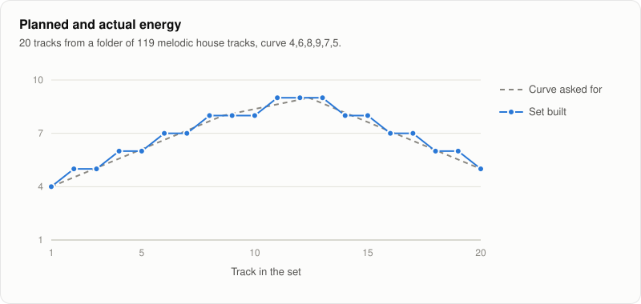
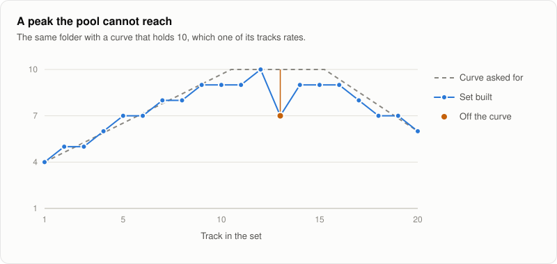

# Build a set along an energy curve

`euphoria set build` takes a pool of tracks, a folder or a playlist, and the shape you want the energy of the set to take: a slow warm up, a peak, a breather, a second peak, a landing. It picks and orders tracks from the pool so that the energy follows that shape, while every transition is a key move you allow on the [Camelot wheel](../concepts/keys-and-camelot.md) and every tempo change is small.

```
euphoria set build ~/Music/DJ --curve 4,6,8,9,7,5 --tracks 20
```

## The curve

The curve is a list of energy levels on Euphoria's [energy scale](../concepts/energy.md), from 1 to 10, spread evenly from the first track to the last with straight lines between them. `4,6,8,9,7,5` starts at 4, peaks at 9 two thirds of the way in, and lands at 5. One number makes a flat set.

Three presets cover common slots:

| Preset | Levels | For |
| --- | --- | --- |
| `warm-up` | 3, 4, 4, 5, 5, 6, 6, 7 | The opening slot: rises slowly and leaves the peak to the next DJ. |
| `peak-time` | 7, 8, 9, 8, 9, 10, 9, 8 | The headline slot: starts high and peaks twice. |
| `journey` | 4, 5, 7, 8, 6, 7, 9, 10, 7, 5 | A whole night in one set: a build, a first peak, a breather, a higher second peak and a cool down. The default. |

The energy rating is Euphoria's own scale, so a curve made for it does not carry over to the energy numbers of other tools.

## The rules every transition keeps

- **Key.** The move from one key to the next must be one of `--moves`. The default allows the same key, one step on the wheel (8A to 9A), the relative key (8A to 8B), the diagonal move (8A to 7B) and the energy boost of two steps up (8A to 10A). Add `mood-change` or `semitone-boost` for bolder sets, or narrow it to `same,adjacent,relative` for the smoothest one.
- **Tempo.** The tempo changes by at most `--max-bpm-step` beats per minute between two tracks, 5 by default.
- **Artist.** Two tracks by the same artist never follow each other, unless you pass `--allow-artist-repeats`. Artists come from the tags. "A feat. B", "A & B" and "A, B" count as both A and B. A track without an artist tag never counts as a repeat.

Smoother moves cost a little less than bolder ones, so among sets that follow the curve equally well, the one with the gentler key changes and the smaller tempo steps wins.

## Reading the result

```
 #  Key    BPM  Step  Move          Energy         Target  Track
 1   4A  125.4                       4 ━━━━──────     4.0  Artist - Title
 2   4A  124.6  -0.8  Same key       5 ━━━━━─────     4.5  Artist - Title
 3   4A  125.6  +1.0  Same key       5 ━━━━━─────     5.1  Artist - Title
 4   5A  125.8  +0.2  Adjacent       6 ━━━━━━────     5.6  Artist - Title
...
12   9A  123.8  -0.9  Energy boost   9 ━━━━━━━━━─     8.9  Artist - Title
...

Curve   ▃▄▄▅▅▅▆▆▇▇▇▇▇▇▆▆▅▅▅▄
Set     ▃▄▄▅▅▆▆▆▆▆▇▇▇▆▆▆▆▅▅▄
20 tracks, 2:08:56. Energy within 0.2 of the curve on average; every mix in key and within 5 BPM.
```

Each line is a track, with the move and the tempo step from the track before it, its energy and the energy the curve asks for at that point. Under the table, two rows of blocks draw the curve you asked for and the curve of the set, one block per track.

On standard error, a summary gives the length of the set, how far its energy is from the curve on average, and whether every mix keeps the rules.

### Planned and actual energy



This set was built from one DJ's folder of 119 melodic house tracks with `--curve 4,6,8,9,7,5 --tracks 20` and the default rules. Every track is within half a point of the curve, 0.24 on average, the largest tempo step is 1.8 BPM, and the key moves are 12 same key, 4 adjacent, one each of relative, diagonal and energy boost. The command took a quarter of a second with the tracks already analyzed.

## When the curve cannot be met

A pool cannot always give what the curve asks. A folder of deep house may have nothing above 7, and a pool split between 100 and 140 BPM has no small step between its halves. Euphoria never refuses: it builds the closest set it can and says where it falls short.

- A track more than one point from the curve is listed, with tracks in a row told together: `tracks 9 to 12 are below the curve by up to 3.0: the pool has nothing closer that mixes in.` Its energy is marked in the table and in the curve rows.
- A transition that breaks a rule is listed with what it breaks: a key move you did not allow, a tempo step past the limit, or the same artist twice. The search breaks a rule only when no set of that length avoids it, and then as few times as it can.
- When the pool has fewer usable tracks than you asked for, the set is shorter and says so. Tracks without a key, a tempo or an energy are left out of the pool and counted.



The same folder with `--curve 4,7,10,10,6`. Only one of its tracks rates 10, so the top of the set is that track and the 9s around it, and track 13 drops to 7 where no 9 that mixes in was left. The command says so: `track 13 is below the curve by up to 3.0`. Every transition still keeps the rules.

## Options

| Option | What it does |
| --- | --- |
| `<FOLDER\|PLAYLIST>` | Folders or audio files to choose from, or the name of a playlist built in the desktop app. A path that exists wins over a playlist of the same name. |
| `--curve` | Levels separated by commas, or a preset. Defaults to `journey`. |
| `--tracks` | How many tracks the set has. Defaults to 20. |
| `--minutes` | How long the set lasts. The track count is this length divided by the median length of the tracks in the pool, as if each played in full, so a set mixed with long blends ends up shorter. |
| `--first`, `--last` | Open or close the set with this track. It joins the pool if it is not in it. |
| `--max-bpm-step` | The largest tempo change between two tracks. Defaults to 5. |
| `--moves` | The key moves allowed, separated by commas: `same`, `adjacent`, `relative`, `diagonal`, `energy-boost`, `mood-change`, `semitone-boost`. |
| `--allow-artist-repeats` | Let two tracks by the same artist follow each other. |
| `--json` | Print the set as JSON, with every transition and every deviation. |
| `--m3u` | Also write the set as an M3U8 playlist, which nearly every DJ and music program opens. `--force` replaces an existing file. |

The tracks are analyzed first, or read from the cache when they were analyzed before, and the analysis options of [`euphoria analyze`](../reference/cli.md#euphoria-analyze) apply. A key or tempo you corrected in the desktop app is used in place of the detected one.

## How it chooses

Ordering tracks so that every pair mixes is a search over far too many orders to try: 30 tracks from a pool of 500 can be chosen and ordered in about 10<sup>80</sup> ways. Euphoria scores a set by how far each track is from the curve (the square of the difference, so one track three points off counts more than three tracks one point off), plus a small cost for each key move and tempo step, plus a large penalty for each broken rule.

It first works out, for every track at every position, the lowest cost of finishing the set from there if tracks were allowed to repeat. That is exact and fast, and it can only be lower than the true cost. A beam search then builds the set one track at a time, keeping the 256 most promising partial sets ranked by their cost so far plus that estimate of what is left, so it sees the peak coming and saves the right tracks for it. A last pass tries swapping two tracks, moving one, and putting an unused track in place of one in the set, and keeps every change that lowers the cost.

The same pool and options always give the same set. On a pool of 500 tracks and a set of 30, the search takes 30 to 60 milliseconds on an Apple M5 with every core busy. On small pools where every order can be checked, the tests confirm it finds the best set.

The JSON output has `cost` and `lower_bound`: the cost of the set, and the cost no set can go below, from the first step. The closer they are, the nearer the set is to the best possible.

## Compared with other tools

The desktop app suggests the next track from the one playing, one step at a time, which suits a DJ who decides as they go. The set builder plans the whole set at once, so it saves high energy tracks for the peak instead of spending them early.

## Limits

- Energy is one number per track. A track with a long breakdown counts as its average. The [energy curve of each track](../concepts/energy.md#energy-curve) is not yet used.
- Tracks are placed evenly along the curve, whatever their length.
- Half and double tempo mixes, such as 70 into 140, are not considered.
- Not tested: how DJs rate the sets against sets they built by hand.
