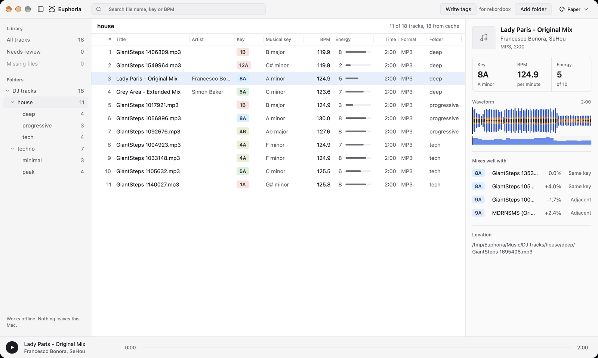

# Desktop app

The desktop app shows your library as a table: add folders, watch each track get its key and tempo, then sort, search and find tracks that mix together. It uses the same analysis as the command line tool, so both give the same answers.

The app is an early version. It runs from a source checkout on macOS; there is no download yet.

## Run it from source

Install the requirements in [building from source](../development/building.md). On macOS you also need Xcode, which provides the Metal shader compiler the interface is built with. Then:

```
cargo run --release -p euphoria-app
```

Use `--release`: analysis is many times slower in a debug build.

## Add music

On first launch the window shows a drop zone. Drop a folder, or several folders and files, from Finder onto the window, or click **Choose folder**. Later, use **Add folder** in the toolbar, **File > Add Folder** or Command O.

Folders are searched all the way down for MP3, M4A, FLAC, WAV and AIFF files. A track Euphoria has analyzed before is filled in at once. Every other track appears as a row marked "Queued", changes to "Analyzing" when its turn comes, and fills in when its analysis finishes. The toolbar shows how many are done, for example "12 of 340 done". A file that could not be analyzed counts as done.

The app analyzes as many tracks at once as your computer has cores, up to 4. The command line tool goes up to 8 by default and lets you choose. See [large libraries and memory](analyze-your-library.md#large-libraries-and-memory).

Your files are only read, until you choose to [write tags](#write-tags) into them.

## The track table

| Column | Shows |
| --- | --- |
| Title | The title in the file's tags, or the file name when there is none |
| Artist | The artist in the file's tags |
| Key | The Camelot code, coloured by its number |
| Musical key | The key by name, such as A minor |
| BPM | The tempo, to one decimal |
| Energy | The [energy rating](../concepts/energy.md) from 1 to 10, with a bar |
| Time | The length |
| Format | The file type |
| Folder | Where the file is, from the folder on show |

The Folder column shows the path from the folder chosen in the sidebar to the file's own folder. With `DJ tracks` chosen, a file in `DJ tracks/afro_house/warmup` shows `afro_house/warmup`; with `afro_house` chosen, it shows `warmup`; a file directly in the chosen folder shows a dash. Under **All tracks** the path starts inside the folder you added, with that folder's name in front when you added more than one. The column grows to fit the longest path on show, as long as the title keeps room; a path still too long keeps its last folder names in view, and pointing at it shows the whole path. Sorting by Folder groups the files folder by folder, in the order of the sidebar.

Titles and artists are read from the files after they appear, so the file name shows for a moment first. Pointing at a title shows it in full.

### Resize the columns

Drag the line between two column headers to make the column on its left wider or narrower; the pointer turns into a resize arrow over it. Double click the line to fit the column to its longest text among the tracks on show. Each column has a narrowest width, so a key, a tempo and an energy bar always stay readable. **View > Reset Column Widths** returns every column to its usual width.

Until you resize them, Title and Artist share the room the other columns leave, and Folder is as wide as its longest path. In a narrow window, or when the widths you chose do not fit, the table leaves columns out rather than squeezing the title: first Format, then Folder, Artist, Time, Musical key and the row number. The title, key, tempo and energy always stay.

Click a column header to sort by it, and click again to reverse the order. Sorting by key follows the Camelot wheel: by number, then the minor key (A) before the major key (B). Tracks with no value in the sorted column come last.

Type in the search field, or press Command F first, to filter as you type. Each word must match part of the file name, the title or the artist, the whole key code (`8a`), or the start of the tempo (`124`).

Click a row to select it. The arrow keys, Page Up, Page Down, Home and End move the selection. Command click adds a track to the selection or takes it out, Shift click selects every row between, and Command A selects every track on show.

## The sidebar

- **All tracks** shows the whole library.
- **Needs review** shows the tracks that could not be analyzed, within the folder on show when one is chosen. Its count follows that folder.
- **Missing files** is a placeholder and always shows 0.
- **Folders** shows each folder you added as a tree of the folders inside it, to any depth, with the number of tracks in each, counting the folders inside it. Folders with no audio files anywhere inside them are left out.

### Browse your folders

Click the triangle beside a folder to show the folders inside it, and again to hide them. Click a folder to show its tracks in the table, including those in the folders inside it; the heading above the table names it. Search and sorting work inside the chosen folder. **All tracks** shows everything again.

The tree lists folders only. The table is the list of files, with their key, tempo and energy, and the Folder column says where each file sits inside the chosen folder.

After clicking a folder, the keyboard moves through the tree:

| Key | Does |
| --- | --- |
| Up and Down | Show the folder above or below |
| Right | Show the folders inside, or go to the first of them when they are already shown |
| Left | Hide the folders inside, or go to the folder holding this one |
| Home and End | Show the first or the last folder listed |

A long folder name is cut short; point at it to read the full path. When the tree is taller than the window, it scrolls.

If you add a folder that is inside a folder you already added, it appears in the outer folder's tree rather than a second time.

To give the table more room, fold the sidebar away. Any of these folds it, and the same one brings it back:

- the sidebar button at the left of the toolbar, beside the window buttons, which stays there while the sidebar is folded
- Control Command S (Control Alt S on Linux and Windows)
- **View > Hide Sidebar**, which reads **Show Sidebar** while it is folded

## The inspector

The inspector shows the selected track: its name, format and length, its key, tempo and energy in three boxes, and its waveform. The waveform is read from the file when you select the track.

**Mixes well with** lists up to eight other tracks in your library whose key mixes with the selected one and whose tempo is within 6 percent: the same key, the keys one step either way on the Camelot wheel, and the relative major or minor. The smoothest key moves come first, then the closest tempos, then the closest energy. Each row shows the key, the name, how much faster or slower the track is, and how the keys relate. Click a row to go to that track. [Keys and the Camelot wheel](../concepts/keys-and-camelot.md) explains these moves.

### Resize the inspector

Drag the left edge of the inspector to make it wider or narrower. The pointer turns into a resize arrow over the edge. The waveform, the three boxes and the list of mixes follow the new width. Double click the edge to return to the usual width.

| | Width |
| --- | --- |
| Usual | 320 |
| Narrowest | 288 |
| Widest | 640, or less when the window is small: the table always keeps at least 400 |

In the Deck theme the track detail is a strip under the table, and you drag its top edge to change its height in the same way. The waveform grows with the strip, and a taller strip lists more mixes. The strip is 180 high to begin with, and goes from 124 to 420, always leaving at least 200 for the table.

A size you chose in a large window is kept when the window gets smaller. It is only drawn smaller while the window has no room for it.

## Listen to a track

Select a track and press Space, or click the round play button, to hear it. Press Space again to pause. Playing starts at once, however long the track is, and carries on while other tracks are being analyzed. Space types a space as usual while you are in the search field.

- Selecting another track while one is playing switches to it. While paused or stopped, selecting a track only gets it ready.
- The position and the length are shown as "2:23 / 6:48".
- When a track reaches its end it stops there. Play starts it again from the beginning.

In most themes the player is a bar along the bottom of the window, with the play button, the track, the position, a thin progress line and the length. In the Deck theme the play button and the position sit in the strip under the table, beside the wide waveform.

If a track cannot be played, the player says why in a few words, for example "This file is no longer there" or "No audio output to play through", and everything else keeps working.

## The waveform

The waveform shows the whole track from left to right, and its colours show what is sounding:

| Colour | Band | Typical sounds |
| --- | --- | --- |
| Blue | Bass, below 200 Hz | Kick drums and bass lines |
| Amber | Middle, 200 Hz to 2.5 kHz | Vocals, chords and snares |
| White, or near black in the Paper theme | Treble, above 2.5 kHz | Hi hats and cymbals |

The three are drawn on top of one another, bass at the back, each as tall as that band is loud. A stretch with a kick is tall and blue, a breakdown without drums loses its blue and shrinks to amber, and hi hats show as light tips.

The waveform is also where you move through the track. A line marks where playing is, and the part already played is fainter. Click anywhere on the waveform to jump there, or hold the button and drag. The progress line in the player bar works the same way. Before you press play, a click sets where playing will start.

### Energy over time

Under the waveform, across the same width, a row of bars shows the [energy curve](../concepts/energy.md#energy-curve): the energy rating from 1 to 10 of each stretch of about 4 seconds, as tall as the rating. Breakdowns show as low bars and drops as a jump back to full height, right under the part of the waveform they belong to. Silent stretches have no bar. The playhead runs through the curve too, and the part already played is fainter. The curve is worked out from the same decoded audio as the waveform, so it appears a moment after it. When it cannot be worked out, the row says "Energy over time not available", and pointing at it shows why.

### Key changes

When a track changes key, a strip under the energy curve shows each stretch in its key's colour with its Camelot code, aligned with the waveform. Point at a stretch to read its key and where it starts and ends. Silences between stretches stay empty. A track that stays in one key shows no strip, since its key is in the box above. For now the strip is also left out when the track's key is none of its stretches or a stretch is shorter than 30 seconds, because such a timeline can contradict the key above it.

## Write tags

The app can write the key, tempo and energy it found into the files themselves, with the same safety as [`euphoria tags write`](write-tags.md): you see every change before anything is written, and one step puts the old tags back.


1. Select the tracks to write, or choose a folder in the sidebar.
2. Click **Write tags** in the toolbar, or choose **Tags > Write Tags…** (Command Shift T). The DJ program the tags are written for is shown beside the button.
3. The preview lists every file that would change, each field with the value it has now and the value it would get. **Selected tracks** and **All shown** switch between the selection and every track the table shows, such as a whole folder. Files that already hold the values, tracks not analyzed yet and files that cannot be written safely are counted or listed with the reason.
4. Click **Write** to write them. Nothing is written before that, and **Cancel** or Escape closes the preview without writing.
5. The app shows how far it has got, then the files written and any it could not write, with the reason. Those are left as they were.

**Undo this write**, **Tags > Undo Last Tag Write…** or the button in the settings puts back the exact tags the last write replaced, after asking. The app and `euphoria tags undo` share their backups, so either undoes a write the other made.

Each file written, and each file put back by an undo, is recorded in the [analysis cache](../reference/cli.md#the-analysis-cache) as it is, so it is not analyzed again the next time the app starts.

## Settings

Open the settings with **Euphoria > Settings…** (Command comma), or click the program name beside **Write tags**.

| Setting | Choices |
| --- | --- |
| DJ program | rekordbox, Serato, Traktor, Engine DJ, VirtualDJ, Mixxx, or any program. Tags are written to the fields that program reads; [Use Euphoria with your DJ program](dj-programs.md) lists them. |
| Key notation | Camelot (8A), musical (Am) or Open Key (1m), in the key field and in the label. |
| Energy label | At the start of the comment, at its end, at the start of the grouping, or nowhere. |
| Tempo | Whether the tempo is written. Choosing Serato unticks it, because Serato detects the tempo itself only for files that have none; you can tick it again. |

## When a file fails

A file that cannot be analyzed stays in the table with **Failed** in its key column and is counted under **Needs review**. Select it to read the reason in the inspector. The other files carry on.

## Themes

Choose a theme from the menu at the right of the toolbar, or from **View > Theme**.

| Theme | Looks like |
| --- | --- |
| Slate | Dark grey with a blue accent. The default. |
| Paper | Light with a blue accent. |
| Deck | Slate colours, with the track detail and the player in a strip under the table and a wide waveform. |
| Graphite | Warm dark grey with an amber accent, compact rows, and keys as coloured text. |
| Key first | Slate colours with solid key chips, a Camelot wheel in the inspector, and the table sorted by key. The wheel has the minor keys (A) on its inner ring and the major keys (B) on its outer ring; the selected track's key is filled in the accent colour and the keys that mix with it, its neighbours and its relative major or minor, in a lighter tint. |




## What the app remembers

The folders you added, the theme, whether the sidebar is folded, the sizes you gave the inspector and the Deck strip, the folders you opened in the tree, the folder on show, the column widths you chose and the tag writing settings are kept in `settings.json`. The backups of tag writes are kept in the `tag-writes` folder beside it:

| System | Folder |
| --- | --- |
| macOS | `~/Library/Application Support/euphoria` |
| Linux | `$XDG_DATA_HOME/euphoria`, or `~/.local/share/euphoria` |
| Windows | `%APPDATA%\euphoria` |

Set the `EUPHORIA_DATA_DIR` environment variable to keep it somewhere else.

Files dropped on their own, outside a folder, are not remembered. If the folder that was on show is gone the next time, for example on a drive that is not connected, the app starts on **All tracks**.

## Remembered results

The app keeps each finished analysis in the same folder, in the cache the command line tool also uses. A track analyzed once, by the app or by `euphoria analyze`, is not analyzed again: when the app starts, the remembered folders are searched and their known tracks are filled in within a moment. Only new or changed files are analyzed. A file that was moved or renamed is recognised by its content when its turn comes.

The count above the table says how many tracks were filled in this way, for example "48 tracks, 44 from cache".

If the cache cannot be opened, the app says why in a notice along the bottom of the window and analyzes without it, so results are not remembered until the problem is fixed. `euphoria cache clear` resets a damaged cache. The [command reference](../reference/cli.md#the-analysis-cache) explains how files are recognised and when a track is analyzed again.

## Quitting

You can quit while tracks are being analyzed. The app closes at once: tracks already finished are remembered, and the ones that were waiting or in progress are analyzed the next time the app starts.

## Build Euphoria.app

A binary started with `cargo run` has no Dock icon of its own. To get an application with the Euphoria icon that you can keep in the Dock, build a bundle on macOS:

```
./scripts/bundle-macos.sh
open target/release/bundle/Euphoria.app
```

The script builds the app in release mode, makes the icon from `assets/logo` and writes `target/release/bundle/Euphoria.app`. The bundle is meant for the computer that built it: it uses the libkeyfinder installed there and is not signed.

## Try it without music

To see how the interface behaves with a large library, start the app with made up tracks. Their keys and tempos are invented and nothing is analyzed:

```
EUPHORIA_DEMO_TRACKS=10000 cargo run -p euphoria-app
```

## About the screenshots

The screenshots on this page and in the README show a demo library of GiantSteps Key previews, the clips the benchmarks use, never anyone's own music. [`make_screenshots.py`](https://github.com/lvndry/euphoria/blob/main/docs/images/desktop-app/make_screenshots.py) builds that library, runs the app on it and captures the window again when the app changes.

## Not there yet

- Cue points, and the reference tone for checking a key by ear.
- Exporting to DJ software from the app; `euphoria export rekordbox` does it from the command line.
- Filters for key and tempo ranges.
- Linux and Windows builds: the app is only built and tested on macOS so far.
