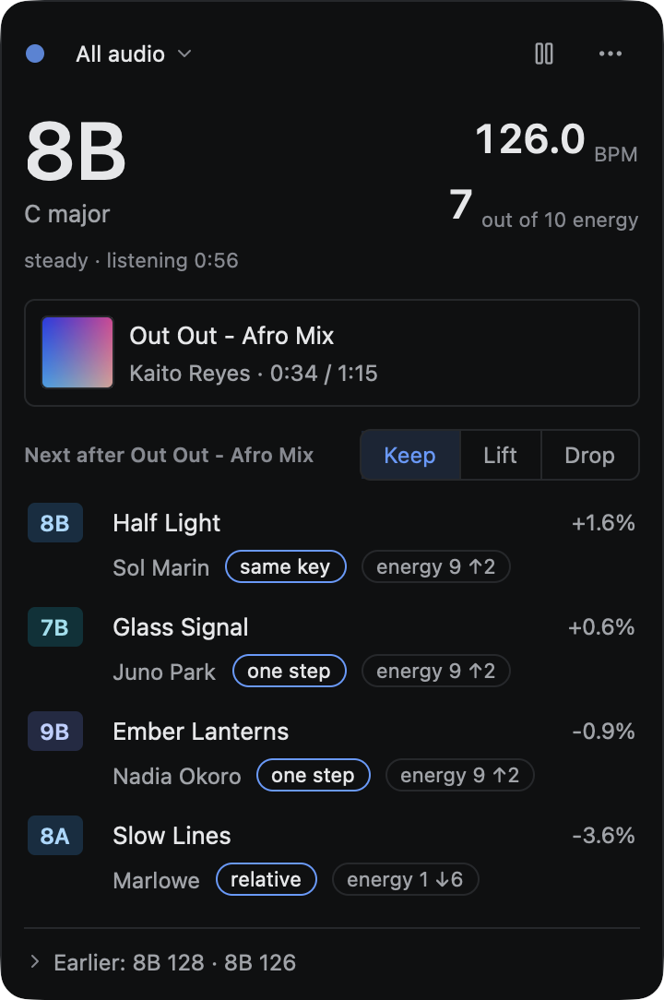

# Euphoria Live

Euphoria Live listens to the audio your Mac is playing and shows its key and tempo as it plays. It works with any source: rekordbox, Spotify, YouTube in a browser, a turntable through an audio interface that macOS plays out.



## Open it

- **In the app:** the **Live** button in the toolbar, **View, Live** (Shift Command L), or Command K and "Open Euphoria Live".
- **In the menu bar:** once Live has been started, Euphoria keeps an item in the macOS menu bar. Its title is the key heard, such as `8B`, or "Live" while it has nothing to show, and "Live paused" when paused. Click it to show or hide the Live panel. Right click it, or Control click, for a menu: Show Live, Pause listening, Keep Live running when the window is closed, Open Euphoria and Quit Euphoria.
- **Without the library window:** `open -a Euphoria --args --live` starts Euphoria with only the menu bar item and the panel, and no Dock icon.
- **In a terminal:** `euphoria live`, below.

Opening Live starts listening. The first time, macOS asks for permission, described below.

## The panel

The panel is a small window that stays on top of other windows, so it can sit beside rekordbox.

- **Listening** with a red dot, and "Nothing is recorded", whenever Euphoria is listening. When paused the dot is grey and the panel says "Not listening".
- **Listen to** chooses what is heard: *All audio*, or one of the applications playing audio right now, such as rekordbox. The list is read when you open it. Euphoria's own playback is never heard.
- **The key**, big, in the notation you chose in the settings, with its musical name and its confidence: high, medium or low. Below it the **BPM**, the **energy** from 1 to 10, and a level meter.
- **Next** lists the tracks of your library that mix in after what is playing, with the same ranking, the same Keep, Lift and Drop choice, the same pills and the same filters of the suggestion pool as the "Next after" list of the main window. It ranks from the key and tempo heard, so it works for Spotify or YouTube too; no library track needs to match. Tracks the cache has no analysis for are left out.
- **Scrolling.** The Next list scrolls with the trackpad, the mouse wheel and a scrollbar while the readout and the controls stay put, and the panel can be resized down to a minimum height. Up and Down move through the rows and keep the row in view; Enter opens it in Euphoria.
- **Click a track** in the Next list, or the **In your library** card, to open it in Euphoria: the library window comes up, or is opened again if it was closed (and the Dock icon returns), the track is selected in the table and shown in the inspector, with any search, filter, folder or playlist that hid it taken off. Nothing is played in Euphoria, because the music is playing in another app. When a track is recognised, the menu bar menu also has **Show <title> in Euphoria**.
- **Pause listening** stops the capture and forgets the audio; **Start listening** resumes.
- **Keep Live running when the window is closed**, **Open Euphoria** and **Quit Euphoria** are at the bottom.

When the audio is silent or too quiet, or just started, the panel says "Listening…" and shows no key, no tempo and no list: nothing is guessed or kept from before.

## Part of the app, in the menu bar

Live is part of Euphoria, not a second app. Close the library window and Live keeps running in the menu bar, with its panel if you left it open, so you can close the library and keep Live beside rekordbox. **Open Euphoria** in the panel or the menu bar menu opens the library window again.

**Keep Live running when the window is closed** is on by default, and counts once Live has been started. Turn it off and closing the library window quits Euphoria, as before. It is kept in a file of its own, `live.json`, beside the settings. The panel on its own never keeps Euphoria open: only the menu bar item does.

While only Live runs, no library table, waveform or analysis worker exists. The library is read from the analysis cache the first time the Next list is shown, once, and nothing is analyzed. Measured on an Apple silicon Mac, with a build of the `fast` profile, listening to a generated track with the library window closed: about 6 percent of one core while analyzing, near zero while the audio is silent, and about 140 MB of memory with the panel closed and about 170 MB with it open and the library of 40 tracks read. Most of that memory is the window system, not the analysis: `euphoria live` in a terminal needs 65 to 90 MB.

## Privacy

**The audio never leaves memory.** Live keeps the last 25 seconds or so of audio in a buffer in memory, reads the key, tempo and energy from it every two seconds, and overwrites the oldest audio as new audio arrives. Nothing is written to disk, nothing is sent anywhere, and the buffer is emptied when you pause, when listening stops and after two seconds of silence. Euphoria does not listen to its own playback.

macOS shows its own indicator while an app hears system audio, and Live adds its own: the red "Listening" dot in the panel and the key in the menu bar whenever it is on, and in the terminal a line saying what it listens to.

## What macOS asks

Live uses a Core Audio *process tap*, which macOS 14.2 (December 2023) added to let an app hear what other apps play. The first time you start listening, macOS asks whether Euphoria may hear the audio of other applications. The text reads "Euphoria Live listens to the audio playing on this Mac to show its key and tempo. The audio stays in memory and is never recorded, saved or sent anywhere." Allow it once; macOS remembers the answer, and you can change it under System Settings, Privacy & Security, Screen & System Audio Recording.

If you refuse, macOS does not report an error: the tap delivers silence. Live then shows "Listening…" and, after ten seconds of exact silence, a hint to check that setting.

Before macOS 14.2 Live says it needs macOS 14.2. The alternative, ScreenCaptureKit, needs the Screen Recording permission, which macOS describes as recording the screen, and its audio capture needs a screen to be shared. That prompt is a poor fit for a tool that never touches the screen, so Euphoria asks for a newer macOS instead.

Linux is not supported yet. A PipeWire or PulseAudio monitor source would be the equivalent and can use the same analysis.

## From the terminal

```
euphoria live
```

`euphoria live` prints one line per update once enough audio has played:

```
$ euphoria live
Listening to All audio. Nothing is recorded; press Ctrl-C to stop.
listening…
8A  A minor  124.0 BPM  high
8A  A minor  124.0 BPM  high
```

The key appears after about 8 seconds of audio and the tempo after about 6. The confidence is that of the key (`low`, `medium` or `high`, as in [the analysis](../concepts/accuracy.md)). When the audio goes silent or too quiet, `listening…` is printed once, and values are never repeated from before. Ctrl-C stops it.

| Option | Meaning |
| --- | --- |
| `--source <name>` | Listen to one application, by the start of its name, such as `rekordbox`. It must be playing audio. Without it, everything the Mac plays is heard except Euphoria. |
| `--interval <seconds>` | Seconds between two readings, 0.5 or more. The default is 2. |
| `--json` | One JSON object per line, for scripts and stream overlays. |

With `--json`, a line is `{"listening":true}` or an object with `source`, `key` (`camelot`, `name`, `confidence`, or `null`), `bpm`, `bpm_confidence`, `energy` and `level_db`.

macOS asks for permission for the program that runs `euphoria`, so from a terminal the prompt names your terminal app.

## How it reads the audio

- **Key:** the drone-v2 network, on the last 25 seconds, every two seconds, with its confidence.
- **Tempo:** the tempo detector on the last 12 seconds, folded into 90 to 180 BPM.
- **Energy:** the energy rating of the last 12 seconds, on the scale of [energy](../concepts/energy.md).
- **Silence:** audio below about -50 dBFS counts as silence. Nothing is shown then, and after two seconds of it the buffer is emptied, so a new track is read on its own and no old value is shown.

Measured on an Apple silicon Mac with a build of the `fast` profile, which is optimised like a release: listening costs about 5 percent of one core at a two second interval, with the buffer full, and about 65 to 90 MB of memory.

## Recognising a track of your library

When what plays is a file in your library, Live says which one and where in it, and the Next list ranks from that track's own key, tempo and energy instead of the ones heard. The panel shows an **In your library** card with the title, the position, and how the track is played: for example "+6.0%, key lock", or "-4.0%, pitch follows" for a turntable or a pitch fader without key lock. In a terminal, add `--from` and `euphoria live` prints `matched: <path>` when it recognises a track, and `--json` adds a `match` object with `path`, `position_seconds`, `tempo_ratio` and `pitch_follows_tempo`.

```
euphoria live --from ~/Music/DJ
```

Without a match, Live ranks from the key and tempo it hears, so Spotify and YouTube work as before.

**Learning the library.** The first time, Euphoria decodes each analyzed track of the library once to make its fingerprint and keeps it in the analysis cache, in a table of its own that never touches an analysis, so nothing is analyzed again. In the app this runs in the background, one track at a time at about a third of a core, and the panel says "Learning your library to recognise tracks: 120 of 800" until it is done; tracks are recognised only after that. `euphoria live --from` does it before it starts listening. Tracks the cache has no analysis for are left out in the app. Moving or retagging a file does not make its fingerprint again, because it is kept under the content of the file.

**How it works.** The audio is brought to 8 kHz, and the spectrogram is searched for peaks louder than everything near them in time and frequency, above 190 Hz so the kick and bass that repeat in every four on the floor track do not match tracks to each other. Pairs of nearby peaks are hashed from their two frequencies and the time between them, so a hash does not depend on level, on where in the track it sits, or much on what else plays. Matching counts, per track and offset, how many hashes agree: at least 8, at least 5 percent of the query's hashes, and twice the next track's.

**Played faster or slower.** DJs play tracks at plus or minus 8 percent, with the pitch following the tempo or, with key lock, staying put. Both move the time between two peaks, and the first moves their frequencies too, so a plain hash would never match. The peaks of the last 15 seconds are moved as each tempo change from 90 to 110 percent in steps of 2 would move them, with the pitch following and without, then hashed and matched; the step that agrees with the most hashes wins, and its tempo change names how the track is played. Frequencies are hashed on a log scale and a gap that is a frame off is tried too, so an off-grid tempo such as +5 percent still matches. A moved match needs 7 percent of the hashes to agree where a track at its own speed needs 5, because it is one of 21 tries.

**Accuracy**, on generated tracks: 10 tracks of 60 s with random melodies over a kick, 15 s excerpts, an index thinned as the cache stores it (a quarter of the hashes). A track is right when it is found and the position is within half a second, or 0.6 s when played at another speed.

| Query | Right | Wrong track |
| --- | --- | --- |
| The same audio | 30 of 30 | 0 |
| Gain of -18 dB or +12 dB | 30 of 30, both | 0 |
| Captured at 48 kHz, tracks stored at 11 kHz | 30 of 30 | 0 |
| Mixed with a second track at -10 dB | 28 of 30 | 0 |
| Mixed with a second track at -3 dB, either track counts as right | 14 of 30 | 0 |
| Key lock, -8, -5, -3, +3, +5, +7 and +8 percent | 15 of 15 at each | 0 |
| Pitch follows tempo, -8, -5, -3, +3, +7 and +8 percent | 15 of 15 at each | 0 |
| Pitch follows tempo, +5 percent | 14 of 15 | 0 |

The tempo rows use 5 tracks at 3 positions. Twelve generated tracks that are not in the library matched nothing, nor did silence or noise. Through the real process tap, a generated track played by `afplay` at 0.92, 0.94, 1.06 and 1.08 times its speed, which keeps the pitch, was recognised as the right file each time, and at its own speed too. Real music, a remix of a library track, and turntable playback through the tap are **not tested**.

**Cost.** About 71 hashes per second of audio; the cache stores a quarter of them, 18 per second, 8 bytes each: 43 KB for a five minute track, 430 MB for 10,000 tracks on disk. In memory the index is one sorted list of 8 bytes a hash, capped at 16 million hashes (128 MB), thinned further when the library is larger, which costs recall; a library over about 16,000 tracks is not indexed beyond that count. Fingerprinting 15 s of live audio takes about 3 ms. Searching 15 s at all 21 tempos takes about 70 ms with a library of 1,000 tracks and 280 ms with one of 10,000 on an Apple silicon Mac, once every three readings, about 6 seconds, which is about 5 percent of a core on top of the 5 percent of the analysis. The first pass over a library costs a decode of every track: the app spreads it out; `--from` runs it at full speed.

## Limits

- **A mix of two tracks gives a blended key.** While two tracks play together, the key of the 25 seconds is that of the blend, with a lower confidence, and the tempo may sit between the two. Wait for the transition to finish.
- **A new track takes about 8 seconds** to show a key, and a key change takes longer than that to show, because the key is read from 25 seconds.
- **Not tested with every source.** It is tested with generated tones and kick patterns, with a generated track played by `afplay` and heard through the process tap (126 BPM and C major came back right, with the tap read at the output device's rate), and by hand against music playing on the Mac that built it. Sources that play through another device than the default output, Bluetooth outputs and rekordbox itself are not tested.
- **Recognition needs a learned library and a track at its own tempo, within 10 percent.** Tracks beyond 10 percent, loops, edits and remixes are not recognised, and two tracks mixed at about equal level are recognised only part of the time.
- **Process names are those macOS knows.** A browser plays audio from a helper process, so `--source` must name that process.
