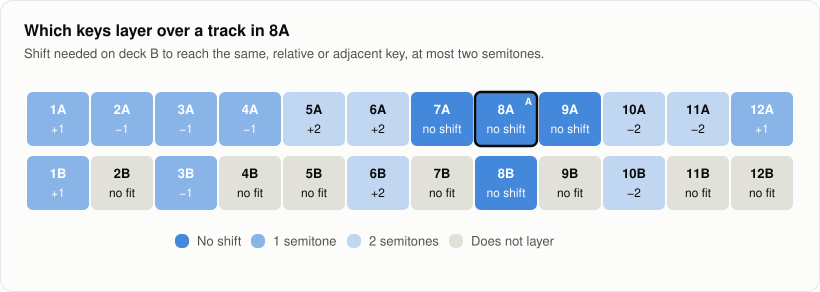

# Mashups

Mashup mode in the desktop app's decks finds tracks that work layered on top of the track on deck A, playing at the same time rather than one after the other, plays the pair in time with the key shift and stems each idea needs, and renders the result to a WAV file. Your tracks are only read, never changed.

## Open mashup mode

Open the decks (**Decks** in the toolbar, **View > Decks** or Command Shift D), load a track on deck A, and click **Mashup** above the list under the decks (**Mix** goes back to the tracks to play next). The list is titled **Layer over deck A**. **Whole library**, **Tracks shown** and a button per playlist choose where ideas come from, as for the mix suggestions.

## How ideas are found

### Key

Two layered tracks sound together for the whole mashup, so the key has to fit more closely than for a mix: only the same key, the relative key (same notes, minor and major swapped, such as 8A and 8B) and the adjacent keys (one step on the Camelot wheel, sharing six of seven notes, such as 7A and 9A) count. When a track is not in one of those keys, deck B's pitch can be shifted by up to two semitones, without changing its tempo, to bring it there. The idea says which shift, for example "Shift B down 2 semitones: 10A becomes 8A, the same key as A". A smaller shift is preferred, since every shift changes the sound a little.

With two semitones either way, every minor key reaches 8A or one of its neighbours, while seven of the twelve major keys stay out of reach, since a major key layers with 8A only as its relative, 8B, and only the major keys within two semitones of 8B get there.

### Tempo

Deck B is stretched to deck A's tempo, so the tempos have to be within 8 percent, which a stretch hides well. A track at half or double the tempo counts too, counted at the other tempo. Tracks without a detected tempo are left out, since they cannot be beatmatched.

### Stems

When both tracks have been separated into stems (vocals, drums, bass and other) the ideas also say how they layer: the vocals of one track over the instrumental of the other, usually the vocals of B over the instrumental of A, but the other way round when deck A's track has the vocal and B is an instrumental. Euphoria measures where in the frequency range each stem sits, in octaves from 63 Hz to 8 kHz, and ranks an idea lower when the vocal sits in the same range as the other track's chords and leads (the "other" stem). The reason says how much they overlap, for example "they sit in different ranges (12% overlap)". A track whose own vocal has to be muted ranks a little lower than a true instrumental, since a muted vocal leaves traces. Two tracks without vocals can layer too, but rank lower, since their drums and bass double up. When either track has no stems, the idea says "Stems not compared". Stems separated in an earlier session are found in the stem cache in the background when mashup mode opens; separate a track from the track detail to add it.

### Ranking

Ideas are ordered by a cost that adds the key relation, the shift, the stretch, how the stems layer and the energy difference; the order is a starting point for your ears, not a verdict.

## Try an idea

Click an idea to put it on deck B, or use the arrows **‹** and **›** beside the count to step through them. Deck B gets the shift the idea asks for, and when both tracks have stems, deck B plays only the part the idea uses (its vocals, or its instrumental) and deck A the other part. **Play both** starts both decks with deck B's downbeats on deck A's. Sync to A stays on, so deck B plays at deck A's tempo.

## Adjust each deck

Under each deck, **Key** with **−** and **+** shifts that deck by a semitone at a time, up to 6 either way, and shows the key it is shifted to. When the track has stems, **Full**, **Vocals** and **Instrumental** choose what the deck plays, and a fader for each of **Drums**, **Bass**, **Other** and **Vocals** sets its level. Shifting deck A finds ideas again for its new key. Shifts and stem levels change at once while the deck plays; switching between **Full** and stems opens the deck again where it is, in time with the other deck.

## Export the mashup

**Export mashup…** asks where to save a WAV file and renders both decks into it: each deck from the downbeat at or before where it is (so cue each deck where the mashup should start), at its tempo, key shift, stems and fader level, until the longer of the two ends. The file is 24 bit stereo at 44.1 kHz. When the two layers together would clip, the whole file is turned down to 1 dB below full scale, and the message after the export says by how much. The tracks and their stems are only read; choosing one of them as the output is refused.

## Limits

- Layered keys are judged by key and mode only; the finder does not look at melodies or chord progressions.
- Bars line up only when both tracks have a beat grid from analysis, as on the decks.
- The vocal range check needs both tracks separated, which takes a while per track.
- The export starts both tracks at a downbeat together; it does not arrange sections, add fades or loop a part.
- How good a given mashup sounds has not been tested by listening on a range of real tracks: the ranking is checked by unit tests with made up keys, tempos and stem profiles, and the timing of the export by tests with click tracks, where the beats of a stretched layer land within 3 ms of the other's.
