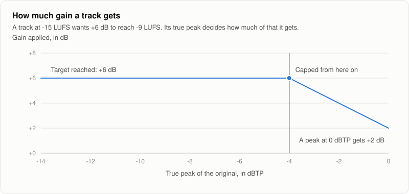

# Prepare files for a club system

Tracks come at very different levels. A quiet old record next to a loud modern master means the DJ rides the gain all night, or one of them sounds weak on the system. **Prepare files** writes copies of your tracks that all play at the same loudness, and that cannot clip on the way, so the faders can stay where they are.

```
euphoria prepare ~/Music/Friday --dry-run
euphoria prepare ~/Music/Friday --out ~/Music/Prepared
```

The first command measures every track and prints what would change. The second writes the copies.

## Why loudness matching matters in a club

A club system is set once, and the limiter of the house amplifier is set to protect the speakers. When a track is 5 LU quieter than the one before it, it loses a lot of its weight on the floor, and the usual answer is to push its channel fader up. When a track is louder, the answer is to pull it down. Both fix the level by hand, mix after mix, and push the master toward its limiter.

Integrated loudness, measured as [EBU R128](https://tech.ebu.ch/publications/r128) describes and reported in LUFS, is the closest single number to how loud a whole track feels. Two tracks at the same LUFS sit at the same level to the ear, whatever their peaks look like. A set at -9 LUFS needs no fader riding between tracks, and leaves the same headroom on the master for every one.

The second half of the job is the peak. Raising a quiet track by 6 dB can push its peaks past full scale, and a converter or a codec downstream then clips them, even when no sample is above 0 dB: the wave between two samples can reach higher than either. The **true peak** measures that, with four times oversampling, in dBTP. Prepare files keeps it under a ceiling, -1 dBTP by default, with a look-ahead limiter.

## What each option does

| Option | Default | What it does |
| --- | --- | --- |
| Loudness | -9 LUFS | The integrated loudness every track is brought to. -14 matches streaming services, -11 is a moderate club level, -9 a loud one and -7 the loudest. |
| True-peak ceiling | -1 dBTP | The level the true peak never passes. |
| Limiting allowance | 3 dB | The most the limiter may turn peaks down. |
| Tuning correction | off | Shifts tracks that are tuned off A = 440 Hz back to concert pitch. |
| Suffix | ` (prepared)` | Added to the name of each copy, before the extension. |
| Lossy sources become | FLAC | MP3, AAC and Ogg tracks are written as FLAC or WAV, your choice. |

**Loudness matching.** Each track is measured, and the gain that brings it to the target is applied. A track already louder than the target is turned down.

**True-peak limiting.** The limiter looks 2 ms ahead, turns the gain down just before a peak that would pass the ceiling, and lets it back up over about 80 ms, so it only acts where it is needed and a track that never reaches the ceiling is not touched. It reports how many dB of limiting each file needed.

**The limiting allowance.** A track whose peaks are very high for its loudness would need heavy limiting to reach the target, and heavy limiting is audible. Prepare files never pushes a track that would need more than 3 dB of limiting. It gives the track less gain instead, so it ends quieter than the target, and says so: the dry run marks it `gain capped`. The chart shows the rule for a track at -15 LUFS that wants +6 dB. Raise the allowance if you accept more limiting.



**Tuning correction.** When the analysis measured a track as off 440 Hz by 3 cents or more, the track is shifted back to concert pitch with the same high quality pitch shifter as [Shift key](../reference/cli.md#euphoria-shift). The shift is smaller than half a semitone, and the tempo does not change. It needs an analysis of each track, so it takes longer; results are cached like any other analysis. Leave it off for tracks played on instruments that were meant to be tuned differently.

**Clipping check.** A passage of three or more samples in a row at full scale is already clipped in the source. Prepare files reports the passages (how many, how long, where the first one is) and does not try to repair them.

## What it writes

- Always new files, next to the original or in the folder you choose. If the name is taken, the copy gets a number, `track (prepared) 2.flac`.
- The same format as the source when it is WAV, AIFF or FLAC, at 24 bits and the same sample rate.
- The tags and the embedded cover art of the original.

## What it never does

- It never overwrites a file, and never changes the original. The original is only read, and stays byte for byte what it was.
- It never writes a lossy file. MP3, AAC (M4A) and Ogg sources become FLAC or WAV. The copy holds what the decoder made of the lossy file at the new level; it does not make the source better.
- It never repairs clipping, and never changes tempo or key.

Cue points and beat grids stored by DJ software in the file or in its own library belong to the original. Analyze the copy again, and import it, before using it with them.

## Reading the dry run

```
$ euphoria prepare ~/Music/Friday --dry-run
/Users/you/Music/Friday/low tide.flac
  loudness  -14.2 LUFS, gain +5.2 dB, to -9.0 LUFS
  limiting  1.1 dB, true peak -5.3 dBTP, ceiling -1.0 dBTP
  output    /Users/you/Music/Friday/low tide (prepared).flac
...
```

Every number of a dry run is the number the real run applies: both come from the same measurement. `--json` prints the same as a document for scripts. [The reference](../reference/cli.md#euphoria-prepare) lists every option.

## Limits

- Loudness is the integrated loudness of the whole track. A track that is quiet for most of its length and loud at the end is matched on the average.
- The limiter keeps the true peak under the ceiling as libebur128 measures it, with a margin of 0.15 dB; another meter can differ by a few hundredths of a dB.
- Cue points, Serato markers and other data your DJ software wrote into the original are not copied; the tags and cover art are.
- A WAV or AIFF copy cannot pass 4 GiB; a longer track needs FLAC.
