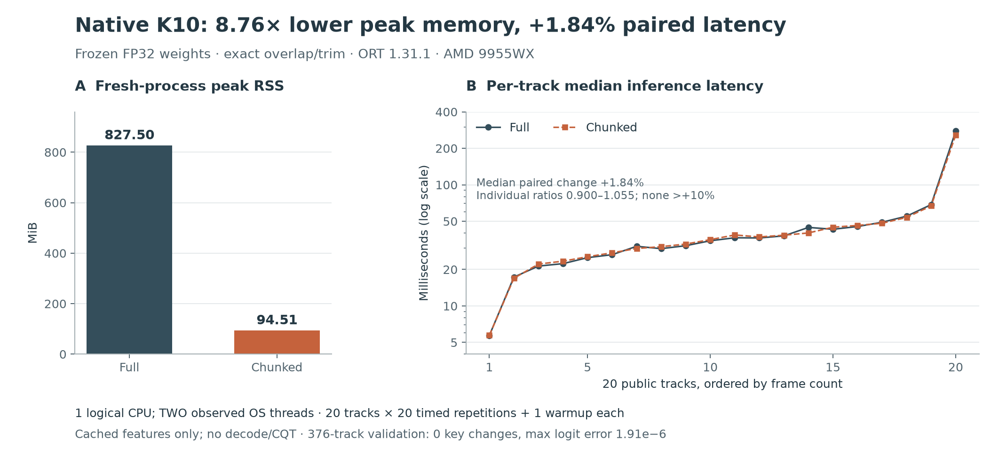

# Native K10 cached-feature inference: bounded activations with prediction parity

**2026-11-11 (UTC).** On one logical CPU of a Threadripper PRO 9955WX, chunked native
inference reduced fresh-process peak RSS from **827.50 to 94.51 MiB (8.76×)**.
The median paired latency change was **+1.84%**, below the predeclared +10% limit.
All 376 public validation tracks retained their predicted key; native full-model
logits were identical to the Python ORT references, and chunked logits differed
by at most **1.90735e-6**. These are inference-parity measurements with fixed
weights and cached features, not a new labeled accuracy score or an audio-to-key
end-to-end benchmark.

## Problem and hypothesis

K10 is a 109,128-parameter CNN predicting 24 musical keys from absolute-frequency
CQT features. Small weights do not imply small working memory: evaluating a long
track at once creates temporal activation tensors proportional to its duration.
Cropping the recording or averaging unrelated cropped predictions would change
the learned function and discard evidence.

The hypothesis was that exact overlap, alignment and trimming could preserve
every final temporal position while bounding the CNN's input workspace. The
predeclared acceptance criteria were zero key disagreements, finite logits and
allclose(atol=1e-5,rtol=1e-5) on 376 public validation tracks, followed by >=2× peak
RSS reduction and <=10% median paired latency regression on the existing 20-track
public selection. The thresholds and track membership were not changed.

## Results

Figure 1. Fresh-process RSS and the 20 per-track latency medians; 20 timed repetitions
and one warmup per track. The independent 376-track parity gate had zero key
changes. [SVG](figures/native-cached-results-58c290b.svg) ·
[Reproduce](plot_results.py) with `uv run --script research/drone-native-cached/plot_results.py`.

### Prediction parity

| Comparison | Tracks | Numerical failures | Key disagreements | Maximum absolute logit error |
| --- | ---: | ---: | ---: | ---: |
| Native full / Python full ORT | 376 | 0 | 0 | 0 |
| Native chunked / Python full ORT | 376 | 0 | 0 | 1.90735e-6 |
| Native chunked / native full | 376 | 0 | 0 | 1.90735e-6 |

Validation consumed 25.353 CPU seconds and 25.393 wall seconds. Its peak is not
used for the resource comparison because that process loaded both modes.

### Fresh-process resource measurements

| Measure | Full | Chunked |
| --- | ---: | ---: |
| Peak process RSS | 847,356 KiB / 827.50 MiB | 96,776 KiB / 94.51 MiB |
| Loaded process peak before features | 32,652 KiB | 32,088 KiB |
| Median of the 20 per-track latency medians | 35.463 ms | 36.199 ms |
| Total process CPU time | 20.347 s | 19.630 s |
| Total process wall time | 20.370 s | 19.657 s |
| Observed process threads | 2 | 2 |

Peak RSS fell **8.75585× (88.58%)**. The median of the 20 paired per-track latency
ratios was **1.018393**, or **+1.84%**; this differs from dividing the two medians
in the table. Individual ratios ranged from 0.900263 to 1.054613; none exceeded +10%.
Chunked peak was also 5.66091× below the historical 535 MiB isolated Python baseline,
but the fresh native full comparison is the relevant matched comparison here.

Lower total CPU time and a slightly higher median paired latency can coexist:
the former weights long/costly tracks more, while the latter weights each track
equally. The raw repetitions are retained for inspection.

## Method

### Frozen computation

Three blocks of Conv3/Conv3/Pool2 give final temporal stride 8 and receptive field
36. Output q depends on input indices `[8q-14,8q+21]`. For an output core
`[q0,q1)` of at most 64 positions, the prefix receives
`[max(0,8q0-16),min(T,8q1+16))`. Retaining local outputs
`[q0-a/8,q1-a/8)` covers every global position once, preserving pooling phase,
true endpoints and the T%8 tail. Prefix input is at most 544 frames.

The unchanged prefix emits `[1,64,24,Q]`. Retained features are summed in FP64,
divided by floor(T/8), cast once to FP32 and passed through the unchanged ONNX
linear head once. Linearity establishes real-arithmetic equivalence; floating
point reassociation still requires measurement. No quantization, truncation,
early exit, feature renormalization or weight change was introduced.

Raw fixtures are band-major little-endian FP32, obtained by widening the existing
padded FP16 CQT cache and taking `[8:200]`. The native reader checks completion,
membership counts, canonical path containment, byte length, digest and finiteness.
It reads into one initialized FP32 allocation through a safe byte view, hashes
the original little-endian bytes and converts endianness in place when needed.
Neither a second full byte buffer nor an audio frontend is retained.

### Runtime and environment

Measured source is **58c290b88959c9901a5c59fd27037b247364190d**. Subsequent report/CI
commits do not relabel or replace that source, its binary or its measurements.
The standalone Rust 1.92+ research crate leaves production Euphoria untouched.
It was built with Rust 1.99.1, `ort=2.0.0-rc.15`/API 31, and the same native
ORT1.31.1 shared library as the Python reference. The C API version is checked
exactly. The runtime is explicitly PreferCPU, with CPU arena enabled,
sequential execution, intra/inter threads=1 and spinning disabled.

Explicit device policy is material: an initial synthetic test found that CPU EP
registration alone left the Rust wrapper's efficiency policy active on macOS,
selecting CoreML and yielding rounded full-model logits with a 4.78e-4 discrepancy.
The provider choice was corrected without relaxing the gate. The behavior is
documented in the [upstream October 2026 issue](https://github.com/pykeio/ort/issues/662).

Linux measurements used CPU affinity 0 and all four OMP/MKL/OpenBLAS/NumExpr thread
environment variables set to 1. Hardware was an AMD Ryzen Threadripper PRO 9955WX
16-Core CPU, x86_64, Linux 6.14.0-37-generic. Both measurement modes reported two
process threads on every track; process affinity constrained execution to one
logical CPU. Process CPU time includes all those threads.

### Validation and resource protocol

First, one process evaluated all 376 frozen public validation fixtures against
unchanged full-model Python ORT logits. No ground-truth key references were read
or scored. It compared native full/reference, native chunked/reference and native
chunked/full. Independently, 160 synthetic runtime cases passed on Linux CPU0:
all eight time remainders, minimum length, seams/tails, random/constants/negative
inputs, impulses and a 1e-3..1e3 amplitude range. Contract tests cover mapping,
ties, integrity, nonfinite inputs, symlink escape, byte order and provenance.

Only after validation passed, two **separate fresh processes** ran the same 20
selected public tracks: full first, then chunked. Each track had one warmup and 20
timed repetitions. Full constructed only its full-model session; chunked only its
prefix/head pair. Both reused sessions across the 20 tracks. Timed calls include
input validation and tensor construction, while fixture I/O/hash loading is
reported separately. Whole-process RSS includes feature loading and allocator
retention. Each stage had a 600 CPU-second ceiling and 610-second outer wall limit.

Reports bind model, bundle, fixture, executable, source, lockfile and ORT-library
hashes, plus CPU capabilities/model, kernel, hashed machine identity, CPU affinity
and thread environment. A code/runtime/hardware mismatch invalidates pairing.

## Decision and limits

**The native cached-feature stage passes its fixed parity and resource gates.**
It is a suitable basis for frontend feasibility work. Production integration is
not enabled, and research reports continue to set `promotion:false`.

The evidence covers one CPU, runtime and fixed-order run. It is descriptive,
without randomized crossover or confidence intervals. RSS is a batch high-water
mark affected by ORT arena retention, not a per-track memory curve. The figures
do not establish universal floating-point equivalence or accuracy on unseen near
ties. No new weights were trained and no labels were scored.

Most importantly, cached CQT excludes decoding, resampling and feature extraction.
Euphoria's actual analyzer also retains whole-track audio and computes tempo,
energy, quality and beat grids. Bounding CNN activations cannot establish a bound
on that complete pipeline, and this result must not be described as native
audio-to-key speed or application-wide memory reduction.

## Evidence and reproduction

The [README](README.md) specifies the complete fixture contract and commands.
Raw 20-track reports are committed unchanged:

- [Full report](evidence/native-full-58c290b.json), SHA256 `68fb6a9f6311f817c6bd8b3e0431477b9f42c1d99d4a5cf430d70faad3a39f2f`.
- [Chunked report](evidence/native-chunked-58c290b.json), SHA256 `5a49330cbd0d8777541e9ce54fcdec0ef62aa7a3e3204d2b2df095f0e74ee0be`.
- [Derived validation summary](evidence/native-validation-summary-58c290b.json), preserving all comparison counts and the original full report digest.

Full validation evidence remains immutable on the research server at
`/home/lysk-admin/drone-experiments/native-runtime-20261111-v1/native-validation-58c290b.json`,
SHA256 `b8f7802b32f6bae775fb4feb49987e79c11d3dd50f1f56a1d6fff5cfd872fe3e`.
Adjacent command JSON/log files record exact invocations. No raw features/audio
are committed. Binary SHA256 is
`0cce67453a2c0ed388aab4a8a71116cb4c1475725b2c0ff429df106aeed612b8`;
source archive SHA256 is
`5b30fbf1bb986ccaba7b52c660d999c789f895789bcb5fefb4accf1ad4301e44`.

## Minimum next frontend feasibility stage

Freeze the exact installed Python frontend first. Export a tiny public/synthetic
golden set containing reference mono 22,050 Hz PCM, CQT shape and core features,
FP16-rounding behavior, full-model logits, source hashes and dependency versions.
Include tones/chords, impulses near both ends, silence, short inputs and different
sample-rate/channel cases. Keep decoded-PCM and raw-file fixtures separate so
decoder/downmix/resampler drift is distinguishable from CQT drift.

Port only the frozen frontend plan and evaluate it on the **same reference PCM**
before changing decoders. Verify time/frequency layout, endpoint padding, recursive
resampling/scaling and final logits. Then compare native raw-audio decoding using
public files. Retain the exact numerical/key gate; record failures without
relabeling, silent algorithm substitution or tolerance changes. Advance to full
public validation only after those diagnostic fixtures establish feasibility.

Persisted final-result cache integration comes after native frontend parity.
At that point its identity must include decoding/frontend versions, rounding,
label order and the model/aggregation contract; the existing Euphoria correction
store must remain independent of machine-generated detections.
