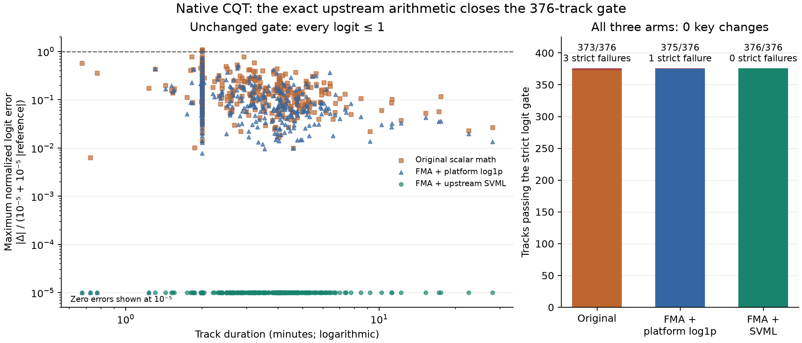
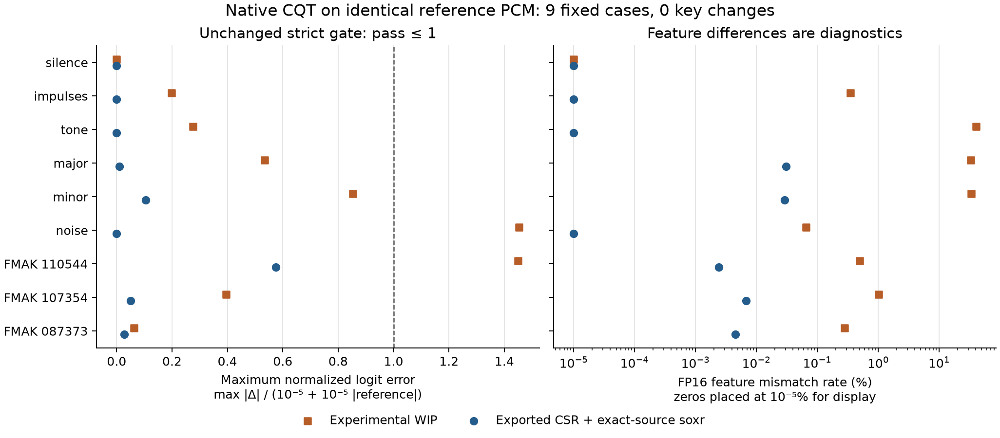

# Native CQT reproduces K10 inputs on 376 public tracks

## Problem

Euphoria needs CPU key analysis that preserves Drone's predictions. The
[native cached-feature study](../drone-native-cached/REPORT.md) validates model
inference, but its inputs already contain the CQT. This study tests native CQT
on the **same decoded PCM** as the actual Python feature pipeline, with unchanged
weights and no label scoring.

**Result:** the source-defined FMA magnitude plus pinned upstream SVML logarithm
reproduces all **82,562,688 FP16-roundtripped core feature values and 9,024 logits
bit for bit** on the fixed 376-track public validation set. Every key prediction
is unchanged. This qualifies the tested Linux CPU configuration for the next
research stage. Production integration and a performance claim require further
work.

## Solution and results

The unchanged strict gate requires finite values, matching shapes, every logit
satisfying `abs(Δ) <= 1e-5 + 1e-5*abs(reference)`, and zero argmax disagreements.
The figure shows all 376 cases; zero errors use the annotated display floor.
[SVG](cqt-376-ablation.svg) and [pinned plotting script](plot_expansion.py) are
included. Figure inputs are independently verified metadata and logits, with no
audio or bulk feature arrays committed.

| Native arithmetic | Own nine-case gate | Strict 376 gate | Changed keys | FP16 core mismatches | Maximum logit error |
| --- | ---: | ---: | ---: | ---: | ---: |
| Scalar `hypotf` + platform `log1pf` | 9/9 | 373/376 | 0 | 4,163 | 2.14577e-5 |
| Source-defined FMA magnitude + platform `log1pf` | 9/9 | 375/376 | 0 | 1,457 | 1.90735e-5 |
| Source-defined FMA magnitude + pinned upstream SVML | 9/9 | **376/376** | **0** | **0** | **0** |

The original native executor passed the small screen but failed the larger
strict gate on Beatport 3662506, 5124850 and 5458695. Those failures remain
preserved. FMA alone still fails Beatport 5124850: its largest normalized logit
error is 1.021261. Unchanged argmax alone does not qualify either failed arm.
The FMA+SVML arm passes its own nine-case and complete 376-case gates.

The two new arms consume each track's **same reference spool** before cleanup.
All 376 PCM hashes and reference logit vectors also match the earlier expansion
exactly. This confirms reference stability across stages. An independent
[summary verifier](https://github.com/lvndry/drone/blob/research/cqt-summary-35644f8/tools/summarize_cqt_expansion.py)
checks every recorded logit, first-index argmax tie, artifact hash and execution
identity. The [original summary](evidence/original-376-summary.json) and
[two-arm summary](evidence/twoarm-376-summary.json) include every case and the
underlying immutable report hashes. The original source/data are retained on
the research host; the Git execution refs are listed below for publication.

### Why the arithmetic change was necessary

The first failure was fixed in advance for diagnosis: Beatport 3662506, with
six differing FP16 core positions. All nine complex CSR responses and all seven
resampled PCM arrays were full-hash identical. Reobserving the actual feature
function reproduced the frozen reference bytes. The scalar Rust probe reproduced
the original six-mismatch count, maximum error and RMS exactly.

Over all 124,032 core positions of that one track:

| Operation comparison | Differing positions |
| --- | ---: |
| Rust normalization vs original normalized complex values | 0 |
| Rust/platform `hypotf` vs original NumPy magnitude | 43,431 |
| NumPy-source finite FMA-ratio magnitude vs original NumPy magnitude | 0 |
| Platform `log1pf` on the **same NumPy magnitudes** vs NumPy `log1p` | 20,730 |
| Isolated upstream SVML on those same magnitudes vs NumPy `log1p` | 0 |

Five of the six FP16 mismatches originate in magnitude rounding; one remains
with equal magnitude because the logarithm differs. At core bin 11/frame 14,
the original vectorized NumPy logarithm is `0x3e136fff`, while platform log1pf is
`0x3e137000`, exactly on a half-precision midpoint. The diagnostic records values,
bits, neighboring FP16 values and signed midpoint distances for all six positions.
No epsilon, output bias, labels or changes to the FP16 contract were introduced.

The distinction between scalar and vector paths was measured rather than
assumed. Python `abs(np.complex64)` agrees with platform hypotf at the affected
positions; scalar `np.abs` and length-one-array ufunc calls agree with the
original vectorized magnitude. Scalar/length-one `np.log1p` agree with the
original vectorized logarithm at all six positions. See the complete
[arithmetic observation](evidence/first-failure-arithmetic.json) and its
[source/runtime context](evidence/first-failure-arithmetic-input.json).

Actual installed NumPy 2.5.4 reports git revision
`a3d0ef1df045b858e68115001fdabc930bb3b68c`, GCC 14.2.1, and `X86_V4` dispatch for
`absolute.Ff` and `log1p.ff`; AVX512_SKX/FMA3 are available. The executed Rust
binary references `hypotf@GLIBC_2.35` and `log1pf@GLIBC_2.2.5`, with glibc 2.39.
NumPy's [complex magnitude source](https://raw.githubusercontent.com/numpy/numpy/v2.5.4/numpy/_core/src/umath/loops_unary_complex.dispatch.c.src)
uses a ratio, fused multiply-add and square root in its SIMD path. Its
[logarithm dispatch source](https://raw.githubusercontent.com/numpy/numpy/v2.5.4/numpy/_core/src/umath/loops_umath_fp.dispatch.c.src)
and [build configuration](https://raw.githubusercontent.com/numpy/numpy/v2.5.4/numpy/_core/meson.build)
identify the SVML path used for the Linux x86 SIMD build.

The pinned [NumPy/SVML source](https://github.com/numpy/SVML/blob/bd9d46e0c627ab16f3d2641f7cdb1bc15d303ba4/linux/avx512/svml_z0_log1p_s_la.s)
is copied **without byte changes**, checked against Git blob
`36107575d7d88a074b7e828eddfc9a6b034186d8`. Its BSD notices and source hashes are
preserved under [vendor](vendor/SOURCE.json). The isolated native arithmetic
probe has [zero bit differences](evidence/svml-arithmetic-result.json) on all
124,032 reference magnitudes and links no NumPy or Python. The wrapper batches
16 float32 lanes, zero-pads only the tail, and explicitly rejects unsupported
Linux/x86 AVX512F/DQ/BW/VL/FMA configurations.

## Method

The [original protocol](PROTOCOL.md), [fixed expansion](EXPANSION.md) and
[two-arm protocol](CANDIDATE2.md) were frozen before their corresponding outcomes.
Six deterministic PCM16 signals cover silence, first/middle/final impulses,
440Hz, major/minor chords and seeded noise. Lengths include the minimum eight
frames, exact-hop endpoints and irregular tails. Three original public FMAK
tracks cover 217, 1,295 and 9,057 frames. The expansion uses every role=validation
identity: 126 Beatport and 250 FMAK, sorted by(domain,id), with source audio hashes
verified. Ground-truth references are excluded from the typed study contract and
never used for selection or scoring.

The original FFmpeg/Drone path produces reference FP32 PCM. Actual installed
librosa 1.0.0 private calls export post-compensation complex64 CSR kernels, FFT
sizes, hops, recursive resampling and normalization divisors. The tracer's tests
verify that observation does not alter output. CQT uses 22,050 Hz, 208 bins,
24 bins/octave, hop 4,096, constant centered padding and log1p magnitude, then the
original FP16 storage roundtrip and core slice `[8:200]`.
[librosa's implementation](https://librosa.org/doc/latest/_modules/librosa/core/constantq.html)
describes the recursive transform; installed function/file hashes identify the
actual executed version.

RustFFT 6.4.1 performs the centered zero-padded forward FFT in FP64, then casts the
positive spectrum to complex64 and applies the captured CSR in FP32. Each track's
actual normalization call is captured anew; no silence-derived statistics are
reused. Whole-track frame counts, ceil resampling lengths and full model time
pooling remain intact. Kernels/resampler configurations are verified invariant
across the nine goldens and each expanded track.

Resampling uses the verified [python-soxr 1.1.0 source distribution](https://pypi.org/project/soxr/1.1.0/),
SHA `9f228ae21c78fa9359ca98d8a5e8e91f30639e438e574133dace62c5b5309e44`.
The task-local shared CMake build uses Release, OpenMP off and two jobs. Its
wrapper matches mono FLOAT32 split-channel HQ processing in 96,000-sample blocks,
final null-input flush, ceil-length fix and librosa scaling. The standalone
library reports `libsoxr-0.1.3`; the Python wheel reports
`0.1.3-14-ga66f3ee`. Source identity and build configuration are recorded
separately from version strings: binary identity is not asserted. All 63
recursive outputs in the original nine-case diagnostic match bit for bit.
[Build evidence](evidence/build-evidence-v2.json) includes source/configuration,
compiler, library, licenses, FFT binary, CPU/kernel and executable hashes.
Python-SoXR and libsoxr use LGPL-2.1-or-later; the separate SVML source uses BSD.

Both reference and native logits use the unchanged authoritative full ONNX graph,
SHA `35fc1bfe5d67f7aed2c46221c15519d0f3d5822351932b5bd9899d47d48cb613`,
checkpoint `dcf8a7a292b7c12076ffff63c8c6550cb09a6c41ce4d000fd7949fc6bb4b452c`.
ORT 1.31.1 runs with explicit CPU preference/arena, intra/inter threads 1,
sequential execution and spinning off. Native inference invokes no Python or
Torch. The production workspace/MSRV/default dependencies remain untouched.

## Resource control and provenance

One standard-library supervisor serializes a fresh reference producer and fresh
native processes. It uses CPUs 2–3 and four numeric thread variables set to 1,
with fixed 1,200 aggregate child CPU/1,500 wall second caps, sampled 2 GiB owned-tree
RSS stop and 2 GiB total dedicated-root storage stop. Only the current generated
spool is removed; original audio/caches, goldens, failed cases and earlier
artifacts remain untouched. The first failed spool is retained per arm.

| Operational stage totals | Original expansion | Two-arm expansion |
| --- | ---: | ---: |
| Aggregate child CPU seconds | 539.26 | 603.71 |
| Wall seconds | 608.49 | 721.08 |
| Maximum observed owned-tree RSS, 100 ms sampling | 628.42MiB | 628.94MiB |
| Dedicated experiment storage at completion | 826.44MiB | 1,293.33MiB |

These are supervision/resource observations, not isolated frontend benchmarks or
latency/RSS improvements. Sampling cannot establish an instantaneous universal
memory bound. The first expansion completed 2026-11-11 23:50UTC before its 00:45UTC
stop; arithmetic probes completed 23:53/23:56UTC. No worker remained when the
expired window was checked. A new 06:00UTC window was authorized before the new
source/data outcomes; the two-arm run started2026-11-12 05:10UTC. Its
[recorded process exit](evidence/twoarm-exit.json) is 1 because one arm failed;
independent arm status qualifies FMA+SVML and rejects FMA-only.

| Executed source | Commit / retained research ref |
| --- | --- |
| Drone reference exporter | `b1c90d3`, `research/cqt-reference-b1c90d3` |
| Corrected build evidence collector | `b9c22f2`, `research/cqt-build-evidence-b9c22f2` |
| First nine-case native comparison / diagnostic | `d8424bf` / `9fd6c34`, corresponding `research/cqt-*` refs |
| First 376 producer/supervisor / native | Drone `b5ad965` / Euphoria `66db00c` |
| First-failure arithmetic | Drone `1452f4c` / Euphoria `5beef8c` |
| Standalone upstream SVML probe | Euphoria `93aeb04` |
| Frozen two-arm supervisor / native | Drone `2ac6364` / Euphoria `2f87e2c` |

Numerical identities remain tied to those commits, even when this report/CI is
updated. The other contributor's experimental frontend source stays outside Git;
only its hashes and nine-case comparison outputs are retained. Its unchanged
screening result is shown below.

Focused Python integrity/tracing/budget/summary tests and ruff/ty pass; native
Rust unit tests, formatting and clippy pass. CI extends the existing standalone
source-contract job without requiring owner WIP, models, ORT or math-library
downloads. Numerical Linux checks were actually executed on the research host;
those manual checks are not claimed as hosted CI coverage.

## Decision and limits

Advance the FMA+SVML frontend to a separately reviewed, isolated public 20
frontend/inference benchmark. Its core inputs/logits are exactly reproduced on
this fixed Linux host/runtime set. FMA+platform-log1p is unqualified on this host;
Mac ARM has a different NumPy dispatch and requires its own declared proof.

The tested boundary is identical decoded PCM through original FP16 core features
and full ONNX logits. Native decoding, bounded streaming CQT, combined chunked
inference, concurrency, final-result caching and production integration remain
separate stages. Pre-rounding float32 arrays are not universally bit-identical,
and this finite dataset is not a theorem over arbitrary inputs or hardware.
No labeled accuracy improvement or frontend performance win is claimed here.
