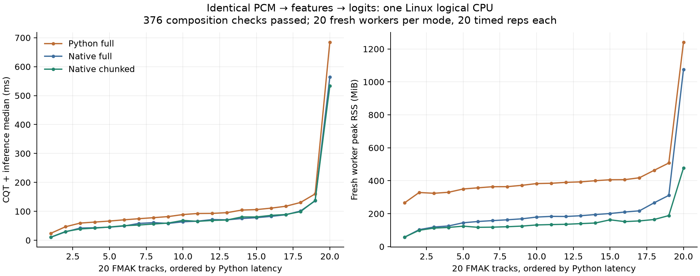
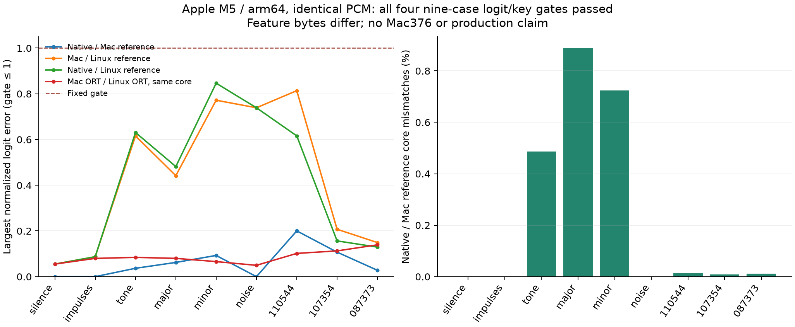
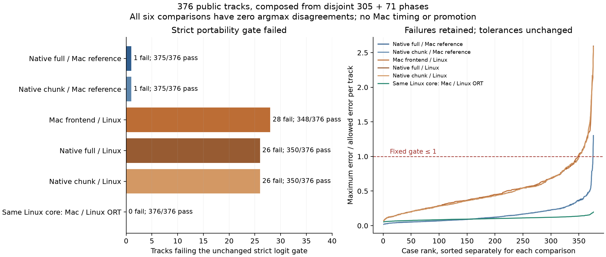
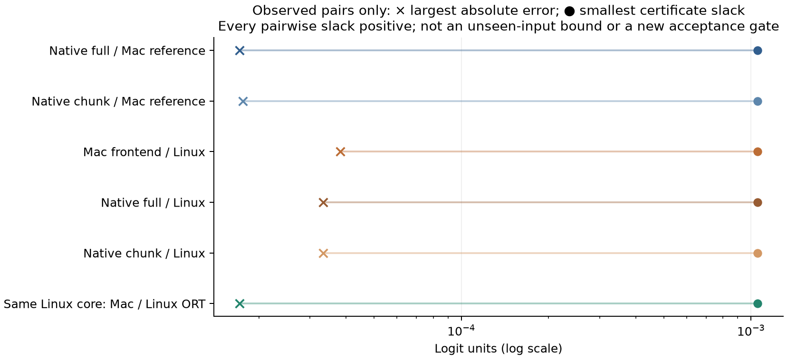

# Native CQT composition and cross-platform CPU portability

## Problem and result

A cached-feature benchmark does not establish that a native frontend preserves
the released classifier, nor measure its memory cost. This study composes the
captured CQT frontend with the unchanged full and chunked ONNX paths, and tests
whether the platform math transfers to an Apple M5 CPU without x86 SVML.
The M5 is a test host, not a hardware requirement for Drone or Euphoria.

The expanded Mac diagnostic now covers all **376 public tracks**, composed from
disjoint 305- and 71-case phases. Strict logit qualification failed: native full
and chunk each passed 375/376 against the actual Mac reference. All six comparison
families nevertheless had **zero argmax disagreements**. The original tolerances
remain unchanged; no Mac timing or promotion followed.

On Linux, the new compute-only API passed nine goldens and all **376 public
validation tracks**. Every FP16-roundtripped core hash matched the canonical
reference. Native full logits were bitwise equal to the reference; chunked logits
had maximum absolute error **1.90735e-6**. Both had **zero key changes**. No labels
were used. Qualification includes FMAK and Beatport; the fixed performance subset
contains **20 FMAK tracks and no Beatport tracks**.

On those 20 tracks, native full and chunked paths lowered median paired latency
by **27.19%** and **26.92%** versus Python full, and median paired worker peak RSS
by **53.11%** and **64.94%**. Chunking added **0.897%** median paired latency versus
native full while reducing median paired peak RSS by **25.85%**. The longest
case still reached **477.5 MiB** with chunking: PCM and frontend allocations
remain material. This is not the earlier cached-only memory result.



The figure relates fresh-process peaks and within-worker medians to exact CQT
frame counts, making long-input costs visible. It does not show model-only latency. All timing workers were restricted to Linux logical CPU2. A separate
late observer saw two OS threads restricted to that CPU; it did not sample every
worker. All four numeric thread environment variables were 1.

| Mode | Median track median | p95 track median | Median worker peak | Maximum worker peak |
| --- | ---: | ---: | ---: | ---: |
| Python full |90.791 ms |186.535 ms |383.783 MiB |1241.738 MiB |
| Native full |64.985 ms |157.664 ms |181.264 MiB |1076.336 MiB |
| Native chunked |67.063 ms |157.219 ms |132.838 MiB |477.500 MiB |

These summary medians are not used to calculate paired effects. Per-track ratios
are calculated first, then their median. p95 uses linear interpolation across 20
track medians. The frozen composed protocol required a visible paired improvement
with full correctness. The older program target of 2× maximum RSS reduction and
≤10% latency regression was not a numeric preregistered gate for this stage;
maximum native-full/native-chunked RSS happened to improve 2.254×.

## Method

The shared `PreparedPlan` preloads verified CSR/FFT constants and each track's
normalization/resampling plan. Its compute path performs CQT, original log1p and
FP16 roundtrip, then either unchanged full ONNX or the qualified overlap/trim
prefix, FP64 hidden mean and unchanged tiny ONNX head. Linux uses FMA-ratio
magnitude plus the pinned upstream SVML kernel. Mac uses FMA-ratio magnitude plus
platform log1p, with actual Mac-captured constants and exact-revision task-local
libsoxr. No NumPy/Python runtime is called by native inference.

All 376 PCM inputs were recreated from SHA-verified public audio through the
original decode/PCM preparation; PCM hashes had to match the archived canonical
references. Canonical CQT hashes and logit vectors were reused, not regenerated. Qualification ran on CPUs4–5/env1 and explicitly exercised the new
prepared API with full and chunked inference. It passed before timing. The
qualification and timing reports have identical source/config/artifact bindings,
including the supervisor and CPU-session source hashes. No numerical source
changed between them.

Timing used 60 fresh workers: Python full, native full and native chunked for each
of 20 fixed tracks, with mode order rotated by track. Each worker loaded the same
PCM before timing, warmed once, then performed 20 timed repetitions. Timers cover
CQT→FP16-roundtripped core→logits. Decode, input reads, session/plan setup, kernel
hashing, evidence JSON/probes and output integrity comparisons are outside the
timed region; returned-input/API checks remain inside the compute calls. Python's
normal CQT filter construction remains in its timed API; native plan construction
is setup. This measures the usable prepared native API, not just identical
low-level operator work. Every timed iteration retained core-hash, finite/logit
and key checks outside its timer. RSS covers the complete fresh worker lifetime,
including setup, PCM, frontend and inference, rather than only the timed region.

The Linux host was AMD Ryzen Threadripper PRO 9955WX. ORT 1.31.1 CPU only used
intra/inter 1, sequential execution and disabled spinning. Unchanged model SHA is
`35fc1bfe5d67f7aed2c46221c15519d0f3d5822351932b5bd9899d47d48cb613`.
Source/binary/library/config/hardware bindings and every raw report are in the
[lossless evidence index](evidence/index.json). No ML runtime download is needed
for the evidence/unit tests.

Qualification consumed 218.19 aggregate child CPU seconds and 269.87 wall seconds;
timing consumed 162.55 child CPU and 168.74 wall seconds. Both completed before the
authorized 2026-11-12 08:30UTC deadline. The stage used the reviewed 1200/1500s
qualification and 1800/2100s timing CPU/wall limits, 2 GiB monitored tree RSS/storage
limits, and streamed/deleted each track spool. These are research-supervisor
observations and stops, not a universal allocation bound.

## RSS unit erratum and reproducibility

**The immutable native `pipeline` reports mislabeled KiB as `peak_rss_bytes`.**
At executed source `c5f8c4e`, `drone_native_cached::process_usage()` returns KiB on
both platforms (Linux ru_maxrss directly, Darwin ru_maxrss/1024). `pipeline` stored
that value unchanged under a byte field. All native peak RSS values in this
report/checker are recovered as **raw ×1,024**. Original bytes, SHA values and
server artifacts are preserved. Python peak values, loaded-RSS values and
supervisor sampled tree RSS already use bytes and are not multiplied.

[The checked summarizer](summarize.py) verifies compressed and decoded bundle
hashes, every raw-file hash, track/repetition counts, qualification identity and
peak ≥ loaded RSS. A separate lossless bundle retains all 376 original input
manifests: their hashes bind the recorded native reports, reference logits and
core identities. The checker independently checks all qualification and timed
logit vectors, both native backends, and every Mac contrast against the fixed
tolerance and key requirements. Its regression fixes the known 105,408 KiB → 107,937,792 byte example.
The post-measurement source fixes future reports by checked conversion once and
labels their format v2 with an explicit byte unit. Historical recovery refuses
other source identities/formats, preventing accidental double conversion. This
repair was not used to produce these measurements; no numerical benchmark was
rerun for it. Any future execution must bind the rebuilt executable.

Historical execution sources are preserved at the
[native compute tag](https://github.com/lvndry/euphoria/tree/research/cqt-composed-compute-20261112),
[Linux controller tag](https://github.com/lvndry/drone/tree/research/cqt-composed-linux-20261112)
and [Mac controller tag](https://github.com/lvndry/drone/tree/research/cqt-mac-nine-20261112).
Use those frozen identities for historical replay. The publication branch's
reporting repair is a later implementation, not the measured executable.

```sh
python3 research/drone-native-cqt/composed/summarize.py
python3 -m unittest discover -s research/drone-native-cqt/composed -p 'test_*.py'
uv run --script research/drone-native-cqt/composed/plot_results.py
```

The bundles preserve original UTF-8 file bytes losslessly, including native's
incorrect field name, with SHA256 for every file and for compressed/decoded
bundles. Figures derive from those verified bytes and the documented unit
recovery. PNG and SVG are adjacent to this report.

## Apple M5 nine-case diagnostic

Mac processing used the same six synthetic and three public canonical PCM arrays,
without new decoding or SVML. Exact preflight versions matched Linux:
librosa 1.0.0, NumPy 2.5.4, SciPy 1.18.1, python-soxr 1.1.0, ORT 1.31.1. The verified
166-file vendored soxr tree was built task-locally, Release/shared/OpenMPoff,
jobs ≤2, with no installation or production change. Source/compiler/CMake/library
hashes, dependency resolution and LGPL 2.1-or-later provenance are preserved.

All nine cases passed every named comparison using the unchanged finite/shape,
`abs(delta) ≤1e-5 +1e-5*abs(reference)` and zero-argmax-change gates:

| Comparison | Cases passed | Maximum absolute logit error | Key changes |
| --- | ---: | ---: | ---: |
| Native Mac / actual Mac Python |9/9 |7.153e-6 |0 |
| Actual Mac Python / canonical Linux |9/9 |2.027e-5 |0 |
| Native Mac / canonical Linux |9/9 |1.407e-5 |0 |
| Canonical Linux core through Mac ORT / Linux ORT |9/9 |1.335e-5 |0 |

The relative term allows some absolute errors above 1e-5. These are not bitwise
comparisons. Native/Mac reference cores differed at 303 of 2,048,256 values;
feature max/RMS and per-case mismatches remain in the raw comparisons.



The Mac reference and native workers consumed 10.65 and 2.84 child CPU seconds,
respectively, with 9.33 and 2.95 wall seconds. These are instrumented diagnostic
worker costs, not performance results. Sampled owned-tree peak RSS was
1,268,514,816 bytes. There was one numeric worker, thread variables and VECLIB set 1;
macOS offers no Linux-style hard affinity here. The retained executor completed
exit 0 before 08:00 UTC. An earlier detached launch was cleaned up before any stage
existed; its empty log and absent PID were investigated, and the retained session
is the authoritative execution record.

## Mac376 problem and prospective method

The nine-case diagnostic was too small to establish portability on real recordings.
The expansion reused the fixed 376 public inputs, unchanged released model,
actual Mac Python CQT, prepared native full/chunk APIs, and canonical Linux
cores/logits. It used no key labels, private audio, truncation, new tolerances or
performance measurements. This is a numerical portability study, not an accuracy
evaluation. Each comparison requires 24 finite logits,
`abs(delta) ≤ 1e-5 + 1e-5*abs(reference)`, and unchanged argmax.

Each track was transported alone: exact S16-derived PCM and the already
FP16-roundtripped canonical core were packed losslessly as int16 and FP16, then
reconstructed with independent SHA checks. This introduces no new quantization.
Each track used a fresh worker; the actual prepared and timed API source versions
were bound prospectively. The new reporting executable uses explicit byte RSS;
the earlier KiB erratum remains confined to its historical evidence.

Three prospective stages remain distinct:

| Stage | Terminal outcome | Reported coverage | Resource evidence |
| --- | --- | ---: | --- |
| v2 `dc575ba` | Controlled SIGINT: supervision overhead made completion implausible | 11/376; excluded from final composition | Last complete checkpoint: 326.53 CPU s, 299.43 wall s |
| v3 `92bc825` | Fixed 1,800 CPU-second resource stop | 305/376, indices 0–304 | Trigger 1,800.213 CPU s; terminal 1,810.651 s including cleanup/reaping |
| v4 `2a546f8` | Complete remainder; exit 1 because strict numerical gates failed | 71/71, indices 305–375 | 554.711/600 CPU s, 531.486 wall s; sampled peak 1,340,243,968 bytes |

V2 was not silently restarted. V3 changed only supervisor sampling: process trees
at approximately 0.1 seconds, disk scans at approximately 1 second, with fresh
boundary checks. It preserved numerical worker/transport/native code. V4 was a
new finite protocol for the exact reported complement, chosen independently of
pass/fail. It retained the v3 resource failure and counted no reported case twice.
V3 worker 305 completed but was not appended before the cap check; its original
orphan evidence remains separate. V4 explicitly recomputed that ID. All six gate
records and three core hashes matched its original orphan exactly. Only the v4
outcome enters the final 305 + 71 composition.

V4 reused the proven nine only after numerical source, executable, model/library,
input and stable runtime identities matched. Mac CPU limits were 1,800 seconds
for v3 and 600 for v4; each phase retained 2 GiB sampled tree RSS and 2 GiB combined
logical disk across all old/new Mac roots. Server limits remained 400 CPU seconds,
1 GiB sampled RSS and 512 MiB new-root disk, on CPUs 14–15/env1. V4 server
consumed 63.399 CPU seconds and peaked at 419,065,856 bytes. All owned processes
terminated and the four protected vLLM process start identities were unchanged.
These are diagnostic costs, **not inference timings**, and sampled RSS is not an
instantaneous allocation guarantee.

## Mac376 results

The exact-disjoint verifier checked the full ordered union, raw native vectors,
input/core witnesses and all six original gates. Complete diagnostic coverage
was achieved; **strict portability qualification failed**.

| Comparison | Strict passes | Failed logit elements | Argmax disagreements |
| --- | ---: | ---: | ---: |
| Native full / actual Mac reference | 375/376 | 1 | 0 |
| Native chunk / actual Mac reference | 375/376 | 1 | 0 |
| Actual Mac frontend / canonical Linux | 348/376 | 47 | 0 |
| Native full / canonical Linux | 350/376 | 39 | 0 |
| Native chunk / canonical Linux | 350/376 | 39 | 0 |
| Canonical Linux core: Mac ORT / Linux ORT | 376/376 | 0 | 0 |



Thirty-three distinct tracks failed at least one logit gate. The native-versus-Mac
failure is `fmak:091711`, G-major component: reference −0.2216097116, full error
1.5899539e-5 versus allowed 1.2216097e-5 (ratio 1.3015). This is not simply a
near-zero-reference issue. The worst frontend gate ratio was 2.5943; the largest
Mac/Linux frontend absolute error was 3.8147e-5. Of 126 reference elements with
absolute value ≤0.1, five failed Mac/Linux and six failed each native/Linux
comparison; none failed native/Mac. All seven elements with absolute reference
≤0.01 passed. These post-hoc buckets describe errors and do not alter acceptance.

All six families retained the same argmax on all 376 tracks. The
[root-observed certificate and independent receipt](evidence/mac376-index.json)
also check a stronger arithmetic statement about these saved pairs. For reference
logits r, observed logits a and reference winner w, define e_i = |a_i − r_i|.
Every competitor j has positive slack
`r_w − r_j − e_w − e_j`; the minimum across all cases/families is
**0.0010512024**. The independent receipt exactly recomputed all claimed fields.
This uses observed errors, not a bound on future errors, and establishes neither
unseen-input stability nor key-label accuracy. It does not relax the failed gates.



The figure compares each family’s extrema across tracks; its endpoints need not
come from the same track. It does not draw a per-track unseen-error bound.

All nine stages’ CSR bases, indices and indptr arrays were byte-identical between
Mac and Linux for every track. Exactly three normalization lengths differed by
one float64 ULP. These witnesses narrow the numerical differences; they do not
prove that changing normalization, kernels or a particular math routine would
fix any failure. No such intervention was measured.

## Mac376 evidence and reproduction

The [Mac376 index](evidence/mac376-index.json) binds a deterministic gzip bundle
with exact decoded/original-file SHA256 values. It retains all 376 raw native
reports and complete saved comparison vectors, stage terminal reports/configs,
source text, root certificates and the original independent receipt bytes.
Compact CSR/normalization witnesses retain every original Mac-manifest hash;
representative full manifests include the native/Mac failing case. Larger PCM,
CSR arrays and complete per-track plan artifacts remain unchanged in their
original owned roots; this publication does not copy an audio corpus.

Frozen Drone execution sources are `dc575ba4095f0bfe17f0f5ef18d6c42a4c538ae6`,
`92bc825399a593a99fd0c9480a845619969fa8e7` and
`2a546f88ea84f9d34baeae0b1b09ce6e06979c29`; Euphoria/native source is
`7b0186261eccfbab1f54c21fe3212030e83eda78`. The native executable SHA is
`9a5b7fc9887e7cf160a95614d26b86f2e65df98d837260177c16ca95841893ad`.
The original combined diagnostic SHA remains
`e3055e34852ed1e2fab9e5ad6b697ea008d970bd65c9091b3eb0940f1247bd1f`;
compression and this publication do not reattribute its identity.

```sh
# Saved metadata/vector arithmetic only: no model, audio or ML runtime needed.
python3 research/drone-native-cqt/composed/summarize_mac376.py
python3 -m unittest discover -s research/drone-native-cqt/composed -p 'test_*.py'
uv run --script research/drone-native-cqt/composed/plot_mac376.py
```

For an artifact-level replay in the retained frozen v4 source and original roots:

```sh
python -m tools.cqt_mac376_remainder combine \
  --proof /tmp/euphoria-native-cqt-mac376-v4/remainder-proof.json \
  --config /tmp/euphoria-native-cqt-mac376-v4/qualification-configs/mac.json \
  --report /tmp/euphoria-native-cqt-mac376-v4/qualification/report.json \
  --output /tmp/mac376-rechecked-disjoint.json
```

This command verifies existing artifacts; it is not permission to recreate audio
or restart the stopped phases. The publication verifier independently recomputes
gates/certificates and checks the retained original native report vectors.

## Decision and limits

The prepared Linux frontend→full/chunked API is qualified on the fixed 376 public
tracks, and its 20-case FMAK performance improvement is measured. Preserve both
paths and prefer chunked inference for long inputs. The complete frontend still
materializes PCM and CQT arrays, so production memory requires further work.

The Mac expansion now has complete **disjoint diagnostic coverage**, not a
successful single 376-case run. Strict logit gates failed despite zero observed
argmax disagreements. No Mac timing or promotion followed. Ordinary-PC deployment
remains the product goal; neither an M5 nor the research GPU is an inference
requirement. These data establish neither other-PC parity nor production readiness.

The composed proof starts from pinned FFmpeg-produced 22,050 Hz S16-derived PCM;
decode is outside the timing region. It does not qualify Euphoria
Symphonia/mixdown/resampling on original files, and Drone inputs must not silently
inherit libkeyfinder tuning correction. Public full-length house/deep/melodic-house
accuracy, calibrated Drone confidence, bounded warm sessions, and engine/model
cache identity require separate evidence. Existing libkeyfinder confidence
thresholds cannot be applied to softmax top1-minus-top2 margins without calibration. No final-result cache, Euphoria production key detector,
default dependency/MSRV, model weights or training changed.
